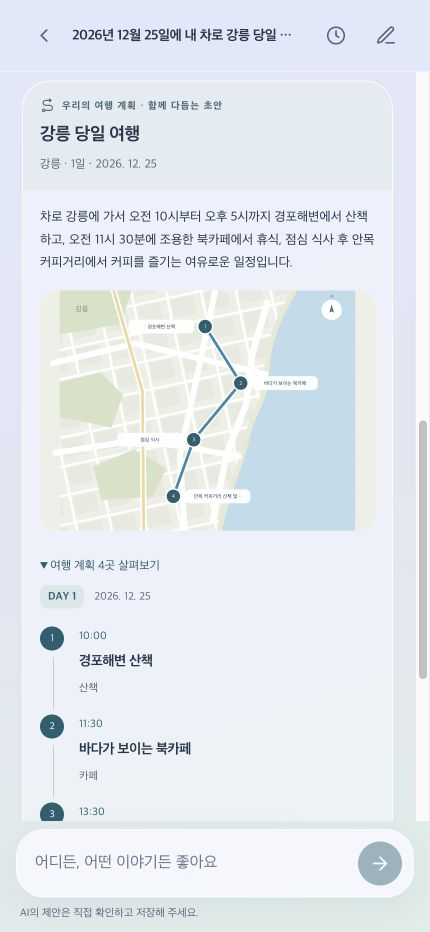
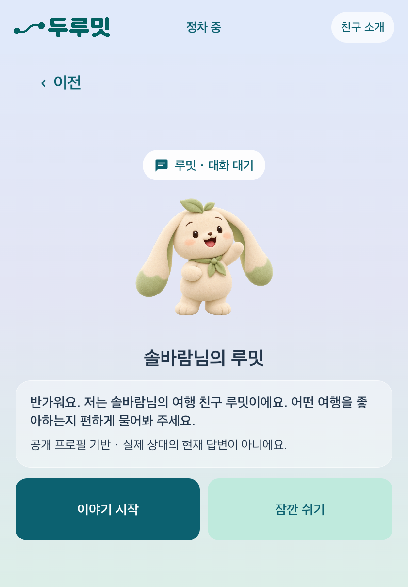
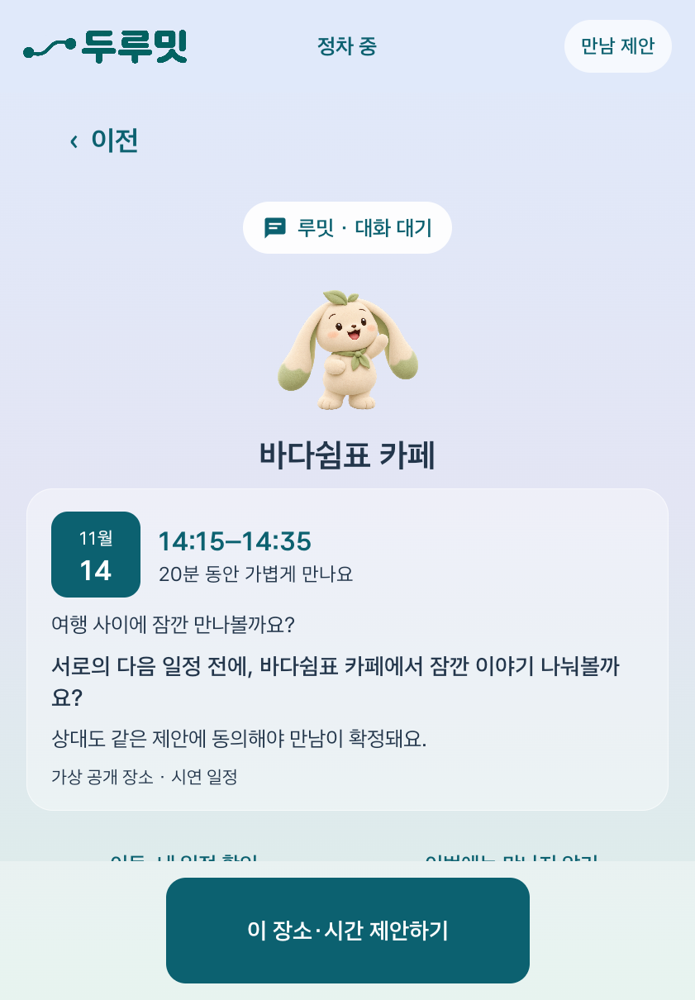
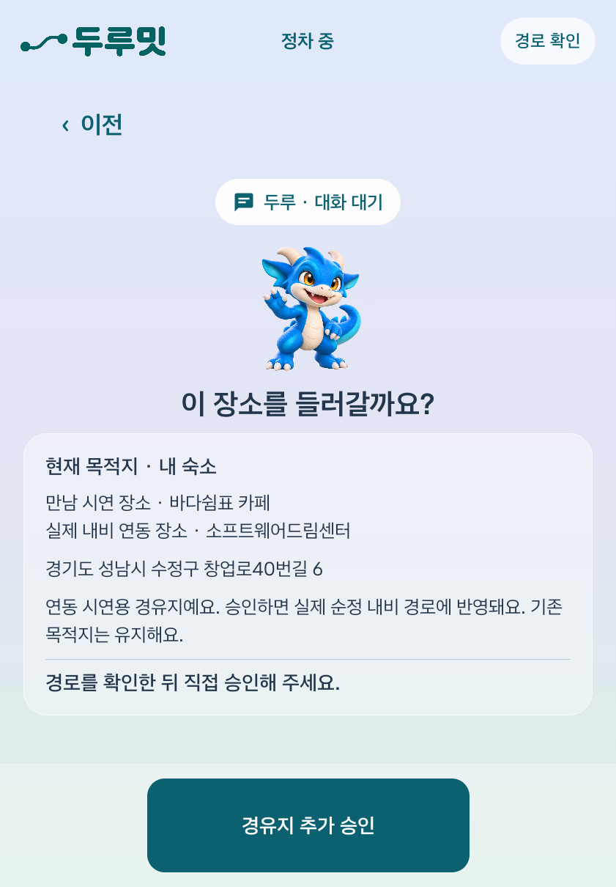
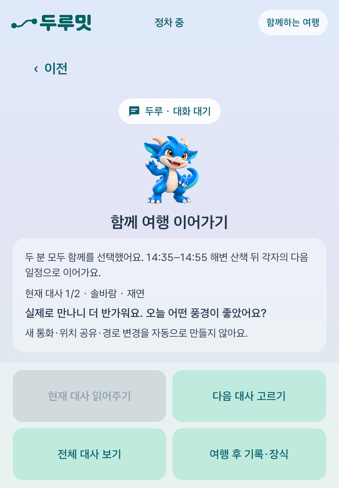
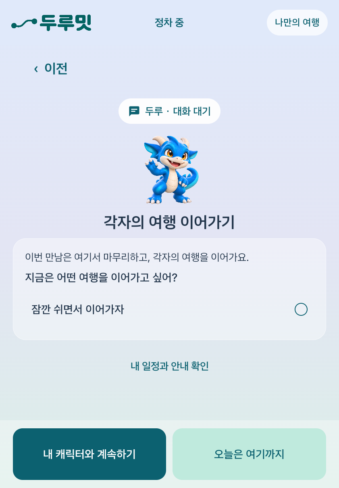

# 두루밋 · Doo Roo Meet

**혼자 떠나는 자동차 여행에 AI 친구와 새로운 만남을 더하는 서비스입니다.**

모바일에서 여행 준비 → Pleos에서 상대 알아가기 → 짧은 만남 → 함께 또는 각자의 여행

[제출 APK](apk/말할카말카_두루밋_release.apk) · [주요 화면](#주요-화면) · [코드 구조](#코드-구조) · [실행 방법](#실행-방법) · [테스트 환경](#테스트-환경-및-필요한-설정) · [검증](#기술-및-검증)

| 개발 영역 | 바로 가기 | 담당 기능 |
| --- | --- | --- |
| **차량 목업 앱** | [vehicle-app/](vehicle-app/) | Pleos 캐릭터 UI·주행 모드·만남·내비 승인 |
| **백엔드** | [backend/](backend/) | 계정·AI 대화·여행 저장·연결·차량 전달 |
| **모바일 웹** | [mobile-web/](mobile-web/) | 여행 준비·취향 확인·일정 편집·여행자 연결 |

## 주요 화면

### 모바일 · 대화로 준비하는 여행

<table>
  <tr><th>1. AI 친구와 대화</th><th>2. 여행 계획 확인·수정</th><th>3. 여행자 연결</th></tr>
  <tr>
    <td></td>
    <td></td>
    <td></td>
  </tr>
  <tr><td>대화를 통해 여행 취향을 파악하고,<br>사용자가 확인한 내용만 기억합니다.</td><td>대화로 만든 일정의 장소·시간을 수정하고,<br>확정한 계획을 내 여행에 저장합니다.</td><td>공개할 소개와 여행 정보를 확인하고,<br>상대와 만날 수 있는 공통 시간을 정합니다.</td></tr>
</table>

### Pleos · 알아가고 만나기

<table>
  <tr><th>4. 상대 AI 친구와 첫 인사</th><th>5. 짧은 만남 제안</th><th>6. 경유지 추가 승인</th></tr>
  <tr>
    <td></td>
    <td></td>
    <td></td>
  </tr>
  <tr><td>상대가 공개한 소개를 AI 친구에게 듣고,<br>질문·메시지로 서로 알아갑니다.</td><td>만남 장소·시간과 다음 일정을 확인하고,<br>서로 동의한 짧은 만남을 준비합니다.</td><td>기존 목적지를 유지할지 확인한 뒤,<br>운전자가 만남 장소의 경유지 추가를 승인합니다.</td></tr>
</table>

<details>
<summary><strong>만남 이후 · 함께해도, 각자여도 이어지는 여행</strong></summary>

만남이 끝나면 두 사람은 상대의 선택을 보지 않고 독립적으로 결정합니다. 두 사람 모두 제출하기 전에는 결과를 확정하지 않습니다.

<table>
  <tr><th>7-A. 함께 여행 이어가기<br>IF: 두 사람 모두 동행 선택</th><th>7-B. 내 AI 친구와 여행 이어가기<br>IF: 한 사람이라도 각자 여행 선택</th></tr>
  <tr>
    <td></td>
    <td></td>
  </tr>
  <tr><td>서로의 동의를 확인하고,<br>함께 이어갈 여행을 안내합니다.</td><td>각자의 결정을 존중하고,<br>내 AI 친구와 원래 여행을 이어갑니다.</td></tr>
</table>

</details>

<details>
<summary><strong>현재 구현과 캡처 범위 · 기능별 개발 현황</strong></summary>

**제출 APK는 서버 없이 실행하는 오프라인 시연판입니다.** 아래의 계정·실제 AI·저장·차량 전달 기능은 소스 코드에 포함된 별도 서버 연동 모드에서 동작합니다. 화면 번호는 위의 주요 화면과 연결됩니다.

| 기능 | 구현한 내용 | 시연 방식·남은 범위 |
| --- | --- | --- |
| 가입·AI 친구 설정 | 계정 가입·로그인, 캐릭터 선택, 첫 대화, 취향 요약 확인·저장, 계정별 대화 복원 | 로컬 서버·SQLite 기반. 운영 서비스 배포는 후속 범위 |
| **1. AI 대화·취향** | OpenAI Responses API 스트리밍, 저장 취향·여행 조회, 취향/일정 제안 도구, 답변 중단·재시도 | 실제 AI는 API 키 필요. 캡처의 대화는 촬영용 고정 응답 |
| **2. 여행 계획** | 일정 초안 생성, 장소·시간 직접 편집, AI에 재수정 요청, 확인 후 저장, 기존 여행 업데이트 | 지도는 일정 설명용 SVG. 실시간 장소 검색·교통·경로 계산은 미구현 |
| **3. 여행자 연결** | 공개 소개·여행 정보 확인, 연결 요청·취소, 공통 시간 확인, 여행별 상태 저장 | 추천 후보는 고정 데이터. 상대 수락·답장은 진행자 패널로 재현하며 실사용자 자동 매칭은 미구현 |
| 모바일 → 차량 전달 | 연결 코드 요청·차량 승인, 확정 여행 전송, 차량 확인·저장 후 수신 확인(ACK), 연결 해제 | 서버 연동 모드의 실제 API·저장 처리. 오프라인 APK는 준비된 여행 사용 |
| **4. Pleos 교류** | 공개 프로필·AI 친구 소개, 질문·메시지 확인 흐름, 통화 동의 UI·음성 샘플 재생 | 상대 답변·통화는 시나리오. 실제 상대 통신·실시간 통화·마이크/STT는 미구현 |
| **5–6. 만남·내비** | 장소·시간 동의, 다음 일정 확인, 운전자 승인, 경유지 추가·취소·제거 상태 관리 | 제출 APK는 모의 내비. `realDebug`에서 고정 POI의 NaviHelper 추가·제거를 별도 검증했으며 실시간 만남 장소 추천은 미구현 |
| **7-A/B. 만남 이후 선택** | 독립 선택 제출, 두 사람의 제출 대기, 모두 동행 / 한 사람이라도 각자 선택 시 결과 분기 | 서버 상태 로직·차량 UI 구현. 상대의 선택은 진행자 입력, 오프라인 APK에서는 두 결과를 각각 재현 |
| 차량 사용 환경 | Pleos 차량 UX 제한 수신, 정차 상세/주행 간편 화면 전환, 2·3분할 대응, 제한·포커스 변경 시 음성 중단 | 제출 release APK도 실제 에뮬레이터의 정차·주행 전환 확인. Gleo 연동은 후속 범위 |

**캡처의 출처:** 모바일 1–3번은 실제 웹 UI의 촬영·검수 화면이며, 고정 AI 응답·여행자 후보를 사용합니다. 차량 4–7번은 Pleos 에뮬레이터의 오프라인 Debug 미리보기입니다. 번호는 서비스 이용 순서이며, 서로 다른 검수 회차의 화면이므로 날짜·별명·여행이 다를 수 있습니다.

**검증의 범위:** 서버 API·상태 전이와 차량 단위 검사, 실제 release APK 설치·실행 및 주행 전환을 확인했습니다. 캡처 자체는 실제 상대와의 전체 통합 흐름 완주나 순정 내비 변경 성공을 입증하는 자료가 아닙니다. 영역별 상세 구현·코드·검사는 [모바일 웹](mobile-web/README.md), [백엔드](backend/README.md), [차량 앱](vehicle-app/README.md)에 정리했습니다.

[캡처 안내](assets/README.md) · [통합 시나리오 테스트](backend/tests/scenario-flow.test.mjs)

</details>

## 코드 구조

```text
wayMate/
├── vehicle-app/       # 차량 목업 앱 · Kotlin / Jetpack Compose / Pleos
├── backend/           # 계정·AI·여행 API · Node.js / SQLite
│   ├── server/        # 실제 계정·AI·여행·차량 API
│   └── demo/          # 기본 시연 서버·고정 데이터·공통 소재
├── mobile-web/        # 모바일 웹 · HTML / CSS / JavaScript
│   ├── src/           # 여행 준비·AI 채팅·연결 UI
│   ├── shared/        # 모바일·서버 공통 데이터 함수
│   └── demo/          # 기본 시연 웹·진행자 패널
├── shared/            # 공통 디자인·서버 음성 모듈
├── apk/               # 말할카말카_두루밋_release.apk · 제출용 release APK
├── assets/            # README용 대표 UI 캡처
└── .github/           # 서버·차량 빌드 및 테스트 CI
```

**모바일 웹 ↔ 백엔드 ↔ 차량 앱**으로 연결합니다. 모바일 화면은 백엔드가 API와 함께 제공하며, 차량은 확인한 여행을 저장하고 ACK를 보냅니다.

## 제출 APK

**팀명: 말할카말카 · 앱 이름: 두루밋**

- 파일: [`apk/말할카말카_두루밋_release.apk`](apk/말할카말카_두루밋_release.apk)
- 빌드: **demoRelease**, `debuggable=false`, 전용 release 서명
- 실행: **Pleos Connect ARM 2.1.0 / API 34**에 설치한 뒤 **두루밋 오프라인 시연** 실행
- 설정: 서버·계정·인터넷·API 키 없이 준비된 여행·대화·만남·두 결말을 재현
- [APK 정보·설치 방법](apk/README.md) · [SHA-256](apk/SHA256SUMS.txt)

## 실행 방법

Node.js **22.22.2** 기준, 저장소 루트에서 실행합니다.

```sh
npm run setup
npm run start:demo    # 키 없는 기본 시연 · http://127.0.0.1:3000
```

실제 AI·계정·차량 통합 시연은 `backend/.env.example`을 참고해 `backend/.env`에 API 키를 설정한 뒤 실행합니다.

```sh
npm start            # 통합 시연 · http://127.0.0.1:3008
npm test             # 백엔드·시연 서버·모바일 클라이언트 회귀 검사
```

차량 앱은 JDK **21**·Android SDK **35**·Pleos **API 34** 환경에서 빌드합니다.

```sh
cd vehicle-app
./gradlew :app:assembleDemoRelease  # 로컬 release 서명 설정 필요
# 서버 연동 개발용 Debug 빌드
./gradlew :app:assembleMockDebug :app:assembleRealDebug \
  -PwaymateApiPort=3008 -PwaymatePersonalApiPort=3008
```

[백엔드 설정](backend/README.md) · [모바일 웹 안내](mobile-web/README.md) · [차량 빌드·설치](vehicle-app/README.md)

## 테스트 환경 및 필요한 설정

| 항목 | 검증 환경 |
| --- | --- |
| Pleos Connect 에뮬레이터 | **ARM 2.1.0 / Android API 34** |
| 전체 디스플레이 | **2560 × 1440px**, 밀도 **160dpi** |
| 3분할 앱 영역 | **841 × 1210dp** |
| 2분할 앱 영역 | **1682 × 1210dp** |
| Android 빌드 | JDK **21**, compile SDK **35**, Build Tools **35.0.0** |
| 웹·서버 | Node.js **22.22.2** |

제출용 오프라인 APK는 서버·계정·API 키 없이 실행합니다. 실제 AI를 사용하는 모바일·차량 통합 모드는 `backend/.env`의 API 키와 3008 서버가 필요하며, 차량의 API 주소는 `http://10.0.2.2:3008`입니다.

정차 상태에서 상세 화면과 시연 메뉴를 사용합니다. 실제 차량 UX 제한이 주행 상태이면 간편 화면으로 전환하며, 속도 0만으로 정차로 판단하지 않습니다.

## 기술 및 검증

| 영역 | 기술·검사 |
| --- | --- |
| 모바일 웹 | HTML · CSS · JavaScript, 반응형 UI |
| 백엔드 | Node.js · SQLite · OpenAI Responses API · JSON Schema · SSE |
| 차량 앱 | Kotlin · Jetpack Compose · Pleos Connect · NaviHelper |
| 자동 검증 | Node 회귀 테스트 · Kotlin/JVM · Android Lint · GitHub Actions |

[백엔드 테스트](backend/tests/) · [시연 서버 테스트](backend/demo/tests/) · [차량 단위 테스트](vehicle-app/app/src/test/) · [CI 설정](.github/workflows/)

저장소·패키지의 내부 식별자 `wayMate` / `waymate`는 유지합니다.
