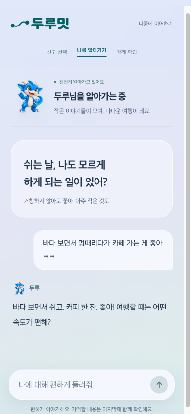
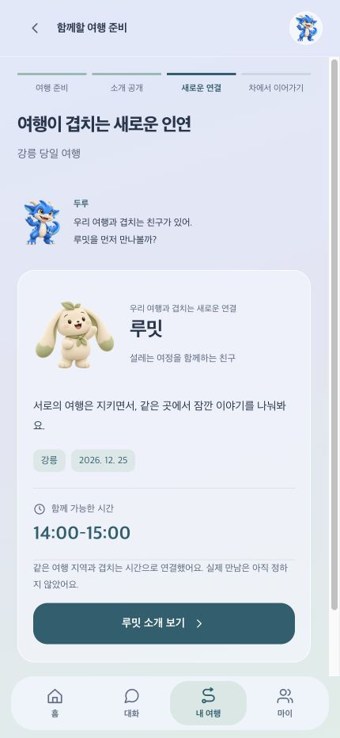

# 두루밋 · Doo Roo Meet

**혼자 떠나는 자동차 여행에 AI 친구와 새로운 만남을 더하는 서비스입니다.**

모바일에서 여행 준비 → Pleos에서 상대 알아가기 → 짧은 만남 → 함께 또는 각자의 여행

[주요 화면](#주요-화면) · [코드 구조](#코드-구조) · [실행 방법](#실행-방법) · [검증](#기술-및-검증)

| 개발 영역 | 바로 가기 | 담당 기능 |
| --- | --- | --- |
| **차량 목업 앱** | [vehicle-app/](vehicle-app/) | Pleos 캐릭터 UI·주행 모드·만남·내비 승인 |
| **백엔드** | [backend/](backend/) | 계정·AI 대화·여행 저장·연결·차량 전달 |
| **모바일 웹** | [mobile-web/](mobile-web/) | 여행 준비·취향 확인·일정 편집·여행자 연결 |

## 주요 화면

### 모바일 · 대화로 준비하는 여행

<table>
  <tr><th>AI 친구와 대화</th><th>여행 계획 확인·수정</th><th>여행자 연결</th></tr>
  <tr>
    <td></td>
    <td></td>
    <td></td>
  </tr>
  <tr><td>취향을 알아가는 대화</td><td>직접 다듬고 내 여행에 저장</td><td>공개 정보와 공통 시간 확인</td></tr>
</table>

### Pleos · 알아가고 만나기

<table>
  <tr><th>상대 AI 친구와 첫 인사</th><th>짧은 만남 제안</th><th>경유지 추가 승인</th></tr>
  <tr>
    <td></td>
    <td></td>
    <td></td>
  </tr>
  <tr><td>공개한 정보를 바탕으로 교류</td><td>서로 동의한 장소·시간에 만남</td><td>운전자가 확인한 뒤 경로 반영</td></tr>
</table>

<details>
<summary><strong>만남 이후 · 함께해도, 각자여도 이어지는 여행</strong></summary>

두 사람은 상대의 선택을 보지 않고 독립적으로 결정합니다. 모두 동의하면 함께 여행하고, 각자 여행을 선택해도 내 AI 친구가 계속 동행합니다.

<table>
  <tr><th>함께 여행 이어가기</th><th>내 AI 친구와 여행 이어가기</th></tr>
  <tr>
    <td></td>
    <td></td>
  </tr>
</table>

</details>

<details>
<summary>현재 구현과 캡처 범위</summary>

| 구분 | 범위 |
| --- | --- |
| 실제 구현 | 계정·AI 스트리밍·도구 호출·여행 저장·차량 수신/ACK·독립 선택 |
| 시나리오 재현 | 고정 여행자 후보·상대 응답·만남 장소/시간·준비된 통화 샘플·모의 내비 |
| 별도 SDK 검증 | 고정 POI의 NaviHelper 경유지 추가/제거·차량 UX 제한·음성 중단 |
| 후속 개발 | 실시간 교통 기반 만남 추천·상대와의 실시간 통화·마이크/STT·Gleo |

모바일 캡처는 실제 웹 UI의 촬영·검수 자료이며 대화에는 고정 응답을 사용했습니다. 차량 캡처는 Pleos 에뮬레이터의 오프라인 Debug 미리보기입니다. 각 이미지는 다른 회차의 예시이며 실제 SDK 성공이나 전체 통합 시연 완주를 뜻하지 않습니다.

[캡처 안내](assets/README.md) · [통합 시나리오 테스트](backend/tests/scenario-flow.test.mjs)

</details>

## 코드 구조

```text
wayMate/
├── vehicle-app/       # 차량 목업 앱 · Kotlin / Jetpack Compose / Pleos
├── backend/           # 계정·AI·여행 API · Node.js / SQLite
│   ├── server/        # 실제 계정·AI·여행·차량 API
│   └── demo/          # 기본 시연 서버·고정 데이터·공통 소재
├── mobile-web/        # 모바일 웹 · HTML / CSS / JavaScript
│   ├── src/           # 여행 준비·AI 채팅·연결 UI
│   ├── shared/        # 모바일·서버 공통 데이터 함수
│   └── demo/          # 기본 시연 웹·진행자 패널
├── shared/            # 공통 디자인·서버 음성 모듈
├── assets/            # README용 대표 UI 캡처
└── .github/           # 서버·차량 빌드 및 테스트 CI
```

**모바일 웹 ↔ 백엔드 ↔ 차량 앱**으로 연결합니다. 모바일 화면은 백엔드가 API와 함께 제공하며, 차량은 확인한 여행을 저장하고 ACK를 보냅니다.

## 실행 방법

Node.js **22.22.2** 기준, 저장소 루트에서 실행합니다.

```sh
npm run setup
npm run start:demo    # 키 없는 기본 시연 · http://127.0.0.1:3000
```

실제 AI·계정·차량 통합 시연은 `backend/.env.example`을 참고해 `backend/.env`에 API 키를 설정한 뒤 실행합니다.

```sh
npm start            # 통합 시연 · http://127.0.0.1:3008
npm test             # 백엔드·시연 서버·모바일 클라이언트 회귀 검사
```

차량 앱은 JDK **21**·Android SDK **35**·Pleos **API 34** 환경에서 빌드합니다.

```sh
cd vehicle-app
./gradlew :app:assembleMockDebug :app:assembleRealDebug \
  -PwaymateApiPort=3008 -PwaymatePersonalApiPort=3008
```

[백엔드 설정](backend/README.md) · [모바일 웹 안내](mobile-web/README.md) · [차량 빌드·설치](vehicle-app/README.md)

## 기술 및 검증

| 영역 | 기술·검사 |
| --- | --- |
| 모바일 웹 | HTML · CSS · JavaScript, 반응형 UI |
| 백엔드 | Node.js · SQLite · OpenAI Responses API · JSON Schema · SSE |
| 차량 앱 | Kotlin · Jetpack Compose · Pleos Connect · NaviHelper |
| 자동 검증 | Node 회귀 테스트 · Kotlin/JVM · Android Lint · GitHub Actions |

[백엔드 테스트](backend/tests/) · [시연 서버 테스트](backend/demo/tests/) · [차량 단위 테스트](vehicle-app/app/src/test/) · [CI 설정](.github/workflows/)

저장소·패키지의 내부 식별자 `wayMate` / `waymate`는 유지합니다.


## 백엔드 없는 Pleos 시연 APK

[오프라인 APK 다운로드](https://github.com/ho72/wayMate/releases/tag/v0.1.0-offline-demo-20261115) · [빌드·설치 안내](vehicle-app/README.md)

백엔드 없이 준비된 38개 차량 장면과 실제 정차·주행 전환을 볼 수 있습니다. 실제 음성 인식·상대 통신·순정 내비 변경은 포함하지 않습니다.
