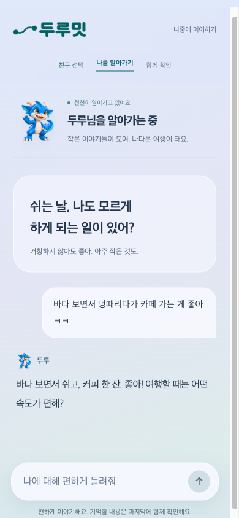
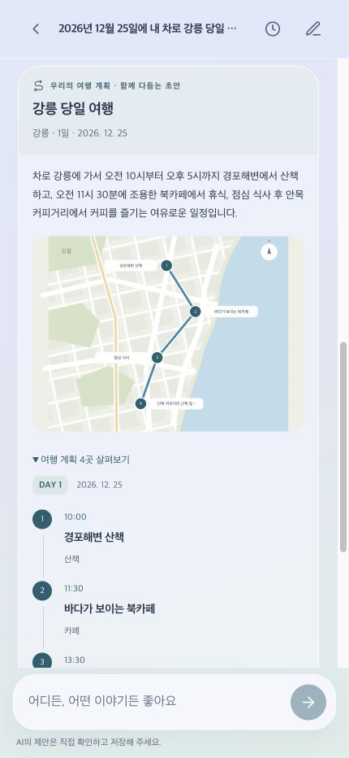
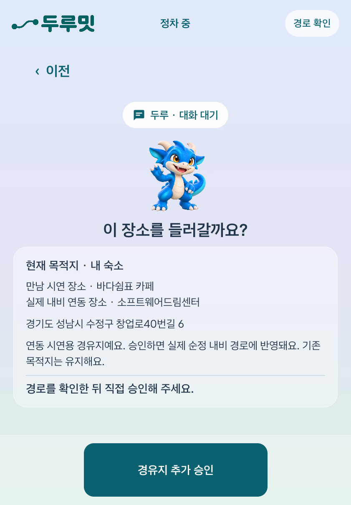

# Backend · 계정·AI·여행 서버

계정·AI 대화·여행 저장·차량 전달을 담당하는 Node.js 서버입니다. [모바일 웹](../mobile-web/)의 정적 파일과 API를 함께 제공합니다.

[전체 프로젝트](../README.md) · [모바일 웹](../mobile-web/README.md) · [차량 앱](../vehicle-app/README.md)

## 백엔드가 지원하는 주요 화면

백엔드의 별도 사용자 화면 대신, API와 저장 기능이 연결되는 모바일·차량 화면을 함께 제시합니다. 번호는 메인 README와 같습니다.

<table>
  <tr><th>1. AI 대화·취향 제안</th><th>2. 여행 계획·저장</th><th>6. 만남 경유지 승인</th></tr>
  <tr>
    <td></td>
    <td></td>
    <td></td>
  </tr>
  <tr><td>AI 응답을 스트리밍하고,<br>확인 전 취향은 초안으로 관리합니다.</td><td>일정의 버전·사용자 소유권을 확인하고,<br>확정한 여행을 계정별로 저장합니다.</td><td>승인·실행 결과·명령 수신 상태를 관리하고,<br>모의 내비와 실제 SDK 결과를 구분합니다.</td></tr>
</table>

모바일 대화는 촬영용 고정 응답, 차량은 오프라인 Debug 미리보기입니다. 이미지는 API의 사용 맥락을 보여주며 실제 모델·SDK 호출 성공의 증빙은 아닙니다. [캡처 출처·범위](../assets/README.md)

## 개발한 기능

| 영역 | 구현 내용 | 주요 코드 |
| --- | --- | --- |
| 계정·세션 | 가입·로그인, 비밀번호 해시, 세션·CSRF/Origin 검사, 계정별 데이터 접근 | [http.mjs](server/http.mjs) |
| AI 대화 | Responses API 스트리밍, 도구 실행, 호출 제한·중단·오류 처리, 대화 기록 저장 | [agent.mjs](server/agent.mjs), [store.mjs](server/store.mjs) |
| 취향·일정 초안 | 저장 취향/여행/최신 초안 조회, 취향·일정 제안, 사용자 확인 후 반영, 수정 버전 확인 | [contracts.mjs](server/contracts.mjs), [store.mjs](server/store.mjs) |
| 저장·복원 | SQLite 기반 계정·프로필·대화·여행 저장, 기존 여행 업데이트, 중복 요청 처리 | [store.mjs](server/store.mjs) |
| 차량 페어링 | 일회성 연결 코드, 모바일 연결 요청·차량 승인, 장치 인증, 연결 해제 | [vehicle-http.mjs](server/vehicle-http.mjs), [vehicle-store.mjs](server/vehicle-store.mjs) |
| 여행 전달 | 확정 여행 스냅샷·버전 전송, 차량 ACK 확인 후 수신 완료, 계정·장치별 접근 검사 | [vehicle-store.mjs](server/vehicle-store.mjs), [계약](contracts/) |
| 여행자 연결·만남 | 여행별 공개 정보·공통 시간·연결·만남 상태, 명령 수신 결과·회차 관리 | [journey.mjs](server/journey.mjs), [상태 처리](demo/server/v4/) |
| 독립 선택·결말 | 두 사람의 선택을 각각 접수, 모두 제출할 때까지 대기, 함께/각자 분기 | [ending.mjs](demo/server/v4/ending.mjs) |
| 음성 | 선택적 서버 TTS, 사용자 동의·요청 취소·재생 상태 처리 | [공통 음성 모듈](../shared/server/) |

실제 AI 에이전트는 `get_profile`, `get_saved_trips`, `get_latest_trip_draft`, `propose_preferences`, `propose_trip` 도구를 사용합니다. 제안 도구는 초안만 만들며 사용자 확인 없이 프로필·저장 여행을 변경하지 않습니다.

연결·만남의 **상태 전이와 저장 로직은 구현**되어 있습니다. 다만 추천 후보는 고정 데이터이고, 상대방의 수락·답장·결말 선택은 진행자 패널로 입력합니다. 실사용자 자동 매칭·실시간 통화·교통 기반 장소 추천·운영 배포는 후속 범위입니다.

## 코드 구조

| 경로 | 역할 |
| --- | --- |
| `server/` | 계정·SQLite·AI 스트리밍·여행·차량 API |
| `contracts/` | 계정·차량 전달 스키마와 예제 |
| `tests/` | 서버·모바일 클라이언트 회귀 검사 |
| `demo/` | 기본 시연 서버·고정 시나리오·차량 공통 소재 |
| `runtime/` | 로컬 DB·회차 상태, Git 추적 제외 |

## 실행

차량까지 연결하려면 [메인 README의 설치·서버·앱·여행 전달 순서](../README.md#실행-방법)를 따릅니다. 아래 `npm start`는 백엔드와 모바일 웹을 실행하며 Pleos 설치·APK 설치·차량 실행은 별도로 진행합니다.

Node 22.22.2 기준, 저장소 루트에서:

```sh
npm run setup
npm run start:demo       # 키 없는 시연 · 3000
npm start               # 모바일·차량 통합 시연 · 3008
npm run start:personal  # 개인 AI 서비스 · 3004
npm test
```

실제 AI 모드에 필요한 키는 **OpenAI API 키**입니다. [OpenAI API 키 관리 페이지](https://platform.openai.com/api-keys)에서 발급한 키를 [.env.example](.env.example)을 참고해 `backend/.env`에 설정합니다. `backend/.env`가 우선하며 기존 시연 설정은 `backend/demo/.env`에서 읽습니다. `.env`는 Git에서 제외되고 키는 백엔드에서만 사용합니다.

```dotenv
OPENAI_API_KEY=발급받은_OpenAI_API_키
OPENAI_MODEL=gpt-4.1-mini
```

| 설정 | 기본값·용도 |
| --- | --- |
| `OPENAI_API_KEY` | **실제 AI 모드 필수**. 모바일 AI 대화·취향/일정 제안용. 해당 모델을 호출할 수 있는 API 프로젝트·사용 한도 필요 |
| `OPENAI_MODEL` | 선택. 기본값 `gpt-4.1-mini` |
| `SERVICE_PORT` | 개인 서비스 3004 |
| `SERVICE_PUBLIC_ORIGIN` | `http://127.0.0.1:3004` |
| `SERVICE_DB_PATH` | `runtime/waymate.sqlite` |
| `ELEVENLABS_API_KEY`, `ELEVENLABS_VOICE_ID` | 선택적 서버 TTS. 음성 합성을 사용할 때만 둘 다 설정하고, 사용하지 않으면 비워 둠 |

`npm start`의 통합 시연은 전용 3008 포트·Origin·DB를 지정합니다. 모바일은 `http://127.0.0.1:3008/#trips`, 진행자는 같은 계정의 `/scenario-operator`입니다. 상대 수락·답장·만남 진행은 준비된 시나리오로 재현합니다.

차량 AI 대사 생성은 `.env`에 `WAYMATE_DIALOGUE_PROVIDER=openai`를 추가할 때 같은 키를 사용하는 선택 기능입니다. 기본 준비 대사로도 차량 시연을 진행할 수 있습니다.

설정 변경 후 서버를 재시작합니다. `http://127.0.0.1:3008/health`의 `status: "ready"`는 서버 기동을 뜻합니다. 실제 OpenAI 키·모델 호출은 모바일 웹에서 AI 답변을 받아 확인합니다. ElevenLabs 키 없이도 AI 텍스트 대화는 사용할 수 있으며, 제출용 오프라인 APK와 3000 기본 시연에는 OpenAI 키도 필요하지 않습니다.

Pleos TTS/STT·Gleo Interface 연동은 [향후 확장 검토 범위](../README.md#pleos-sdk-확장-계획--현재는-미구현)이며, 현재 서버의 OpenAI 키 설정을 대체하지 않습니다.

## 주요 코드

- [http.mjs](server/http.mjs): HTTP API·세션·CSRF·SSE·정적 파일.
- [agent.mjs](server/agent.mjs): AI 스트리밍·도구 호출·중단.
- [store.mjs](server/store.mjs): 계정별 대화·프로필·여행 저장.
- [vehicle-http.mjs](server/vehicle-http.mjs): 페어링·확정 여행 전달·차량 ACK.
- [journey-http.mjs](server/journey-http.mjs): 여행별 연결·만남·선택·시연 API.

AI 제안은 사용자 확인 후 저장합니다. 차량 수신 완료는 확인·저장·ACK 이후 표시합니다. 로컬 서버의 공개 배포와 실사용자 매칭은 후속 범위입니다.

## 검사

저장소 루트에서 `npm test`, 통합 흐름만 확인하려면 `npm run test:scenario`를 실행합니다. 외부 AI·음성 제공자는 테스트 대체 구현을 사용합니다. 실제 모델 호출은 별도 설정이 필요합니다.

[차량 앱 설정](../vehicle-app/README.md) · [모바일 웹 구조](../mobile-web/README.md)
