# wayMate 목업 화면 설계서와 와이어프레임

작성일 2026년 11월 11일 · 버전 0.2 · 자유 입력·주행 음성 목표 반영

이 문서는 01~05 v0.6, 06 협업 가이드, 07 현재 구현 계약을 분석한 **목업 목표 화면의 시각 설계서**다. 기준 커밋은 `450c4fa`다. 실제 앱 구현 상태는 07을 따른다. 디자인 완성도보다 화면 구성·버튼 의미·상태 전환을 우선한다.

- [전체 화면 PDF](wireframes/v1/waymate-screen-spec-v0.2.pdf)
- [화면별 검토 뷰어](wireframes/v1/index.html): 저장소를 받은 뒤 브라우저에서 연다. GitHub 파일 화면에서는 HTML이 실행되지 않는다.
- 이전 PDF v0.1은 이력으로 보존한다. 현재 기준은 이 문서·v0.2 PDF·갱신된 SVG다.
- 피드백 형식: **WF-019 / 요소 4 / 대기시간을 더 먼저 보여주세요.** 화면 번호는 고정하고 삭제·추가 시 재번호를 붙이지 않는다.
- 담당자·마감은 미정이다. 이 설계는 기능·사용자·실제 주행·SDK 검증의 완료 기록이 아니다.

## 1. 문서 분석과 설계 판단

| 기준 | 화면에 반영한 판단 |
|---|---|
| 01 서비스 범위 | 자유 입력 온보딩과 이동 중 음성 대화 핵심을 유지. 원문·소개 확인·연결·동의 분리 |
| 02 시나리오 | A/B 대사 출처·사전 소개 조건·첫 만남 20분·두 결말 유지 |
| 03 상호작용 | 기존 WF 번호 유지. WF-002 자유 입력·예시 초안, WF-032 차단, 신규 WF-051 주행 음성 목표로 구분 |
| 04 연동 | 사용자 승인 → 요청 → 반영 확인. mock/real 출처와 처리 결과 분리. unknown에서 중복 요청 금지 |
| 05 검수 | Q 기능 검수와 V01~V05 가치/주행 검증 분리. 미정 담당·마감 유지 |
| 06 협업 | 앱 UI·차량 플랫폼·서버의 책임 경계 유지. 이 산출물은 문서·설계 자산만 추가 |
| 07 현재 구현 | my_trip 저장·HTTP 전달·ACK 기반 구현과 목표 화면을 구분. 전체 대화·내비 완료로 표시하지 않음 |

## 2. 목업 범위와 이번 요청의 확장

**B**는 기존 기본 목업, **E**는 이번 요청으로 설계한 차량 특화 확장 시연, **O**는 기존 추가 기능이다. B의 DM01~DM11 의미는 바꾸지 않는다.

E는 ‘30분 쉴 곳/점심 장소’의 준비된 질문, 가상 후보, 상세, 개인 경유지 또는 새 목적지 승인, 저장 일정 확인을 재현한다. 실시간 주변 검색·LLM·STT·자유 일정 분석·실제 영업 검증은 추가하지 않는다. E는 본인 여행 대안 프리셋이며 13:50의 B 만남 이야기와 자동으로 결합하지 않는다.

**자동 내비 반영**은 명확한 실행 버튼으로 승인한 뒤 순정 내비에 요청해, 사용자가 주소를 다시 입력하지 않아도 되는 흐름이다. 목록 열기·상세 선택·앱 진입만으로 경로를 바꾸지 않는다. 기존 D가 있으면 M 경유지 추가, D가 없으면 새 목적지 설정을 구분한다. 기존 경로가 바뀌면 다시 확인하고 무단 덮어쓰지 않는다.

공유 만남은 양쪽 동의와 별도 운전자 승인이 필요하다. 개인 장소는 본인의 명시적 승인이 필요하다. 개인 추천에 기존 MEETING 전용 NAV_APPROVE를 우회 사용하지 않는다. E의 데이터·명령·검수 계약은 구현 전에 01~05와 함께 갱신해야 한다.

| 내비 흐름 | 요청·결과 화면 | 종료·취소 의미 |
|---|---|---|
| 공유 만남 | WF-021 승인 → WF-022~025 | 만남 취소와 경유지 제거는 WF-026에서 구분 |
| 개인 휴식·식사·일정 | WF-037/038 승인 → WF-046 대기 → WF-047 경유지 또는 WF-048 새 목적지 | 실패 WF-049, 미확인 WF-050. B 연결·만남 취소 명령을 호출하지 않음 |

개인 안내의 요청 중 취소·반영 후 경로 복구는 이번 목업의 실행 범위에 넣지 않는다. 승인 전 취소만 제공하며 나머지는 후속 계약·검증 항목이다. 새 목적지 결과를 ‘M 경유 → 기존 D 유지’로 잘못 표시하지 않는다. 모든 개인 화면은 질문 종류·선택 장소·주소/좌표·동작·요청 ID를 유지한다. 뒤로 가기는 휴식 WF-036, 점심 WF-045, 저장 일정 WF-039 등 실제 진입 화면으로 돌아간다.

## 3. Pleos 배치와 주행 제한

대표 배치는 **드라이빙뷰(시스템) / 순정 내비 / 우측 wayMate 앱 창**이다. 창 비율과 위치는 플랫폼·사용자 설정에 따른다. 앱 내부에 순정 내비를 임베드하거나 상태바·GNB·차량 UI를 가짜로 구현하는 안이 아니다. 아래 차량 전체 그림은 배치 개념도다.

Connect-S의 1:1, Connect-W의 2:1/1:2, 앱 단독·가로/세로·앱 가림에 대응한다. 앱이 우측 고정이나 내비 상시 노출을 강제할 수 있다고 약속하지 않는다. 신규 앱 실행·딥링크로 배치가 바뀔 수 있어 실제 프로젝트에서 검증한다.

| 상태 | 화면·행동 기준 |
|---|---|
| 안전한 주차·실제 제한 없음 | 큰 캐릭터, 질문·목록·공개·동의·경로 변경 확인 제공 |
| driving_voice · 검증 조건 충족 | 상대 캐릭터와 음성 문답·쉬기·종료. 목록·키보드·긴 자막·큰 애니메이션·새 전송/동의/SDK 승인은 잠금 |
| blocked · 플랫폼 차단·지원 미검증·비활성·보고 만료 | 녹음·재생 중단. 현재 v2와 미검증 환경은 차단 유지. 운영자 전환으로 실제 제한 해제 금지 |
| 플랫폼이 앱을 가림 | 가림을 따르고 오버레이로 우회하지 않음. 순정 내비도 시스템 정책에 따름 |
| 주차·앱 복귀 | 최신 제한·상태 확인 뒤 현재 장면 복원. 전송·SDK·음성 자동 재실행 없음 |
| 내비 음성 안내 | 오디오 포커스 우선. 캐릭터 음성 중단/감쇄·수동 재개 |

주행 음성 목표는 핸즈프리 UI 지침을 근거로 검토하는 설계다. DO 선언·카테고리 심사·기능별 실제 제한·마이크/오디오·fresh 세션·foreground·실제 환경 증빙을 충족해야 하며 Boolean 제한 하나로 음성 전체를 허용/금지하지 않는다. 공식 API 문서는 있어도 프로젝트 안내의 STT/TTS는 준비 중으로 표시되어 콘솔·제공 SDK 검증이 필요하다. Gleo function 연동도 자유 캐릭터 대화의 자동 지원이 아니다. 실제 제공 조건은 04번 7.3절과 05번 V05가 기준이다.

법령의 지리안내 표시 예외를 캐릭터 대화·장소 목록 조작의 포괄 허용으로 확대하지 않는다. 상세 조작은 안전한 주차 상태로 제한하며 신호 대기·속도 0만으로 해제하지 않는다. DO·카테고리·지역·실제 제한·차종/버전 검증이 필요하고 이 문서로 법적 적합성이나 주행 지원을 인증하지 않는다.

## 4. 캐릭터·정보·행동의 공통 규칙

| 모드 | 구성 | 쓰는 상황 |
|---|---|---|
| H 큰 캐릭터 | 앱 창 중앙의 캐릭터·현재 발화, 아래 일정/바로가기 | 기본 홈·내 친구·상대 캐릭터·결말 |
| C 축소 | 발화자를 상단에 줄이고 조건·목록·답장을 우선 | 콘텐츠·장소 리스트·메시지 |
| F 숨김 | 캐릭터를 제외하고 정보·승인·취소만 명확히 표시 | 공개·경로 변경·불확실 결과 |
| V 주행 음성 | 작은 정적 표시·짧은 상태, 음성 문답·쉬기·종료 | 지원 검증이 필요한 기본 목표 WF-051 |
| R 사용 차단 | 최소 정적 안내 또는 플랫폼 가림, 녹음·재생 중단 | 플랫폼 차단·지원 미검증 WF-032 |

캐릭터는 기존 TravelFriend의 기하 형태를 회색조로 재사용한 구조 표시이며 최종 아트 확정이 아니다. 큰 캐릭터는 차량 전체 중앙이 아니라 **wayMate 앱 창 안의 중앙**이다. 목록에서는 상단 축소, 경로·동의 확인에서는 숨김으로 전환한다. 반복 애니메이션·게임·자동 화면 이동으로 시선을 끌지 않는다.

확대도는 세로 창의 논리 배치이며 실제 해상도·sp/dp 규격값이 아니다. 넓고 낮은 앱 창은 캐릭터/현재 정보와 선택 영역을 나란히 놓는다. 실제 구현은 03의 글자·터치 기준, 시스템 인셋·가림·실제 창 크기·글자 확대에서 재검수한다.

WF-002의 빈 자유 입력창이 기본이다. 예시 칩은 초안만 채우고 직접 수정·삭제하거나 예시 없이 전송할 수 있다. 원문 1~500 코드 포인트 검증·저장 실패/재시도·키보드 가림을 확인한다. 에이전트는 답변에 따라 필요한 후속 질문을 추가·변경한다. 예: 맛집 탐방 → 좋아하는 음식 종류. 목업은 준비된 분기로 재현하며 임의 답변의 AI 분석·질문 생성으로 설명하지 않는다. WF-003에서 원문과 소개값을 구분하고 확인하지 않은 소개값은 비워둔다. 원문은 상대·차량 전달본에 포함하지 않는다.

공통 요소 번호: **1 역할/상태, 2 캐릭터, 3 발화/조건, 4 필요한 정보·입력, 5 실행 버튼·음성 제어**. 숨김 모드는 2가 없는 것이 의도다. 준비·전송·동의·경로 반영 상태를 합치지 않는다.

## 5. 번호별 화면 목록

| 번호 | 화면 | 범위 | 기존 화면·기능 |
|---|---|---|---|
| [WF-001](#wf-001) | 내 친구와 시작 | B | M01.START · DM01 |
| [WF-002](#wf-002) | 에이전트와 자유 입력 온보딩 | B | M01.CHAT · DM01 |
| [WF-003](#wf-003) | 내 답변과 소개값을 따로 확인 | B | M01.CHARACTER / SUMMARY · DM01 |
| [WF-004](#wf-004) | 공개 소개 미리보기 | B | M01.PUBLIC_REVIEW · DM01 |
| [WF-005](#wf-005) | 대화로 여행 계획 확인 | B | M02.CHAT / REVIEW · DM02 |
| [WF-006](#wf-006) | 내 친구가 후보를 먼저 제안 | B | M03.LIST · DM03 |
| [WF-007](#wf-007) | 상대 소개·연결 요청 | B | M03.B_DETAIL / M04.REQUEST_WAITING · DM04 |
| [WF-008](#wf-008) | 공통 시간 재확인 | B | M04.TIME_REVIEW · DM04 |
| [WF-009](#wf-009) | 모바일에서 차량으로 이어주기 | B | M04.TRANSFER_READY / VEHICLE_CONFIRMED · DM05 |
| [WF-010](#wf-010) | 상대 없이도 내 친구와 여행 | B | M02.MY_TRIP · DM02·DM04 |
| [WF-011](#wf-011) | 차량에서 내 여행 불러오기 | B | P01.READY / LOADING · DM05 |
| [WF-012](#wf-012) | 기본 홈 · 큰 내 친구 | B | P02.MY_AGENT · DM05·DM06 |
| [WF-013](#wf-013) | 콘텐츠 선택 · 캐릭터 상단 축소 | B | P02.LIST · DM06·DM07 |
| [WF-014](#wf-014) | 상대의 캐릭터와 대화 | B | P02.PROFILE_QUESTION / ANSWER · DM06 |
| [WF-015](#wf-015) | 상대에게 전할 말 확인 | B | P02.MESSAGE_DRAFT · DM06 |
| [WF-016](#wf-016) | 답장·후속 질문 확인 | B | P02.MESSAGE_RECEIVED / REPLY_DRAFT · DM06 |
| [WF-017](#wf-017) | 직접 통화 제안·동의 대기 | B | P02.CALL_READY / WAITING · DM07 |
| [WF-018](#wf-018) | 통화 샘플 · 발화자와 중단 | B | P02.CALL_ACTIVE · DM07 |
| [WF-019](#wf-019) | 만남 제안 · 일정과 전체 부담 | B | P03.PLACE_REVIEW · DM08 |
| [WF-020](#wf-020) | 같은 약속에 대한 상대 응답 대기 | B | P03.PROPOSAL_WAITING / CONFIRMED · DM08 |
| [WF-021](#wf-021) | 만남 카페 경유지 추가 승인 | B | P03.CONFIRMED · DM08 |
| [WF-022](#wf-022) | 내비 요청 중 · 지도는 아직 유지 | B | P03.NAVI_REQUESTING · DM08 |
| [WF-023](#wf-023) | 내비 반영 확인 · 캐릭터로 복귀 | B | P03.NAVI_APPLIED / NAVI_MOCK · DM08 |
| [WF-024](#wf-024) | 명시적 내비 실패 · 재확인 | B | P03.NAVI_FAILED · DM08 |
| [WF-025](#wf-025) | 결과 미확인 · 중복 요청 잠금 | B | P03.NAVI_UNKNOWN · DM08 |
| [WF-026](#wf-026) | 약속 취소와 경유지 제거 | B | P03.CANCELLED / REMOVE_REVIEW · DM08 |
| [WF-027](#wf-027) | 첫 만남 재연 | B | P03.MEETING · DM08·DM11 |
| [WF-028](#wf-028) | 만남 뒤 두 가지 여행 선택 | B | P04.CHOICE · DM09 |
| [WF-029](#wf-029) | 함께할지 상대 선택 기다리기 | B | P04.PEER_WAITING · DM09 |
| [WF-030](#wf-030) | 함께 여행 이어가기 | B | P04.TOGETHER · DM09 |
| [WF-031](#wf-031) | 내 친구와 여행 계속하기 | B | P04.MY_AGENT / EARLY_END · DM09 |
| [WF-032](#wf-032) | 플랫폼 차단 · 음성 지원 미확인 | B | 공통 BLOCKED · DM11 |
| [WF-033](#wf-033) | 주차 복귀 · 현재 상태부터 | B | 공통 RESUME · DM11 |
| [WF-034](#wf-034) | 내 친구에게 장소를 물어보기 | E | E01.REQUEST · DM02·DM08 확장 |
| [WF-035](#wf-035) | 시간 조건에 맞춘 장소 목록 | E | E02.PLACE_LIST · DM08 확장 |
| [WF-036](#wf-036) | 장소 상세 · 실행 전 판단 | E | E03.PLACE_DETAIL · DM08 확장 |
| [WF-037](#wf-037) | 개인 장소 · 기존 목적지 유지 | E | E04.WAYPOINT_REVIEW · DM08 확장 |
| [WF-038](#wf-038) | 목적지 없음 · 새 안내 설정 | E | E05.DESTINATION_REVIEW · DM02·DM08 확장 |
| [WF-039](#wf-039) | 저장된 일정과 순정 내비 | E | E06.ITINERARY · DM02 확장 |
| [WF-040](#wf-040) | 시연자 패널 · 현재 요청만 제어 | B | O01.REQUESTS · DM11 |
| [WF-041](#wf-041) | 재시연·전체 초기화 확인 | B | O01.REPLAY / RESET · DM11 |
| [WF-042](#wf-042) | MC 통화 · 별도 참여 동의 | O | P02.MC_REVIEW / MC_ACTIVE · DM07 |
| [WF-043](#wf-043) | 여행 후 기록·장식 | O | P05.REVIEW · DM10 |
| [WF-044](#wf-044) | 점심 질문에 맞춘 식사 장소 목록 | E | E02.LUNCH_LIST · DM08 확장 |
| [WF-045](#wf-045) | 식사 장소 상세 · 내 일정과 비교 | E | E03.LUNCH_DETAIL · DM08 확장 |
| [WF-046](#wf-046) | 개인 안내 요청 중 · 선택한 장소 유지 | E | E07.NAV_PENDING · DM08 확장 |
| [WF-047](#wf-047) | 개인 경유지 반영 확인 · 원래 목적지 유지 | E | E08.WAYPOINT_CONFIRMED · DM08 확장 |
| [WF-048](#wf-048) | 새 목적지 반영 확인 · 경유지와 구분 | E | E09.DESTINATION_CONFIRMED · DM08 확장 |
| [WF-049](#wf-049) | 개인 안내 명시 실패 · 같은 장소 다시 확인 | E | E10.NAV_FAILED · DM08 확장 |
| [WF-050](#wf-050) | 개인 안내 결과 미확인 · 재요청 잠금 | E | E11.NAV_UNKNOWN · DM08 확장 |
| [WF-051](#wf-051) | 주행 중 상대 캐릭터와 음성 대화 | B | P02.DRIVING_VOICE · DM06·DM11 |

## 6. 화면별 설계

### WF-001. 내 친구와 시작

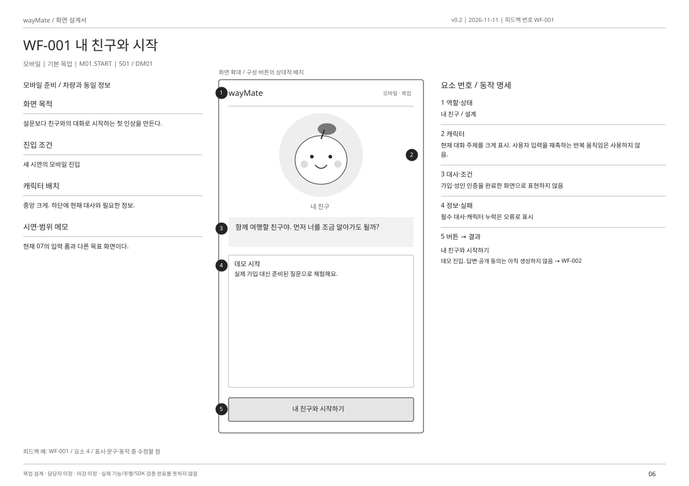

범위 B · M01.START · S01 · DM01 · 담당자 미정 · 마감 미정

**목적:** 설문보다 친구와의 대화로 시작하는 첫 인상을 만든다.

**진입:** 새 시연의 모바일 진입

**조건:** 가입·성인 인증을 완료한 화면으로 표현하지 않음

**실패·분기:** 필수 대사·캐릭터 누락은 오류로 표시

| 버튼 | 동작·조건 | 다음 번호 |
|---|---|---|
| 내 친구와 시작하기 | 데모 진입. 답변·공개 동의는 아직 생성하지 않음 | WF-002 |

**메모:** 현재 07의 입력 폼과 다른 목표 화면이다.

### WF-002. 에이전트와 자유 입력 온보딩

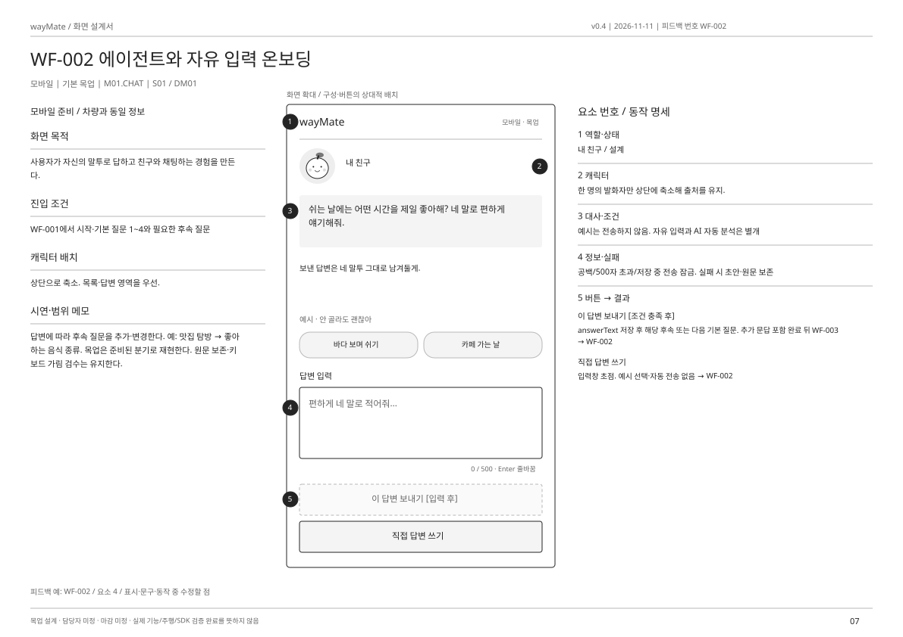

범위 B · M01.CHAT · S01 · DM01 · 담당자 미정 · 마감 미정

**목적:** 사용자가 자신의 말투로 답하고 친구와 채팅하는 경험을 만든다.

**진입:** WF-001에서 시작·기본 질문 1~4와 필요한 후속 질문

**조건:** 예시는 전송하지 않음. 자유 입력과 AI 자동 분석은 별개

**실패·분기:** 공백/500자 초과/저장 중 전송 잠금. 실패 시 초안·원문 보존

| 버튼 | 동작·조건 | 다음 번호 |
|---|---|---|
| 이 답변 보내기 (조건 충족 후) | answerText 저장 후 해당 후속 또는 다음 기본 질문. 추가 문답 포함 완료 뒤 WF-003 | WF-002 |
| 직접 답변 쓰기 | 입력창 초점. 예시 선택·자동 전송 없음 | WF-002 |

**메모:** 답변에 따라 후속 질문을 추가·변경한다. 예: 맛집 탐방 → 좋아하는 음식 종류. 목업은 준비된 분기로 재현한다. 원문 보존·키보드 가림 검수는 유지한다.

### WF-003. 내 답변과 소개값을 따로 확인

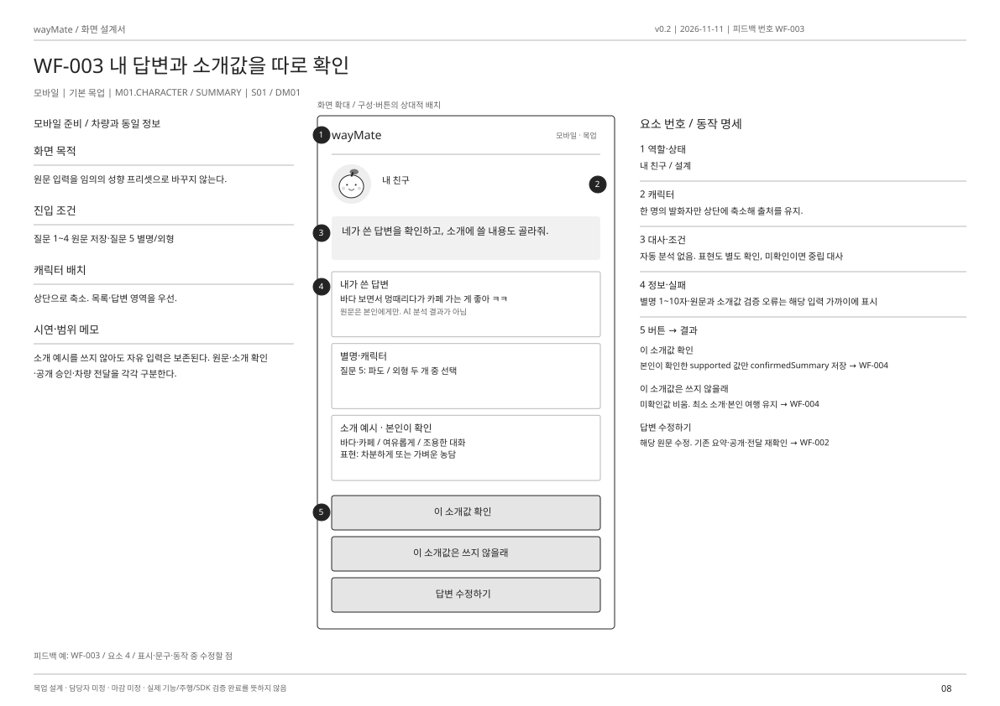

범위 B · M01.CHARACTER / SUMMARY · S01 · DM01 · 담당자 미정 · 마감 미정

**목적:** 원문 입력을 임의의 성향 프리셋으로 바꾸지 않는다.

**진입:** 기본·해당 추가 문답 원문 저장·별명/외형 확인

**조건:** 자동 분석 없음. 표현도 별도 확인, 미확인이면 중립 대사

**실패·분기:** 별명 1~10자·원문과 소개값 검증 오류는 해당 입력 가까이에 표시

| 버튼 | 동작·조건 | 다음 번호 |
|---|---|---|
| 이 소개값 확인 | 본인이 확인한 supported 값만 confirmedSummary 저장 | WF-004 |
| 이 소개값은 쓰지 않을래 | 미확인값 비움. 최소 소개·본인 여행 유지 | WF-004 |
| 답변 수정하기 | 해당 원문 수정. 기존 요약·공개·전달 재확인 | WF-002 |

**메모:** 소개 예시를 쓰지 않아도 자유 입력은 보존된다. 원문·소개 확인·공개 승인·차량 전달을 각각 구분한다.

### WF-004. 공개 소개 미리보기

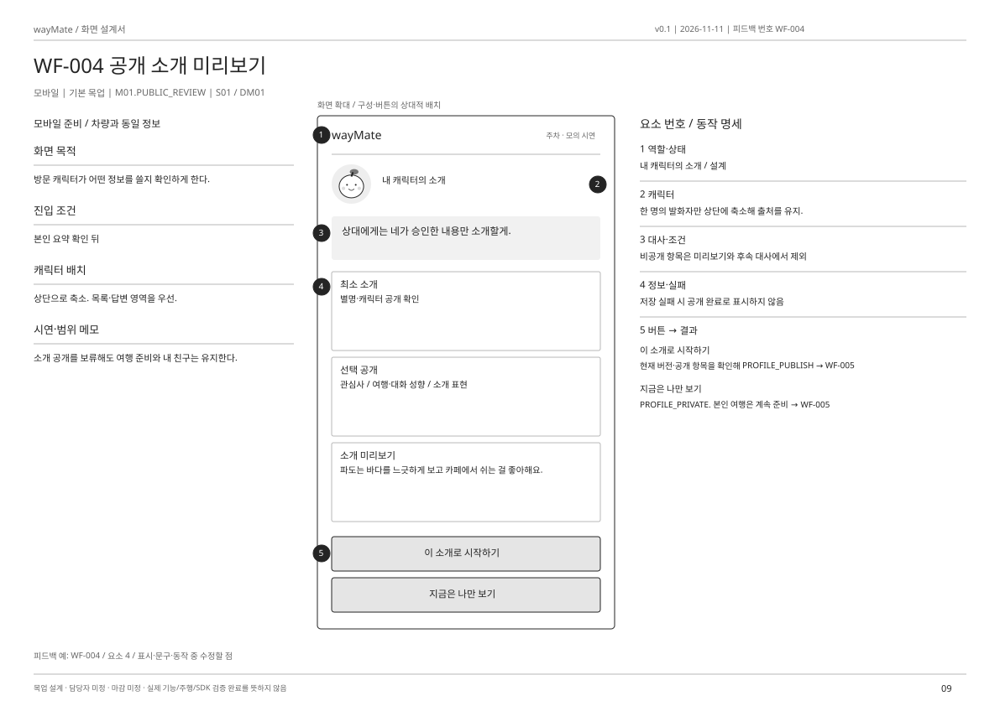

범위 B · M01.PUBLIC_REVIEW · S01 · DM01 · 담당자 미정 · 마감 미정

**목적:** 방문 캐릭터가 어떤 정보를 쓸지 확인하게 한다.

**진입:** 본인 요약 확인 뒤

**조건:** 비공개 항목은 미리보기와 후속 대사에서 제외

**실패·분기:** 저장 실패 시 공개 완료로 표시하지 않음

| 버튼 | 동작·조건 | 다음 번호 |
|---|---|---|
| 이 소개로 시작하기 | 현재 버전·공개 항목을 확인해 PROFILE_PUBLISH | WF-005 |
| 지금은 나만 보기 | PROFILE_PRIVATE. 본인 여행은 계속 준비 | WF-005 |

**메모:** 소개 공개를 보류해도 여행 준비와 내 친구는 유지한다.

### WF-005. 대화로 여행 계획 확인

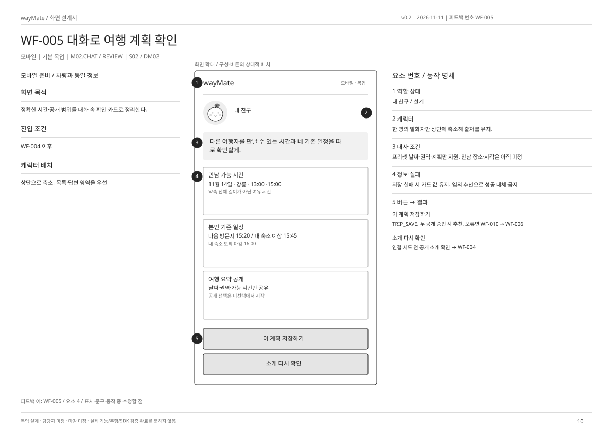

범위 B · M02.CHAT / REVIEW · S02 · DM02 · 담당자 미정 · 마감 미정

**목적:** 정확한 시간·공개 범위를 대화 속 확인 카드로 정리한다.

**진입:** WF-004 이후

**조건:** 프리셋 날짜·권역·계획만 지원. 만남 장소·시각은 아직 미정

**실패·분기:** 저장 실패 시 카드 값 유지. 임의 추천으로 성공 대체 금지

| 버튼 | 동작·조건 | 다음 번호 |
|---|---|---|
| 이 계획 저장하기 | TRIP_SAVE. 두 공개 승인 시 추천, 보류면 WF-010 | WF-006 |
| 소개 다시 확인 | 연결 시도 전 공개 소개 확인 | WF-004 |

### WF-006. 내 친구가 후보를 먼저 제안

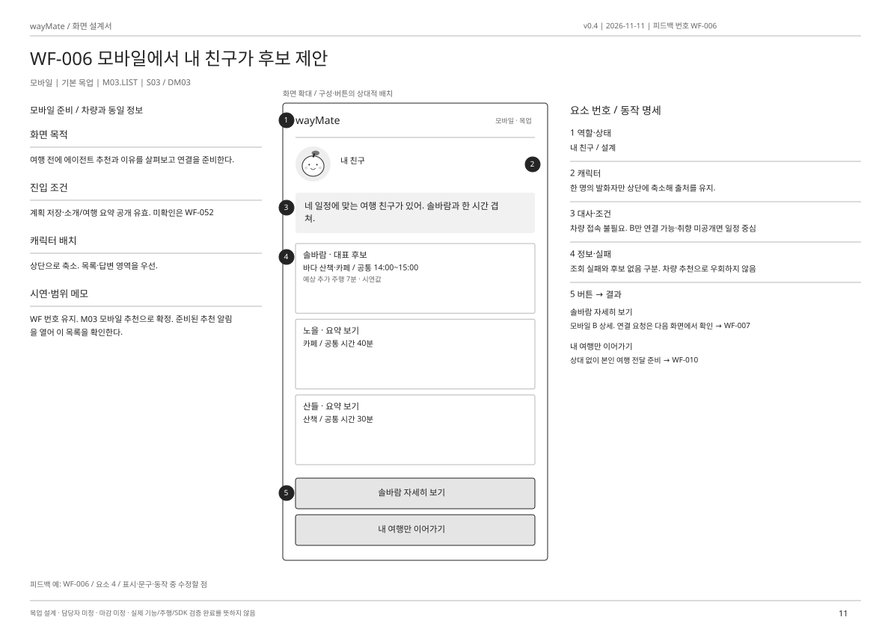

범위 B · M03.LIST · S03 · DM03 · 담당자 미정 · 마감 미정

**목적:** 검색 실행보다 에이전트의 조건·이유가 먼저 보이게 한다.

**진입:** 소개·여행 요약 공개와 계획 저장이 유효

**조건:** B만 연결 가능. 취향 미공개면 일정 중심 설명으로 대체

**실패·분기:** 조회 실패는 로딩 오류로 표시. 후보가 없다고 바꾸지 않음

| 버튼 | 동작·조건 | 다음 번호 |
|---|---|---|
| 솔바람 자세히 보기 | B 상세 열기. 요청은 다음 화면에서 확인 | WF-007 |
| 내 여행만 이어가기 | 연결 없이 본인 여행 보기 | WF-010 |

### WF-007. 상대 소개·연결 요청

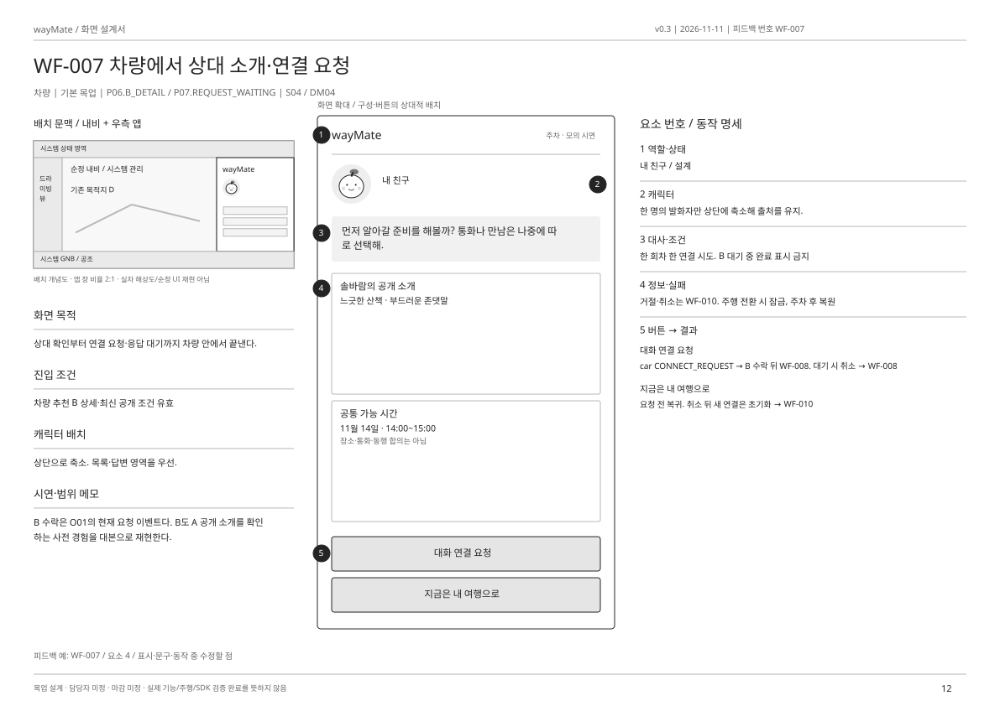

범위 B · M03.B_DETAIL / M04.REQUEST_WAITING · S04 · DM04 · 담당자 미정 · 마감 미정

**목적:** 대화 연결의 의미와 실제 만남 합의를 구분한다.

**진입:** 추천의 B 상세 선택

**조건:** 한 회차 한 연결 시도. B 대기 중 완료 표시 금지

**실패·분기:** 거절·취소는 WF-010. 늦은 수락으로 연결 부활 금지

| 버튼 | 동작·조건 | 다음 번호 |
|---|---|---|
| 대화 연결 요청 | CONNECT_REQUEST → B 수락 뒤 WF-008. 대기 중 요청 취소 가능 | WF-008 |
| 지금은 내 여행으로 | 요청 전 돌아가기 | WF-010 |

**메모:** 요청 후에는 이 영역을 응답 대기로 바꾸고 취소 버튼만 유지한다.

### WF-008. 공통 시간 재확인

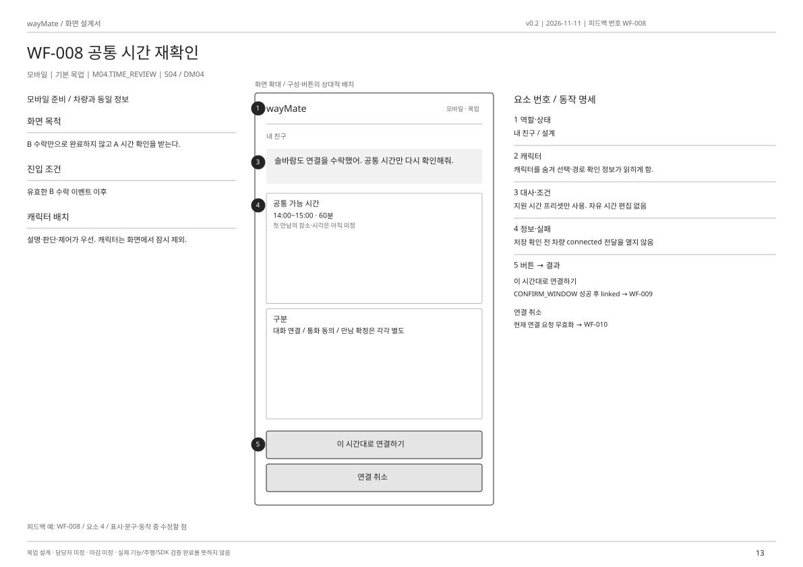

범위 B · M04.TIME_REVIEW · S04 · DM04 · 담당자 미정 · 마감 미정

**목적:** B 수락만으로 완료하지 않고 A 시간 확인을 받는다.

**진입:** 유효한 B 수락 이벤트 이후

**조건:** 지원 시간 프리셋만 사용. 자유 시간 편집 없음

**실패·분기:** 저장 확인 전 차량 connected 전달을 열지 않음

| 버튼 | 동작·조건 | 다음 번호 |
|---|---|---|
| 이 시간대로 연결하기 | CONFIRM_WINDOW 성공 후 linked | WF-009 |
| 연결 취소 | 현재 연결 요청 무효화 | WF-010 |

### WF-009. 모바일에서 차량으로 이어주기

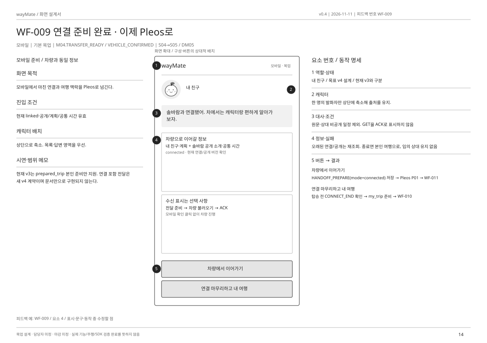

범위 B · M04.TRANSFER_READY / VEHICLE_CONFIRMED · S05 · DM05 · 담당자 미정 · 마감 미정

**목적:** 데이터 연결과 사용자 관계의 연속성을 표현한다.

**진입:** connected 또는 유효한 my_trip 준비

**조건:** 웹 GET·애니메이션으로 ACK 성공을 대신하지 않음

**실패·분기:** 실패·오래된 전달본은 재준비 안내

| 버튼 | 동작·조건 | 다음 번호 |
|---|---|---|
| 차량에서 이어가기 | HANDOFF_PREPARE. 차량 ACK 뒤에만 수신 확인 | WF-011 |
| 내 여행 확인 | 본인 일정 조회 | WF-010 |

**메모:** 07의 현재 구현은 my_trip만 지원한다. connected는 목표 화면이다.

### WF-010. 상대 없이도 내 친구와 여행

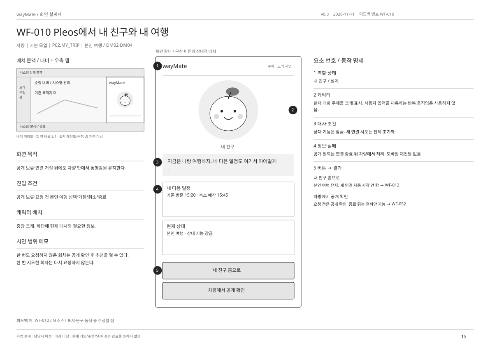

범위 B · M02.MY_TRIP · 본인 여행 · DM02·DM04 · 담당자 미정 · 마감 미정

**목적:** 내 친구가 매칭 실패 뒤에만 생기는 보상이 아님을 보여준다.

**진입:** 공개 보류·요청 거절·연결 종료

**조건:** 상대 기능은 잠그되 본인 요약·일정은 유지

**실패·분기:** 종료 후 공개 철회는 별도 제공. 새 연결 자동 재시작 없음

| 버튼 | 동작·조건 | 다음 번호 |
|---|---|---|
| 차량에서 내 여행 이어가기 | my_trip HANDOFF_PREPARE | WF-011 |
| 소개 공개 확인 | 연결 시도 전만 가능. 종료 후 새 연결은 전체 초기화 | WF-004 |

### WF-011. 차량에서 내 여행 불러오기

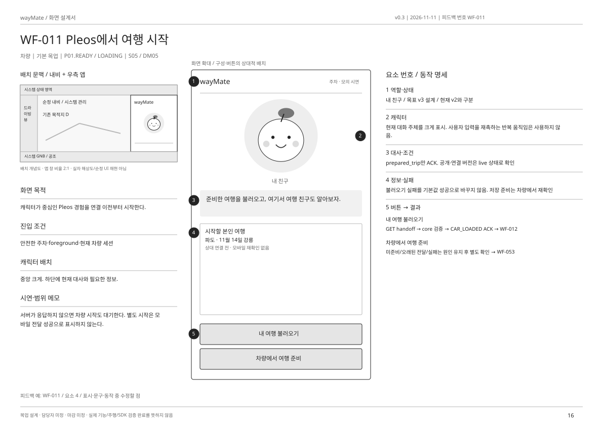

범위 B · P01.READY / LOADING · S05 · DM05 · 담당자 미정 · 마감 미정

**목적:** 큰 캐릭터를 차량 첫 접점으로 두고 전환을 단순화한다.

**진입:** 실제 제한 없음·foreground·전달 준비 유효

**조건:** 주차 상태에서 시작. my_trip은 peer=null

**실패·분기:** 미준비·서버 실패·오래된 전달본은 현재 화면에서 안내

| 버튼 | 동작·조건 | 다음 번호 |
|---|---|---|
| 내 여행 불러오기 | GET handoff → 버전 검증 → CAR_LOADED ACK | WF-012 |
| 다시 확인 | 실패 시 조회 재시도. 명령 자동 반복 없음 | WF-011 |

### WF-012. 기본 홈 · 큰 내 친구

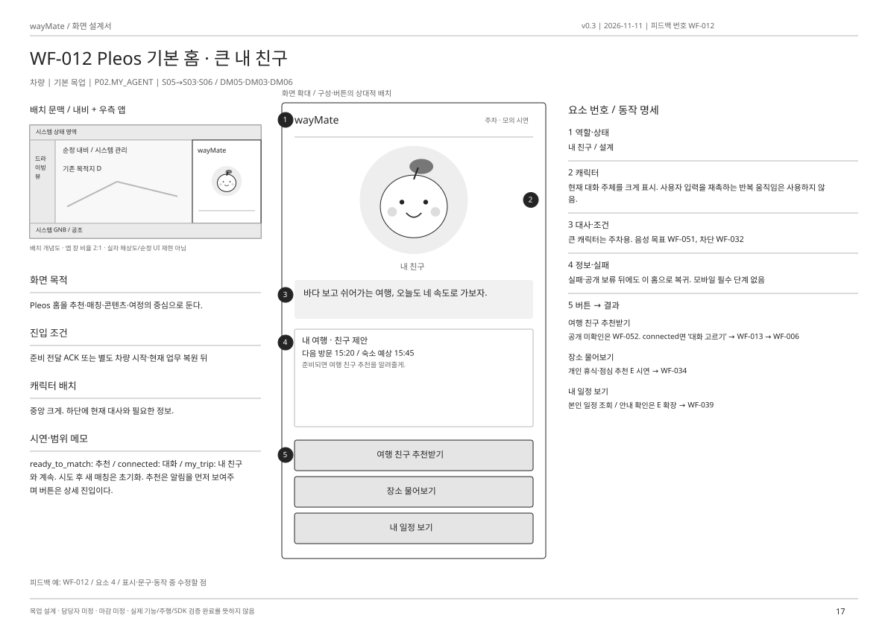

범위 B · P02.MY_AGENT · S05·S06 · DM05·DM06 · 담당자 미정 · 마감 미정

**목적:** 캐릭터가 주인공인 기본 화면과 하단 정보를 확립한다.

**진입:** 정상 전달·현재 상태 복원 후

**조건:** 큰 캐릭터는 주차 화면. 검증된 주행 음성은 WF-051, 차단/미확인은 WF-032

**실패·분기:** 복귀 시 음성·사용자 명령 자동 실행 금지

| 버튼 | 동작·조건 | 다음 번호 |
|---|---|---|
| 대화 고르기 | 연결이 유효하면 콘텐츠 목록. my_trip에는 상대 항목 없음 | WF-013 |
| 장소 물어보기 | 이번 요청 확장 시연 E로 이동 | WF-034 |
| 내 일정 보기 | 읽기 전용 일정 카드 / E 일정 반영 확인 | WF-039 |

**메모:** 배치는 우측 앱 창 안에서만 중앙 정렬한다. 중앙 내비를 가리지 않는다.

### WF-013. 콘텐츠 선택 · 캐릭터 상단 축소

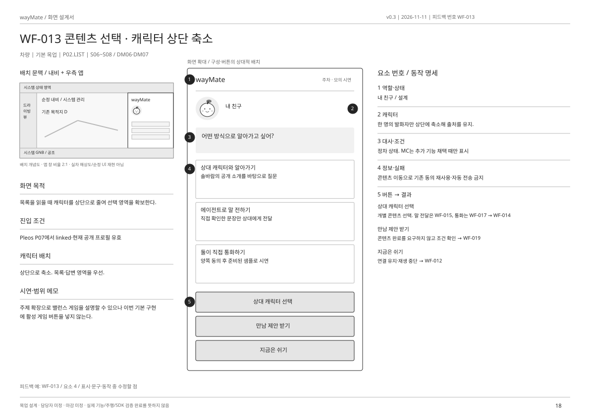

범위 B · P02.LIST · S06~S08 · DM06·DM07 · 담당자 미정 · 마감 미정

**목적:** 목록을 읽을 때 캐릭터를 상단으로 줄여 선택 영역을 확보한다.

**진입:** B linked·현재 공개 프로필 유효

**조건:** 정차 상태. MC는 추가 기능 채택 때만 표시

**실패·분기:** 콘텐츠 이동으로 기존 동의 재사용·자동 전송 금지

| 버튼 | 동작·조건 | 다음 번호 |
|---|---|---|
| 상대 캐릭터 선택 | 개별 콘텐츠 선택. 말 전달은 WF-015, 통화는 WF-017 | WF-014 |
| 만남 제안 받기 | 콘텐츠 완료를 요구하지 않고 조건 확인 | WF-019 |
| 지금은 쉬기 | 연결 유지·재생 중단 | WF-012 |

**메모:** 주제 확장으로 밸런스 게임을 설명할 수 있으나 이번 기본 구현에 활성 게임 버튼을 넣지 않는다.

### WF-014. 상대의 캐릭터와 대화

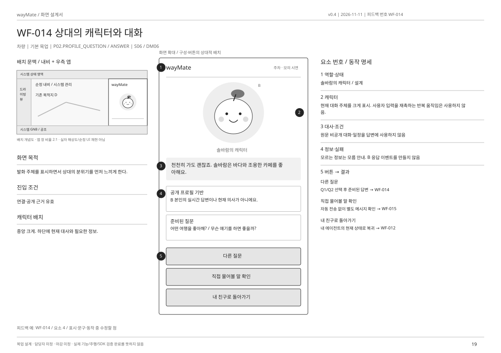

범위 B · P02.PROFILE_QUESTION / ANSWER · S06 · DM06 · 담당자 미정 · 마감 미정

**목적:** 발화 주체를 표시하면서 상대의 분위기를 먼저 느끼게 한다.

**진입:** 연결·공개 근거 유효

**조건:** 원문 비공개 대화·일정을 답변에 사용하지 않음

**실패·분기:** 모르는 정보는 모름 안내. B 응답 이벤트를 만들지 않음

| 버튼 | 동작·조건 | 다음 번호 |
|---|---|---|
| 다른 질문 | Q1/Q2 선택 후 준비된 답변 | WF-014 |
| 직접 물어볼 말 확인 | 자동 전송 없이 별도 메시지 확인 | WF-015 |
| 내 친구로 돌아가기 | 내 에이전트의 현재 상태로 복귀 | WF-012 |

### WF-015. 상대에게 전할 말 확인

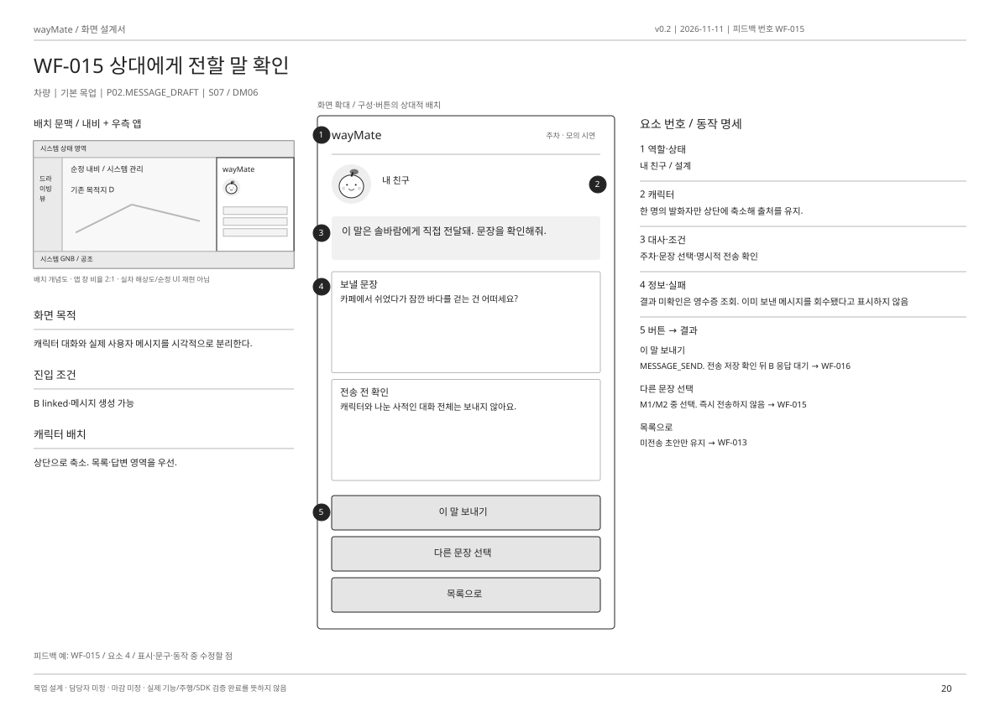

범위 B · P02.MESSAGE_DRAFT · S07 · DM06 · 담당자 미정 · 마감 미정

**목적:** 캐릭터 대화와 실제 사용자 메시지를 시각적으로 분리한다.

**진입:** B linked·메시지 생성 가능

**조건:** 주차·문장 선택·명시적 전송 확인

**실패·분기:** 결과 미확인은 영수증 조회. 이미 보낸 메시지를 회수됐다고 표시하지 않음

| 버튼 | 동작·조건 | 다음 번호 |
|---|---|---|
| 이 말 보내기 | MESSAGE_SEND. 전송 저장 확인 뒤 B 응답 대기 | WF-016 |
| 다른 문장 선택 | M1/M2 중 선택. 즉시 전송하지 않음 | WF-015 |
| 목록으로 | 미전송 초안만 유지 | WF-013 |

### WF-016. 답장·후속 질문 확인

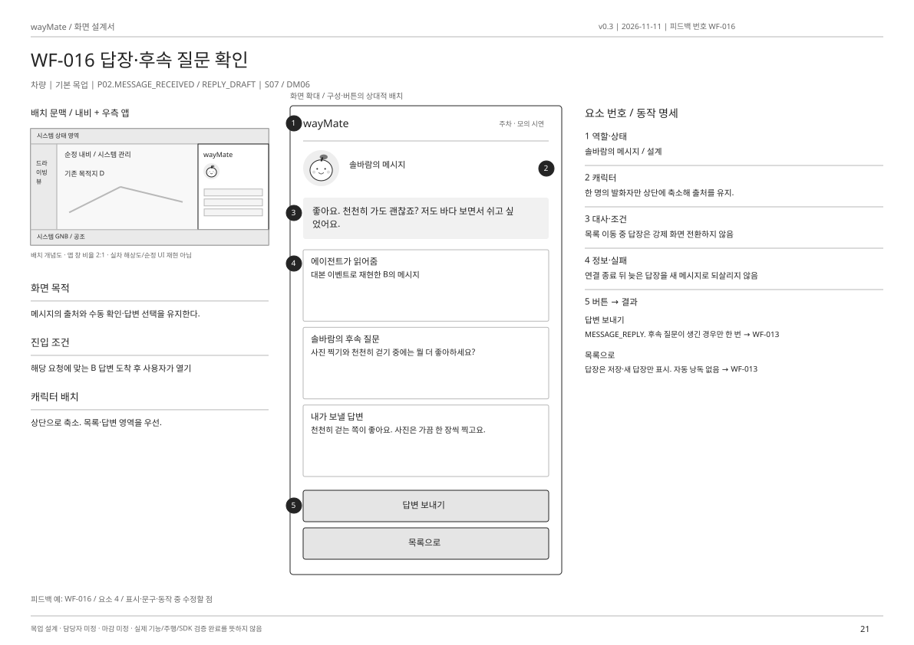

범위 B · P02.MESSAGE_RECEIVED / REPLY_DRAFT · S07 · DM06 · 담당자 미정 · 마감 미정

**목적:** 메시지의 출처와 수동 확인·답변 선택을 유지한다.

**진입:** 해당 요청에 맞는 B 답변 도착 후 사용자가 열기

**조건:** 목록 이동 중 답장은 강제 화면 전환하지 않음

**실패·분기:** 연결 종료 뒤 늦은 답장을 새 메시지로 되살리지 않음

| 버튼 | 동작·조건 | 다음 번호 |
|---|---|---|
| 답변 보내기 | MESSAGE_REPLY. 후속 질문이 생긴 경우만 한 번 | WF-013 |
| 목록으로 | 답장은 저장·새 답장만 표시. 자동 낭독 없음 | WF-013 |

### WF-017. 직접 통화 제안·동의 대기

범위 B · P02.CALL_READY / WAITING · S08 · DM07 · 담당자 미정 · 마감 미정

**목적:** 통화 선택과 기존 연결·만남 동의를 분리한다.

**진입:** linked·다른 통화 요청 없음

**조건:** 정차 상태에서 양쪽 동의

**실패·분기:** 거절·취소·늦은 동의로 재생 자동 시작 금지

| 버튼 | 동작·조건 | 다음 번호 |
|---|---|---|
| 통화 제안하기 | CALL_PROPOSE. B 동의 전 재생 금지 | WF-018 |
| 제안 취소·건너뛰기 | 통화만 생략하고 연결 유지 | WF-013 |

### WF-018. 통화 샘플 · 발화자와 중단

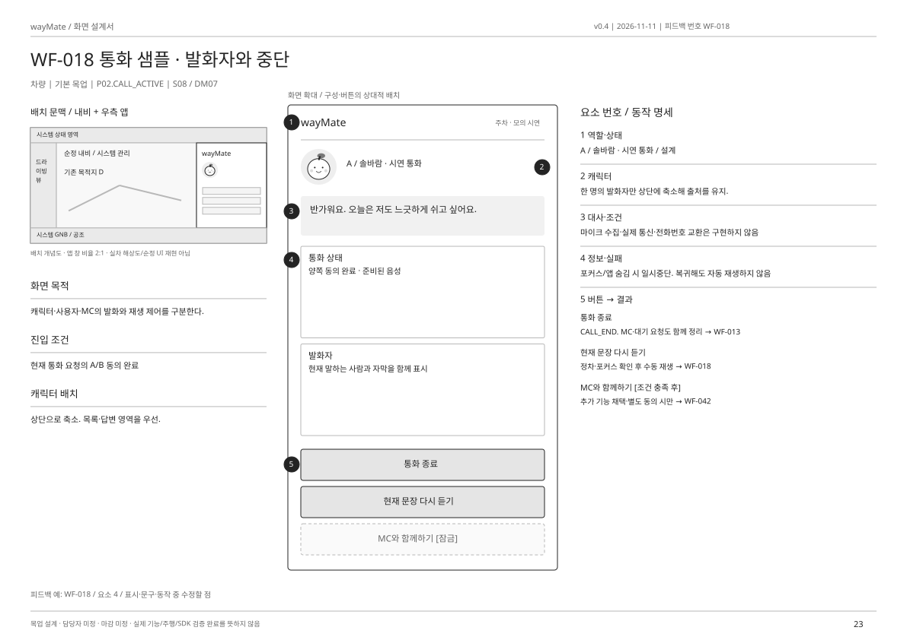

범위 B · P02.CALL_ACTIVE · S08 · DM07 · 담당자 미정 · 마감 미정

**목적:** 캐릭터·사용자·MC의 발화와 재생 제어를 구분한다.

**진입:** 현재 통화 요청의 A/B 동의 완료

**조건:** 마이크 수집·실제 통신·전화번호 교환은 구현하지 않음

**실패·분기:** 포커스/앱 숨김 시 일시중단. 복귀해도 자동 재생하지 않음

| 버튼 | 동작·조건 | 다음 번호 |
|---|---|---|
| 통화 종료 | CALL_END. MC·대기 요청도 함께 정리 | WF-013 |
| 현재 문장 다시 듣기 | 정차·포커스 확인 후 수동 재생 | WF-018 |
| MC와 함께하기 (조건 충족 후) | 추가 기능 채택·별도 동의 시만 | WF-042 |

### WF-019. 만남 제안 · 일정과 전체 부담

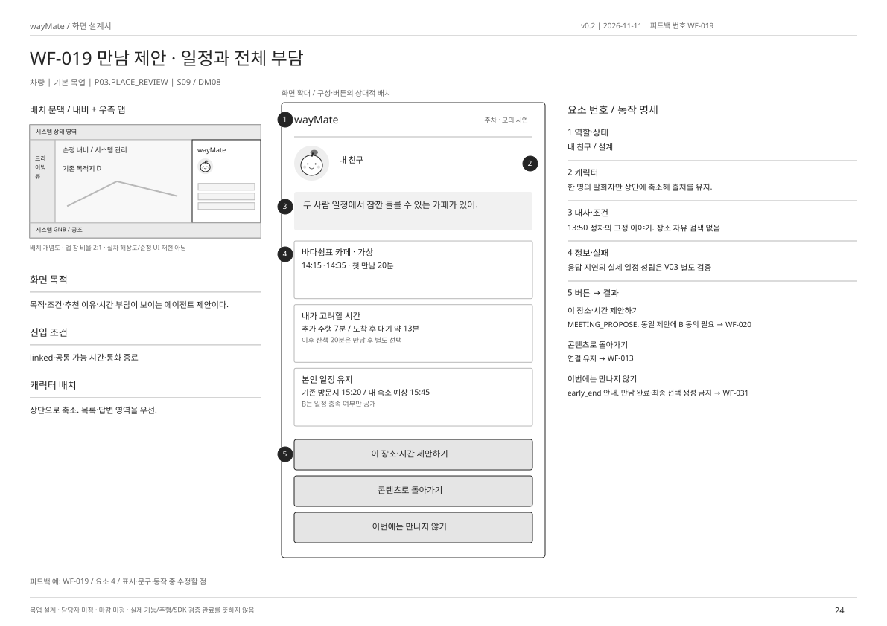

범위 B · P03.PLACE_REVIEW · S09 · DM08 · 담당자 미정 · 마감 미정

**목적:** 목적·조건·추천 이유·시간 부담이 보이는 에이전트 제안이다.

**진입:** linked·공통 가능 시간·통화 종료

**조건:** 13:50 정차의 고정 이야기. 장소 자유 검색 없음

**실패·분기:** 응답 지연의 실제 일정 성립은 V03 별도 검증

| 버튼 | 동작·조건 | 다음 번호 |
|---|---|---|
| 이 장소·시간 제안하기 | MEETING_PROPOSE. 동일 제안에 B 동의 필요 | WF-020 |
| 콘텐츠로 돌아가기 | 연결 유지 | WF-013 |
| 이번에는 만나지 않기 | early_end 안내. 만남 완료·최종 선택 생성 금지 | WF-031 |

### WF-020. 같은 약속에 대한 상대 응답 대기

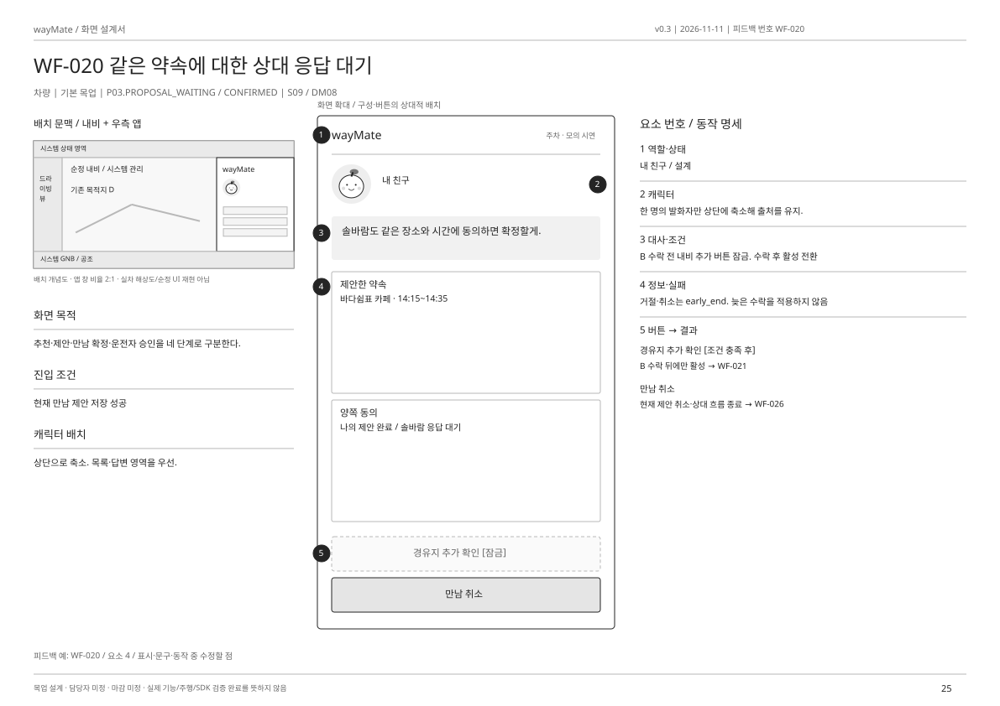

범위 B · P03.PROPOSAL_WAITING / CONFIRMED · S09 · DM08 · 담당자 미정 · 마감 미정

**목적:** 추천·제안·만남 확정·운전자 승인을 네 단계로 구분한다.

**진입:** 현재 만남 제안 저장 성공

**조건:** B 수락 전 내비 추가 버튼 잠금. 수락 후 활성 전환

**실패·분기:** 거절·취소는 early_end. 늦은 수락을 적용하지 않음

| 버튼 | 동작·조건 | 다음 번호 |
|---|---|---|
| 경유지 추가 확인 (조건 충족 후) | B 수락 뒤에만 활성 | WF-021 |
| 만남 취소 | 현재 제안 취소·상대 흐름 종료 | WF-026 |

### WF-021. 만남 카페 경유지 추가 승인

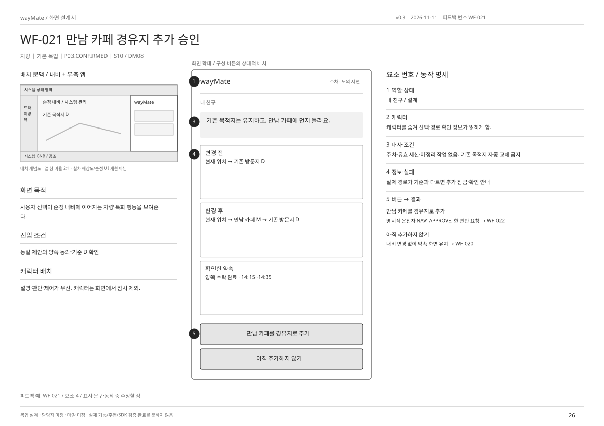

범위 B · P03.CONFIRMED · S10 · DM08 · 담당자 미정 · 마감 미정

**목적:** 사용자 선택이 순정 내비에 이어지는 차량 특화 행동을 보여준다.

**진입:** 동일 제안의 양쪽 동의·기준 D 확인

**조건:** 주차·유효 세션·미정리 작업 없음. 기존 목적지 자동 교체 금지

**실패·분기:** 실제 경로가 기준과 다르면 추가 잠금·확인 안내

| 버튼 | 동작·조건 | 다음 번호 |
|---|---|---|
| 만남 카페를 경유지로 추가 | 명시적 운전자 NAV_APPROVE. 한 번만 요청 | WF-022 |
| 아직 추가하지 않기 | 내비 변경 없이 약속 화면 유지 | WF-020 |

### WF-022. 내비 요청 중 · 지도는 아직 유지

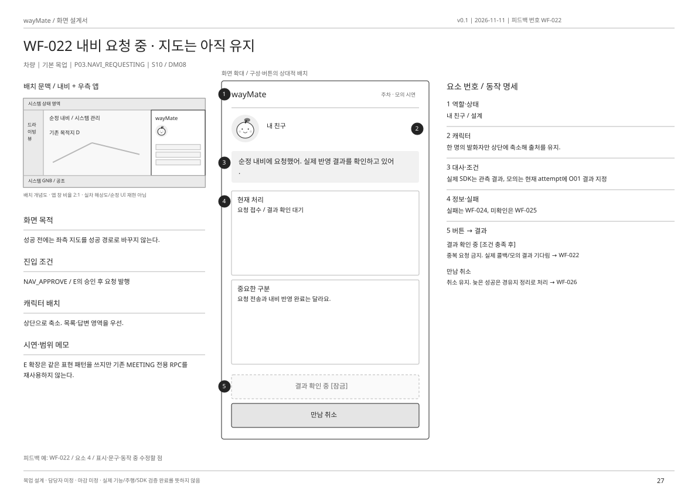

범위 B · P03.NAVI_REQUESTING · S10 · DM08 · 담당자 미정 · 마감 미정

**목적:** 성공 전에는 좌측 지도를 성공 경로로 바꾸지 않는다.

**진입:** NAV_APPROVE / E의 승인 후 요청 발행

**조건:** 실제 SDK는 관측 결과, 모의는 현재 attempt에 O01 결과 지정

**실패·분기:** 실패는 WF-024, 미확인은 WF-025

| 버튼 | 동작·조건 | 다음 번호 |
|---|---|---|
| 결과 확인 중 (조건 충족 후) | 중복 요청 금지. 실제 콜백/모의 결과 기다림 | WF-022 |
| 만남 취소 | 취소 유지. 늦은 성공은 경유지 정리로 처리 | WF-026 |

**메모:** E 확장은 같은 표현 패턴을 쓰지만 기존 MEETING 전용 RPC를 재사용하지 않는다.

### WF-023. 내비 반영 확인 · 캐릭터로 복귀

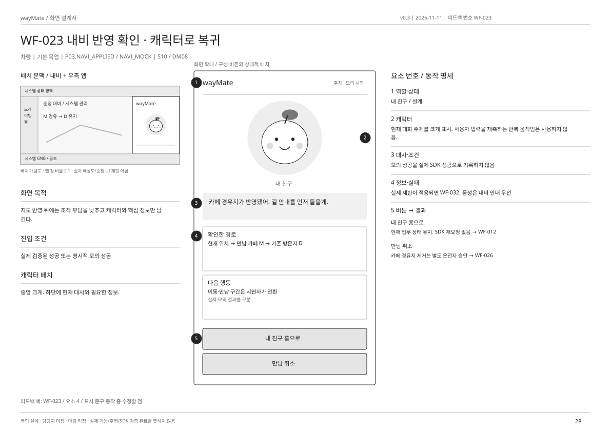

범위 B · P03.NAVI_APPLIED / NAVI_MOCK · S10 · DM08 · 담당자 미정 · 마감 미정

**목적:** 지도 반영 뒤에는 조작 부담을 낮추고 캐릭터와 핵심 정보만 남긴다.

**진입:** 실제 검증된 성공 또는 명시적 모의 성공

**조건:** 모의 성공을 실제 SDK 성공으로 기록하지 않음

**실패·분기:** 실제 제한이 적용되면 WF-032. 음성은 내비 안내 우선

| 버튼 | 동작·조건 | 다음 번호 |
|---|---|---|
| 내 친구 홈으로 | 현재 업무 상태 유지. SDK 재요청 없음 | WF-012 |
| 만남 취소 | 카페 경유지 제거는 별도 운전자 승인 | WF-026 |

### WF-024. 명시적 내비 실패 · 재확인

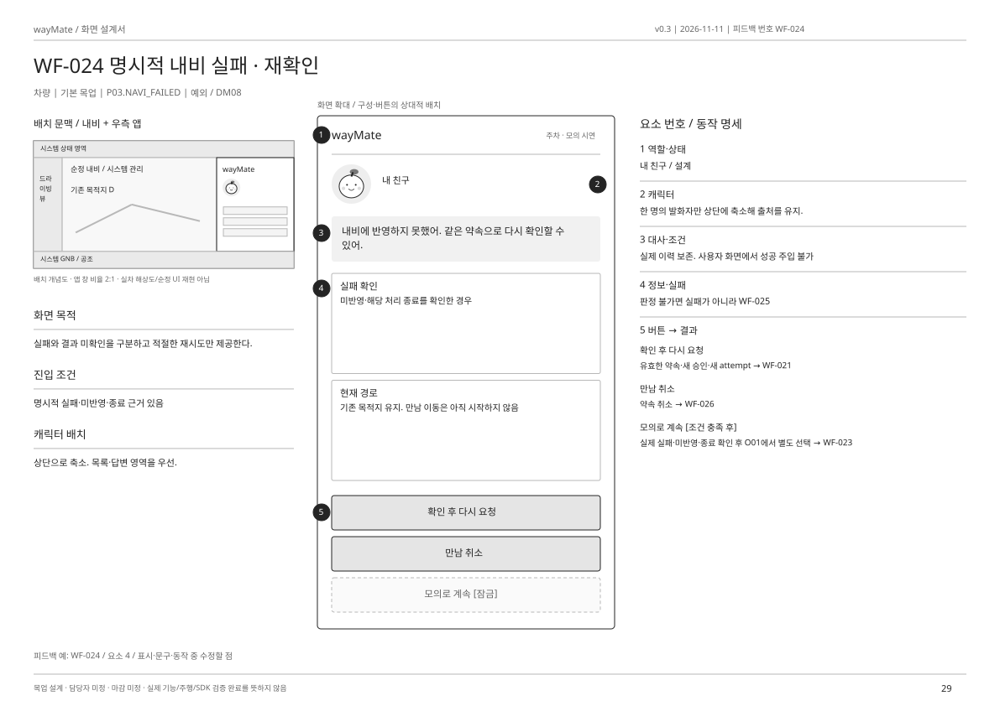

범위 B · P03.NAVI_FAILED · 예외 · DM08 · 담당자 미정 · 마감 미정

**목적:** 실패와 결과 미확인을 구분하고 적절한 재시도만 제공한다.

**진입:** 명시적 실패·미반영·종료 근거 있음

**조건:** 실제 이력 보존. 사용자 화면에서 성공 주입 불가

**실패·분기:** 판정 불가면 실패가 아니라 WF-025

| 버튼 | 동작·조건 | 다음 번호 |
|---|---|---|
| 확인 후 다시 요청 | 유효한 약속·새 승인·새 attempt | WF-021 |
| 만남 취소 | 약속 취소 | WF-026 |
| 모의로 계속 (조건 충족 후) | 실제 실패·미반영·종료 확인 후 O01에서 별도 선택 | WF-023 |

### WF-025. 결과 미확인 · 중복 요청 잠금

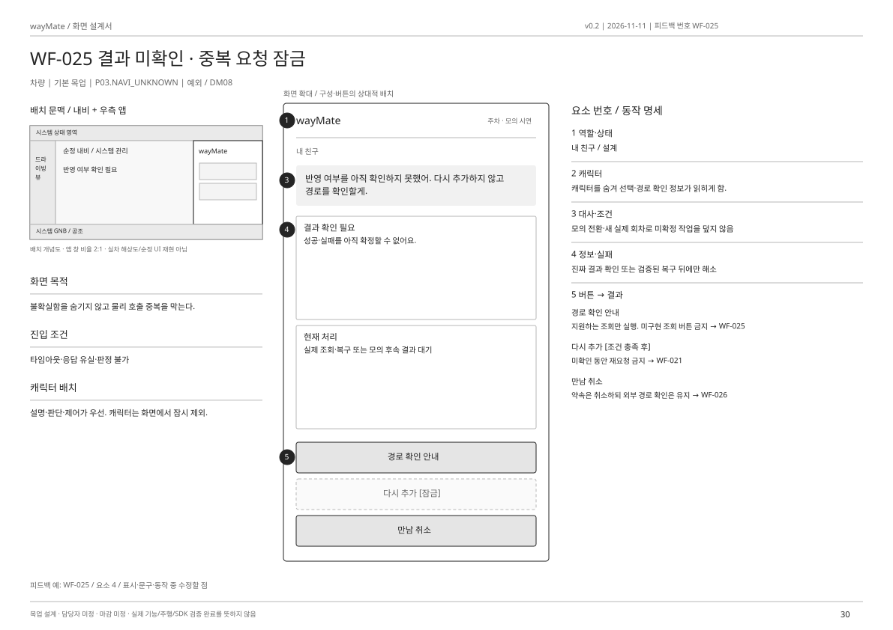

범위 B · P03.NAVI_UNKNOWN · 예외 · DM08 · 담당자 미정 · 마감 미정

**목적:** 불확실함을 숨기지 않고 물리 호출 중복을 막는다.

**진입:** 타임아웃·응답 유실·판정 불가

**조건:** 모의 전환·새 실제 회차로 미확정 작업을 덮지 않음

**실패·분기:** 진짜 결과 확인 또는 검증된 복구 뒤에만 해소

| 버튼 | 동작·조건 | 다음 번호 |
|---|---|---|
| 경로 확인 안내 | 지원하는 조회만 실행. 미구현 조회 버튼 금지 | WF-025 |
| 다시 추가 (조건 충족 후) | 미확인 동안 재요청 금지 | WF-021 |
| 만남 취소 | 약속은 취소하되 외부 경로 확인은 유지 | WF-026 |

### WF-026. 약속 취소와 경유지 제거

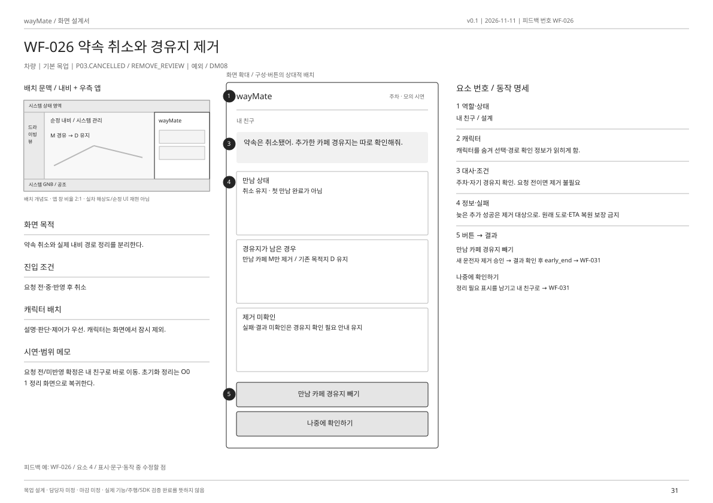

범위 B · P03.CANCELLED / REMOVE_REVIEW · 예외 · DM08 · 담당자 미정 · 마감 미정

**목적:** 약속 취소와 실제 내비 경로 정리를 분리한다.

**진입:** 요청 전·중·반영 후 취소

**조건:** 주차·자기 경유지 확인. 요청 전이면 제거 불필요

**실패·분기:** 늦은 추가 성공은 제거 대상으로. 원래 도로·ETA 복원 보장 금지

| 버튼 | 동작·조건 | 다음 번호 |
|---|---|---|
| 만남 카페 경유지 빼기 | 새 운전자 제거 승인 → 결과 확인 후 early_end | WF-031 |
| 나중에 확인하기 | 정리 필요 표시를 남기고 내 친구로 | WF-031 |

**메모:** 요청 전/미반영 확정은 내 친구로 바로 이동. 초기화 정리는 O01 정리 화면으로 복귀한다.

### WF-027. 첫 만남 재연

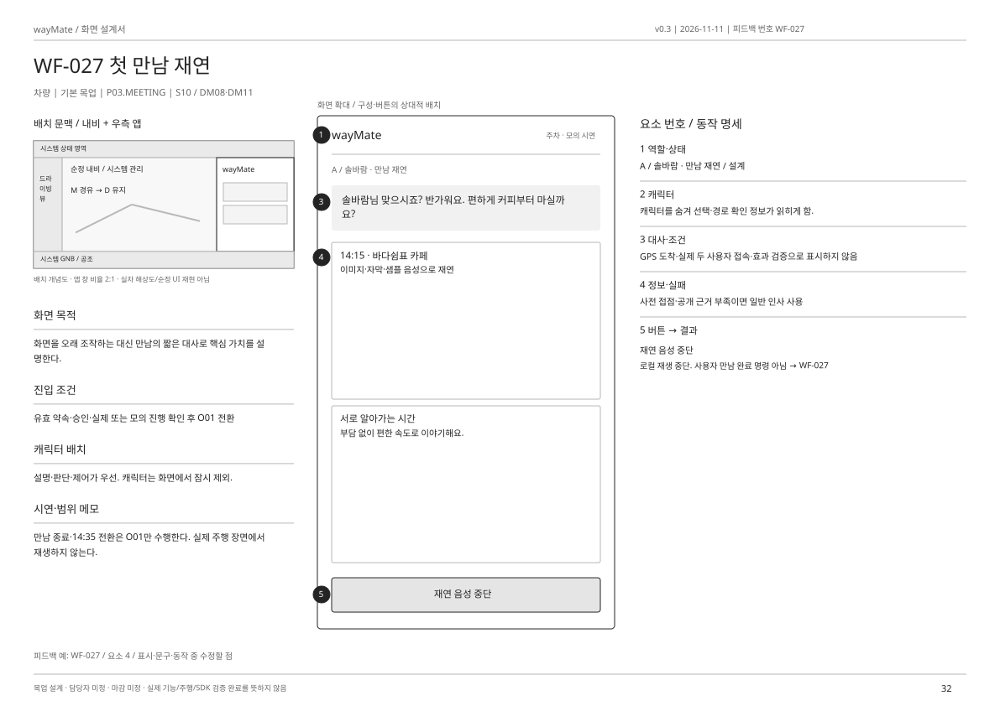

범위 B · P03.MEETING · S10 · DM08·DM11 · 담당자 미정 · 마감 미정

**목적:** 화면을 오래 조작하는 대신 만남의 짧은 대사로 핵심 가치를 설명한다.

**진입:** 유효 약속·승인·실제 또는 모의 진행 확인 후 O01 전환

**조건:** GPS 도착·실제 두 사용자 접속·효과 검증으로 표시하지 않음

**실패·분기:** 사전 접점·공개 근거 부족이면 일반 인사 사용

| 버튼 | 동작·조건 | 다음 번호 |
|---|---|---|
| 재연 음성 중단 | 로컬 재생 중단. 사용자 만남 완료 명령 아님 | WF-027 |

**메모:** 만남 종료·14:35 전환은 O01만 수행한다. 실제 주행 장면에서 재생하지 않는다.

### WF-028. 만남 뒤 두 가지 여행 선택

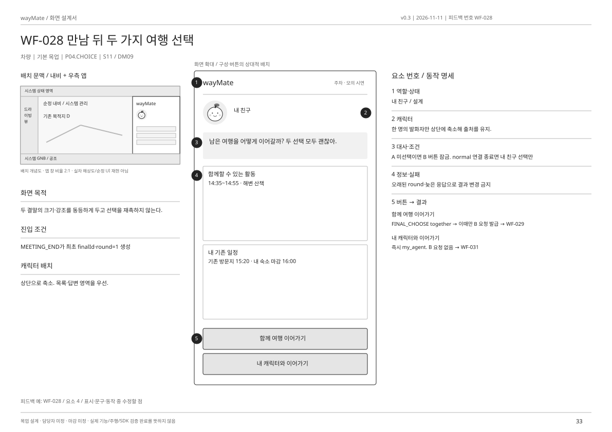

범위 B · P04.CHOICE · S11 · DM09 · 담당자 미정 · 마감 미정

**목적:** 두 결말의 크기·강조를 동등하게 두고 선택을 재촉하지 않는다.

**진입:** MEETING_END가 최초 finalId·round=1 생성

**조건:** A 미선택이면 B 버튼 잠금. normal 연결 종료면 내 친구 선택만

**실패·분기:** 오래된 round·늦은 응답으로 결과 변경 금지

| 버튼 | 동작·조건 | 다음 번호 |
|---|---|---|
| 함께 여행 이어가기 | FINAL_CHOOSE together → 이때만 B 요청 발급 | WF-029 |
| 내 캐릭터와 이어가기 | 즉시 my_agent. B 요청 없음 | WF-031 |

### WF-029. 함께할지 상대 선택 기다리기

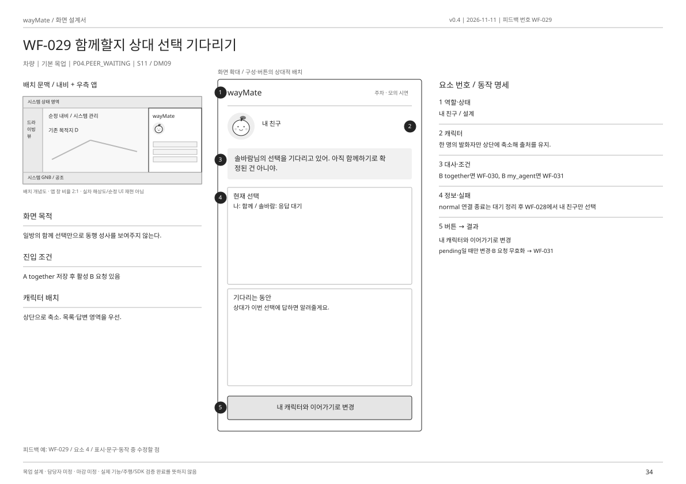

범위 B · P04.PEER_WAITING · S11 · DM09 · 담당자 미정 · 마감 미정

**목적:** 일방의 함께 선택만으로 동행 성사를 보여주지 않는다.

**진입:** A together 저장 후 활성 B 요청 있음

**조건:** B together면 WF-030, B my_agent면 WF-031

**실패·분기:** normal 연결 종료는 대기 정리 후 WF-028에서 내 친구만 선택

| 버튼 | 동작·조건 | 다음 번호 |
|---|---|---|
| 내 캐릭터와 이어가기로 변경 | pending일 때만 변경·B 요청 무효화 | WF-031 |

### WF-030. 함께 여행 이어가기

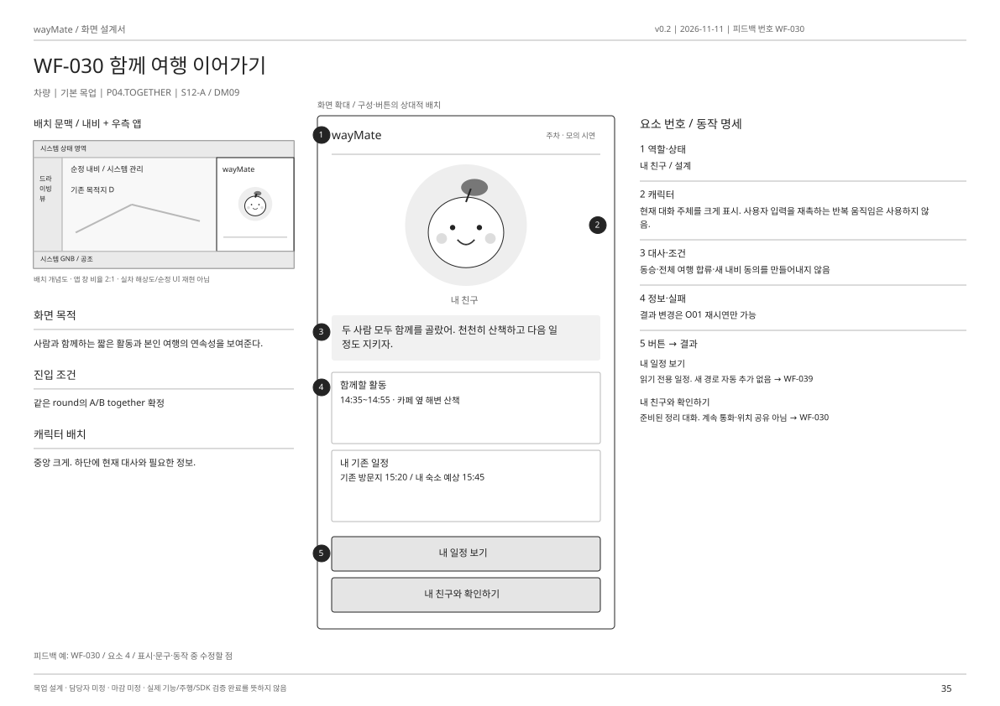

범위 B · P04.TOGETHER · S12-A · DM09 · 담당자 미정 · 마감 미정

**목적:** 사람과 함께하는 짧은 활동과 본인 여행의 연속성을 보여준다.

**진입:** 같은 round의 A/B together 확정

**조건:** 동승·전체 여행 합류·새 내비 동의를 만들어내지 않음

**실패·분기:** 결과 변경은 O01 재시연만 가능

| 버튼 | 동작·조건 | 다음 번호 |
|---|---|---|
| 내 일정 보기 | 읽기 전용 일정. 새 경로 자동 추가 없음 | WF-039 |
| 내 친구와 확인하기 | 준비된 정리 대화. 계속 통화·위치 공유 아님 | WF-030 |

### WF-031. 내 친구와 여행 계속하기

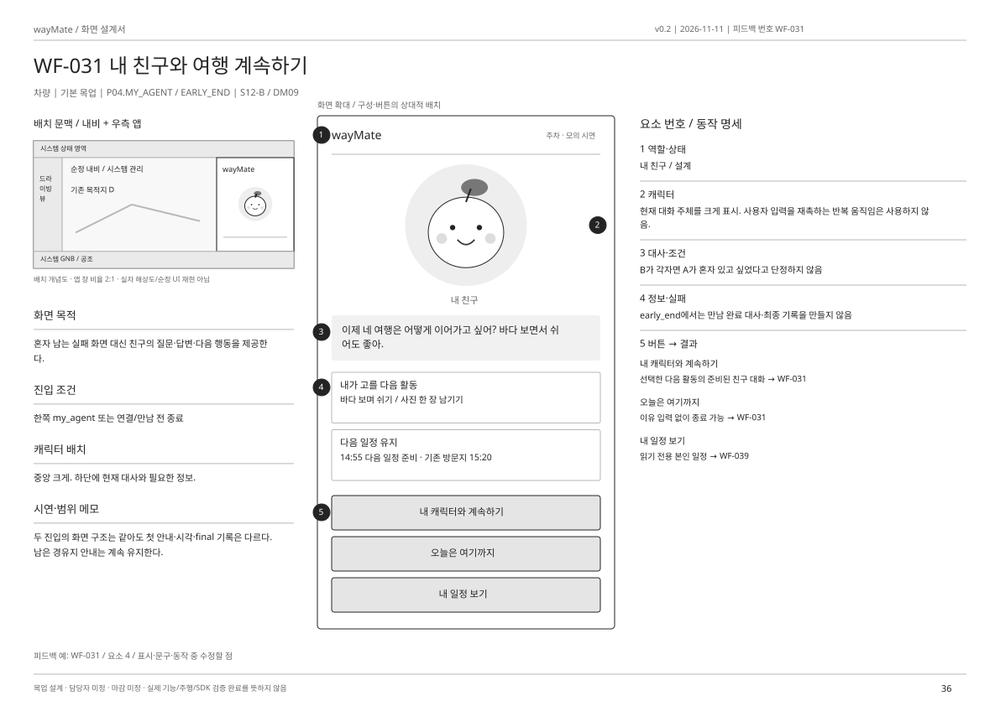

범위 B · P04.MY_AGENT / EARLY_END · S12-B · DM09 · 담당자 미정 · 마감 미정

**목적:** 혼자 남는 실패 화면 대신 친구의 질문·답변·다음 행동을 제공한다.

**진입:** 한쪽 my_agent 또는 연결/만남 전 종료

**조건:** B가 각자면 A가 혼자 있고 싶었다고 단정하지 않음

**실패·분기:** early_end에서는 만남 완료 대사·최종 기록을 만들지 않음

| 버튼 | 동작·조건 | 다음 번호 |
|---|---|---|
| 내 캐릭터와 계속하기 | 선택한 다음 활동의 준비된 친구 대화 | WF-031 |
| 오늘은 여기까지 | 이유 입력 없이 종료 가능 | WF-031 |
| 내 일정 보기 | 읽기 전용 본인 일정 | WF-039 |

**메모:** 두 진입의 화면 구조는 같아도 첫 안내·시각·final 기록은 다르다. 남은 경유지 안내는 계속 유지한다.

### WF-032. 플랫폼 차단 · 음성 지원 미확인

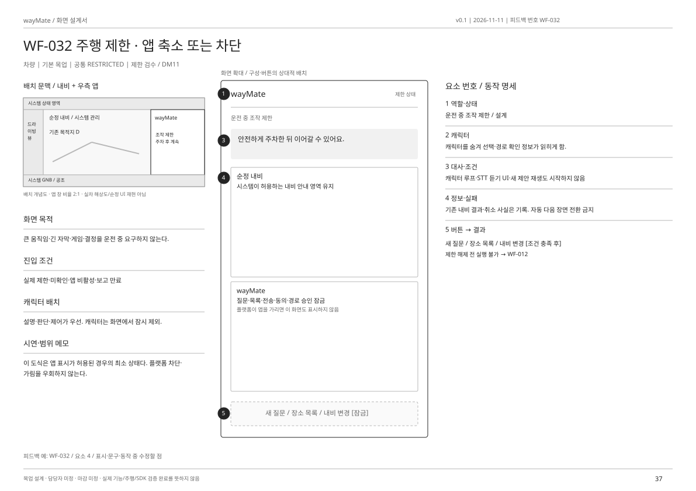

범위 B · 공통 BLOCKED · 제한 검수 · DM11 · 담당자 미정 · 마감 미정

**목적:** 큰 움직임·긴 자막·게임·결정을 운전 중 요구하지 않는다.

**진입:** 플랫폼 차단·음성 지원 미검증·비활성·보고 만료

**조건:** 캐릭터 루프·STT 듣기 UI·새 제안 재생도 시작하지 않음

**실패·분기:** 기존 내비 결과·취소 사실은 기록. 자동 다음 장면 전환 금지

| 버튼 | 동작·조건 | 다음 번호 |
|---|---|---|
| 새 질문 / 장소 목록 / 내비 변경 (조건 충족 후) | 제한 해제 전 실행 불가 | WF-012 |

**메모:** 주행 음성 WF-051과 별개다. 현재 v2·미검증 환경은 이 상태를 유지하며 플랫폼 차단·가림을 우회하지 않는다.

### WF-033. 주차 복귀 · 현재 상태부터

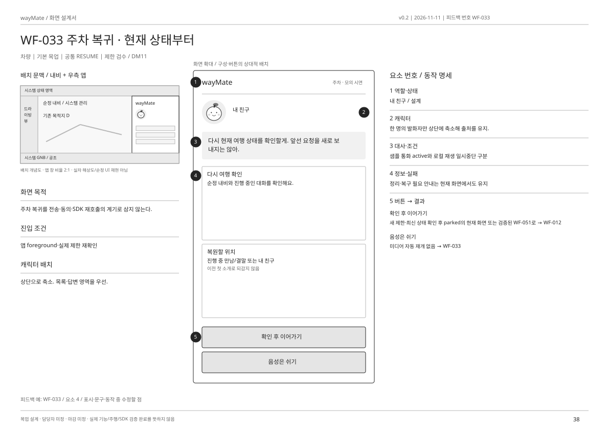

범위 B · 공통 RESUME · 제한 검수 · DM11 · 담당자 미정 · 마감 미정

**목적:** 주차 복귀를 전송·동의·SDK 재호출의 계기로 삼지 않는다.

**진입:** 앱 foreground·실제 제한 재확인

**조건:** 샘플 통화 active와 로컬 재생 일시중단 구분

**실패·분기:** 정리·복구 필요 안내는 현재 화면에서도 유지

| 버튼 | 동작·조건 | 다음 번호 |
|---|---|---|
| 확인 후 이어가기 | 새 제한·최신 상태 확인 후 parked의 현재 화면 또는 검증된 WF-051로 | WF-012 |
| 음성은 쉬기 | 미디어 자동 재개 없음 | WF-033 |

### WF-034. 내 친구에게 장소를 물어보기

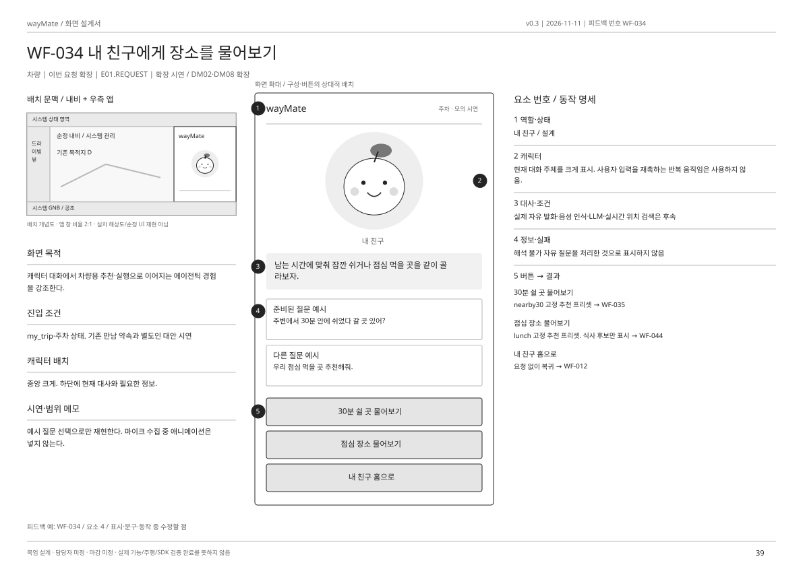

범위 E · E01.REQUEST · 확장 시연 · DM02·DM08 확장 · 담당자 미정 · 마감 미정

**목적:** 캐릭터 대화에서 차량용 추천·실행으로 이어지는 에이전틱 경험을 강조한다.

**진입:** my_trip·주차 상태. 기존 만남 약속과 별도인 대안 시연

**조건:** 실제 자유 발화·음성 인식·LLM·실시간 위치 검색은 후속

**실패·분기:** 해석 불가 자유 질문을 처리한 것으로 표시하지 않음

| 버튼 | 동작·조건 | 다음 번호 |
|---|---|---|
| 30분 쉴 곳 물어보기 | nearby30 고정 추천 프리셋 | WF-035 |
| 점심 장소 물어보기 | lunch 고정 추천 프리셋. 식사 후보만 표시 | WF-044 |
| 내 친구 홈으로 | 요청 없이 복귀 | WF-012 |

**메모:** 예시 질문 선택으로만 재현한다. 마이크 수집 중 애니메이션은 넣지 않는다.

### WF-035. 시간 조건에 맞춘 장소 목록

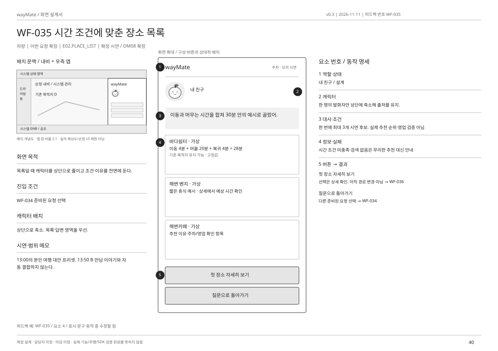

범위 E · E02.PLACE_LIST · 확장 시연 · DM08 확장 · 담당자 미정 · 마감 미정

**목적:** 목록일 때 캐릭터를 상단으로 줄이고 조건·이유를 전면에 둔다.

**진입:** WF-034 준비된 요청 선택

**조건:** 한 번에 최대 3개 시연 후보. 실제 추천 순위·영업 검증 아님

**실패·분기:** 시간 조건 미충족·검색 없음은 무리한 추천 대신 안내

| 버튼 | 동작·조건 | 다음 번호 |
|---|---|---|
| 첫 장소 자세히 보기 | 선택은 상세 확인. 아직 경로 변경 아님 | WF-036 |
| 질문으로 돌아가기 | 다른 준비된 요청 선택 | WF-034 |

**메모:** 13:00의 본인 여행 대안 프리셋. 13:50 B 만남 이야기와 자동 결합하지 않는다.

### WF-036. 장소 상세 · 실행 전 판단

범위 E · E03.PLACE_DETAIL · 확장 시연 · DM08 확장 · 담당자 미정 · 마감 미정

**목적:** 선택과 실행 승인을 나눠 잘못된 목적지 교체를 막는다.

**진입:** 후보 한 곳 선택

**조건:** 공유 만남 장소 변경과 본인 장소 추천은 다른 요청

**실패·분기:** 공유 만남은 양쪽 재동의 없이 임의 변경 금지

| 버튼 | 동작·조건 | 다음 번호 |
|---|---|---|
| 이곳으로 안내 확인 | 기존 D 있으면 WF-037, 목적지 없으면 WF-038 | WF-037 |
| 다른 장소 보기 | 상세 조회만 변경 | WF-035 |

### WF-037. 개인 장소 · 기존 목적지 유지

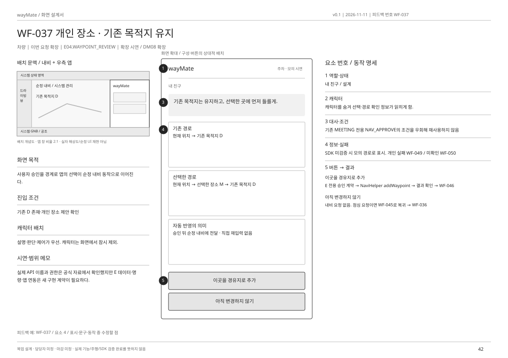

범위 E · E04.WAYPOINT_REVIEW · 확장 시연 · DM08 확장 · 담당자 미정 · 마감 미정

**목적:** 사용자 승인을 경계로 앱의 선택이 순정 내비 동작으로 이어진다.

**진입:** 기존 D 존재·개인 장소 제안 확인

**조건:** 기존 MEETING 전용 NAV_APPROVE의 조건을 우회해 재사용하지 않음

**실패·분기:** SDK 미검증 시 모의 경로로 표시. 개인 실패 WF-049 / 미확인 WF-050

| 버튼 | 동작·조건 | 다음 번호 |
|---|---|---|
| 이곳을 경유지로 추가 | E 전용 승인 계약 → NaviHelper addWaypoint → 결과 확인 | WF-046 |
| 아직 변경하지 않기 | 내비 요청 없음. 점심 요청이면 WF-045로 복귀 | WF-036 |

**메모:** 실제 API 이름과 권한은 공식 자료에서 확인했지만 E 데이터·명령·앱 연동은 새 구현 계약이 필요하다.

### WF-038. 목적지 없음 · 새 안내 설정

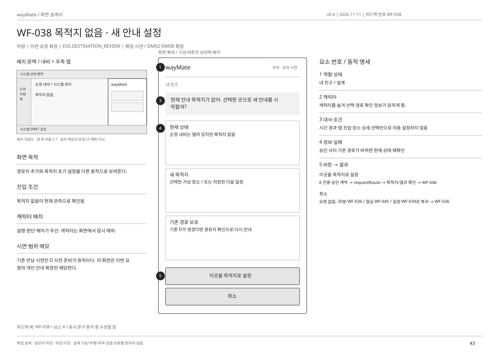

범위 E · E05.DESTINATION_REVIEW · 확장 시연 · DM02·DM08 확장 · 담당자 미정 · 마감 미정

**목적:** 경유지 추가와 목적지 초기 설정을 다른 동작으로 보여준다.

**진입:** 목적지 없음이 현재 관측으로 확인됨

**조건:** 시간 경과·앱 진입·장소 상세 선택만으로 자동 설정하지 않음

**실패·분기:** 승인 사이 기존 경로가 바뀌면 현재 상태 재확인

| 버튼 | 동작·조건 | 다음 번호 |
|---|---|---|
| 이곳을 목적지로 설정 | E 전용 승인 계약 → requestRoute → 목적지/결과 확인 | WF-046 |
| 취소 | 요청 없음. 30분 WF-036 / 점심 WF-045 / 일정 WF-039로 복귀 | WF-036 |

**메모:** 기존 만남 시연은 D 사전 준비가 원칙이다. 이 화면은 이번 요청의 개인 안내 확장만 해당한다.

### WF-039. 저장된 일정과 순정 내비

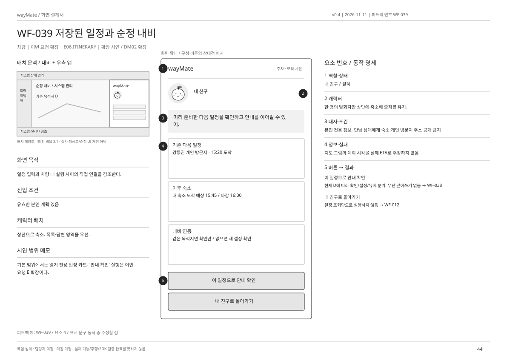

범위 E · E06.ITINERARY · 확장 시연 · DM02 확장 · 담당자 미정 · 마감 미정

**목적:** 일정 입력과 차량 내 실행 사이의 직접 연결을 강조한다.

**진입:** 유효한 본인 계획 있음

**조건:** 본인 전용 정보. 만남 상대에게 숙소·개인 방문지 주소 공개 금지

**실패·분기:** 지도 그림의 계획 시각을 실제 ETA로 주장하지 않음

| 버튼 | 동작·조건 | 다음 번호 |
|---|---|---|
| 이 일정으로 안내 확인 | 현재 D에 따라 확인/설정/유지 분기. 무단 덮어쓰기 없음 | WF-038 |
| 내 친구로 돌아가기 | 일정 조회만으로 실행하지 않음 | WF-012 |

**메모:** 기본 범위에서는 읽기 전용 일정 카드. '안내 확인' 실행은 이번 요청 E 확장이다.

### WF-040. 시연자 패널 · 현재 요청만 제어

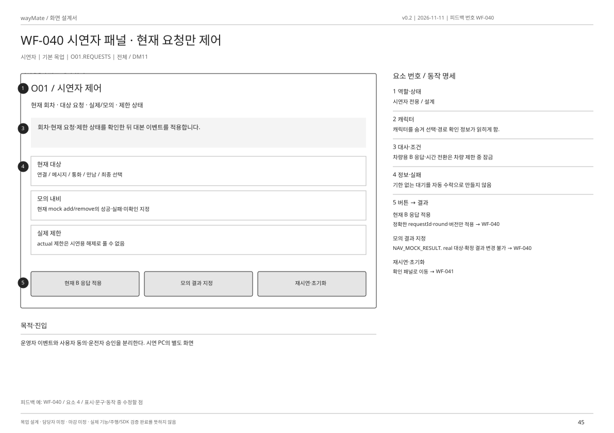

범위 B · O01.REQUESTS · 전체 · DM11 · 담당자 미정 · 마감 미정

**목적:** 운영자 이벤트와 사용자 동의·운전자 승인을 분리한다.

**진입:** 시연 PC의 별도 화면

**조건:** 차량용 B 응답·시간 전환은 차량 제한 중 잠금

**실패·분기:** 기한 없는 대기를 자동 수락으로 만들지 않음

| 버튼 | 동작·조건 | 다음 번호 |
|---|---|---|
| 현재 B 응답 적용 | 정확한 requestId·round·버전만 적용 | WF-040 |
| 모의 결과 지정 | NAV_MOCK_RESULT. real 대상·확정 결과 변경 불가 | WF-040 |
| 재시연·초기화 | 확인 패널로 이동 | WF-041 |

### WF-041. 재시연·전체 초기화 확인

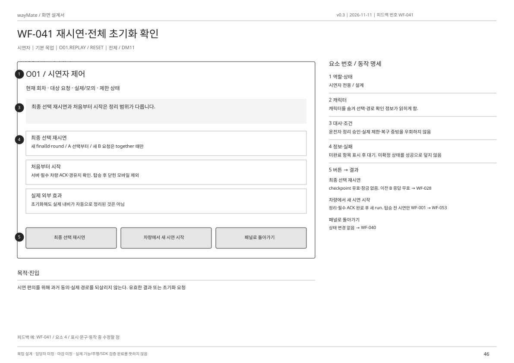

범위 B · O01.REPLAY / RESET · 전체 · DM11 · 담당자 미정 · 마감 미정

**목적:** 시연 편의를 위해 과거 동의·실제 경로를 되살리지 않는다.

**진입:** 유효한 결과 또는 초기화 요청

**조건:** 운전자 정리 승인·실제 제한·복구 증빙을 우회하지 않음

**실패·분기:** 미완료 항목 표시 후 대기. 미확정 상태를 성공으로 덮지 않음

| 버튼 | 동작·조건 | 다음 번호 |
|---|---|---|
| 최종 선택 재시연 | checkpoint 유효·잠금 없음. 이전 B 응답 무효 | WF-028 |
| 처음부터 시작 확인 | 새 run은 필요한 정리·ACK 완료 후에만 | WF-001 |
| 패널로 돌아가기 | 상태 변경 없음 | WF-040 |

### WF-042. MC 통화 · 별도 참여 동의

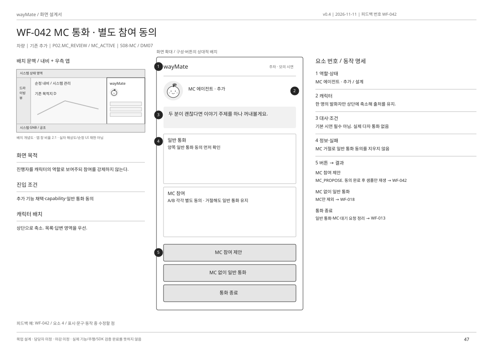

범위 O · P02.MC_REVIEW / MC_ACTIVE · S08-MC · DM07 · 담당자 미정 · 마감 미정

**목적:** 진행자를 캐릭터의 역할로 보여주되 참여를 강제하지 않는다.

**진입:** 추가 기능 채택·capability·일반 통화 동의

**조건:** 기본 시연 필수 아님. 실제 다자 통화 없음

**실패·분기:** MC 거절로 일반 통화 동의를 지우지 않음

| 버튼 | 동작·조건 | 다음 번호 |
|---|---|---|
| MC 참여 제안 | MC_PROPOSE. 동의 완료 후 샘플만 재생 | WF-042 |
| MC 없이 일반 통화 | MC만 제외 | WF-018 |
| 통화 종료 | 일반 통화·MC·대기 요청 정리 | WF-013 |

### WF-043. 여행 후 기록·장식

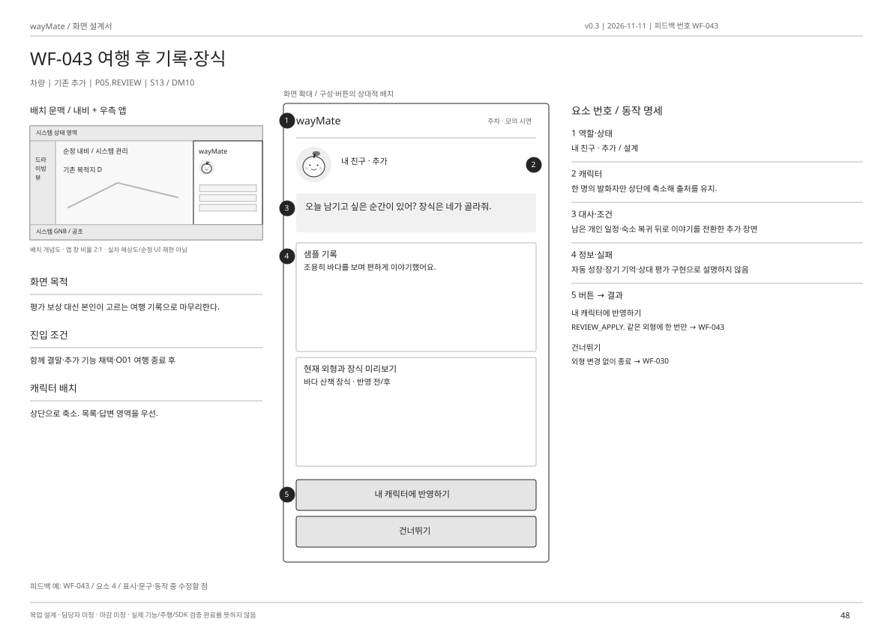

범위 O · P05.REVIEW · S13 · DM10 · 담당자 미정 · 마감 미정

**목적:** 평가 보상 대신 본인이 고르는 여행 기록으로 마무리한다.

**진입:** 함께 결말·추가 기능 채택·O01 여행 종료 후

**조건:** 남은 개인 일정·숙소 복귀 뒤로 이야기를 전환한 추가 장면

**실패·분기:** 자동 성장·장기 기억·상대 평가 구현으로 설명하지 않음

| 버튼 | 동작·조건 | 다음 번호 |
|---|---|---|
| 내 캐릭터에 반영하기 | REVIEW_APPLY. 같은 외형에 한 번만 | WF-043 |
| 건너뛰기 | 외형 변경 없이 종료 | WF-030 |

### WF-044. 점심 질문에 맞춘 식사 장소 목록

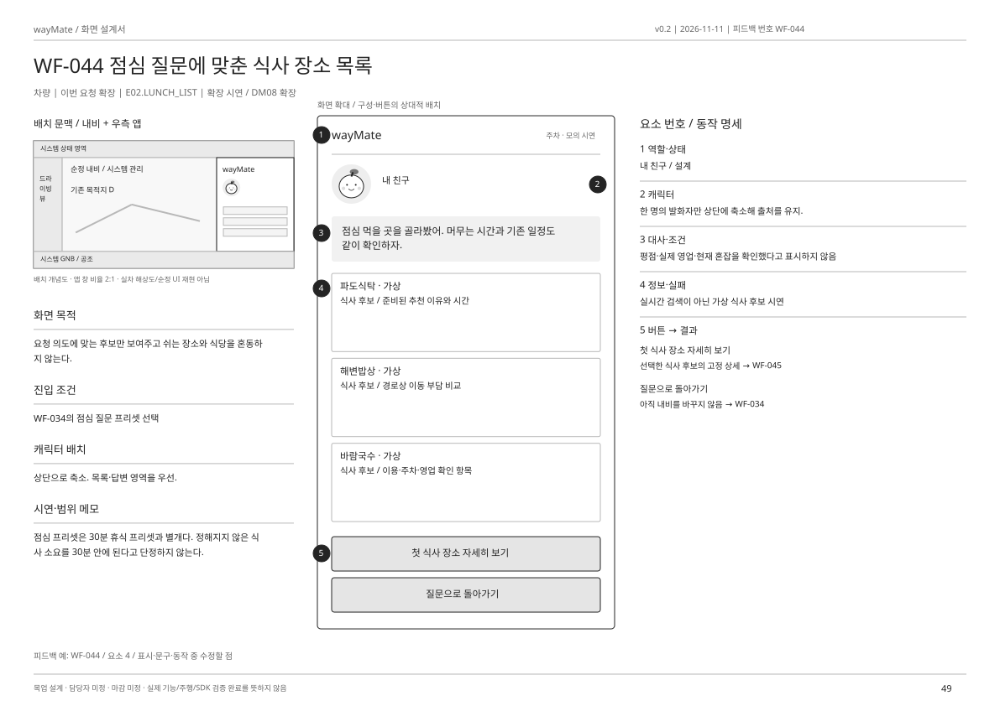

범위 E · E02.LUNCH_LIST · 확장 시연 · DM08 확장 · 담당자 미정 · 마감 미정

**목적:** 요청 의도에 맞는 후보만 보여주고 쉬는 장소와 식당을 혼동하지 않는다.

**진입:** WF-034의 점심 질문 프리셋 선택

**조건:** 평점·실제 영업·현재 혼잡을 확인했다고 표시하지 않음

**실패·분기:** 실시간 검색이 아닌 가상 식사 후보 시연

| 버튼 | 동작·조건 | 다음 번호 |
|---|---|---|
| 첫 식사 장소 자세히 보기 | 선택한 식사 후보의 고정 상세 | WF-045 |
| 질문으로 돌아가기 | 아직 내비를 바꾸지 않음 | WF-034 |

**메모:** 점심 프리셋은 30분 휴식 프리셋과 별개다. 정해지지 않은 식사 소요를 30분 안에 된다고 단정하지 않는다.

### WF-045. 식사 장소 상세 · 내 일정과 비교

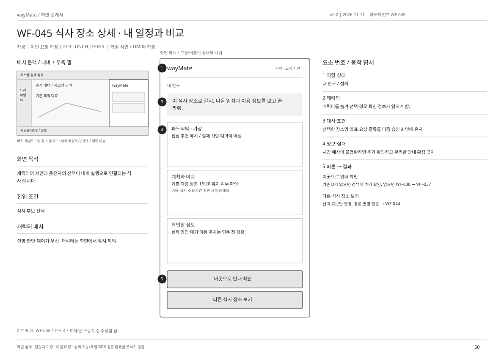

범위 E · E03.LUNCH_DETAIL · 확장 시연 · DM08 확장 · 담당자 미정 · 마감 미정

**목적:** 캐릭터의 제안과 운전자의 선택이 내비 실행으로 연결되는 식사 예시다.

**진입:** 식사 후보 선택

**조건:** 선택한 장소명·좌표·요청 종류를 다음 승인 화면에 유지

**실패·분기:** 시간 예산이 불명확하면 추가 확인하고 무리한 안내 확정 금지

| 버튼 | 동작·조건 | 다음 번호 |
|---|---|---|
| 이곳으로 안내 확인 | 기존 D가 있으면 경유지 추가 확인, 없으면 WF-038 | WF-037 |
| 다른 식사 장소 보기 | 선택 후보만 변경. 경로 변경 없음 | WF-044 |

### WF-046. 개인 안내 요청 중 · 선택한 장소 유지

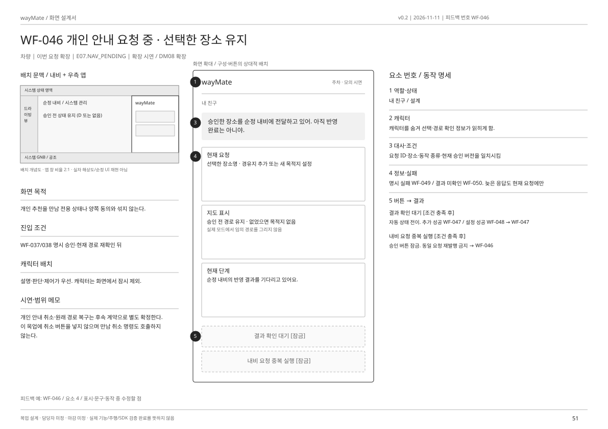

범위 E · E07.NAV_PENDING · 확장 시연 · DM08 확장 · 담당자 미정 · 마감 미정

**목적:** 개인 추천을 만남 전용 상태나 양쪽 동의와 섞지 않는다.

**진입:** WF-037/038 명시 승인·현재 경로 재확인 뒤

**조건:** 요청 ID·장소·동작 종류·현재 승인 버전을 일치시킴

**실패·분기:** 명시 실패 WF-049 / 결과 미확인 WF-050. 늦은 응답도 현재 요청에만

| 버튼 | 동작·조건 | 다음 번호 |
|---|---|---|
| 결과 확인 대기 (조건 충족 후) | 자동 상태 전이. 추가 성공 WF-047 / 설정 성공 WF-048 | WF-047 |
| 내비 요청 중복 실행 (조건 충족 후) | 승인 버튼 잠금. 동일 요청 재발행 금지 | WF-046 |

**메모:** 개인 안내 취소·원래 경로 복구는 후속 계약으로 별도 확정한다. 이 목업에 취소 버튼을 넣지 않으며 만남 취소 명령도 호출하지 않는다.

### WF-047. 개인 경유지 반영 확인 · 원래 목적지 유지

범위 E · E08.WAYPOINT_CONFIRMED · 확장 시연 · DM08 확장 · 담당자 미정 · 마감 미정

**목적:** 개인 추천 선택이 왼쪽 순정 내비의 경유지로 이어졌음을 보여준다.

**진입:** 같은 개인 add 요청의 성공과 현재 경유지·기존 D 확인

**조건:** 왼쪽 도식의 M은 승인한 개인 장소. 공유 만남 카페로 바꾸지 않음

**실패·분기:** 다른 경로나 요청이면 성공 표시 없이 WF-050으로 확인

| 버튼 | 동작·조건 | 다음 번호 |
|---|---|---|
| 내 친구와 계속하기 | 결과 기록 후 홈. 만남·B·동행 동의는 만들지 않음 | WF-012 |
| 내 일정 보기 | 읽기 전용 조회. 새 안내 재요청 없음 | WF-039 |

### WF-048. 새 목적지 반영 확인 · 경유지와 구분

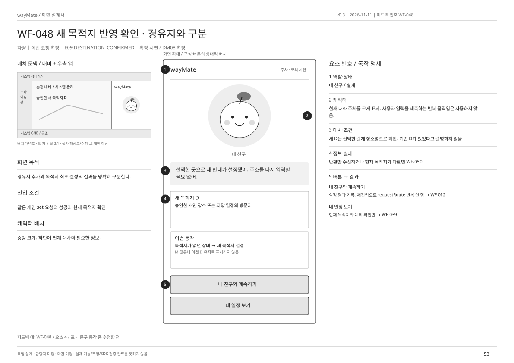

범위 E · E09.DESTINATION_CONFIRMED · 확장 시연 · DM08 확장 · 담당자 미정 · 마감 미정

**목적:** 경유지 추가와 목적지 최초 설정의 결과를 명확히 구분한다.

**진입:** 같은 개인 set 요청의 성공과 현재 목적지 확인

**조건:** 새 D는 선택한 실제 장소명으로 치환. 기존 D가 있었다고 설명하지 않음

**실패·분기:** 반환만 수신하거나 현재 목적지가 다르면 WF-050

| 버튼 | 동작·조건 | 다음 번호 |
|---|---|---|
| 내 친구와 계속하기 | 설정 결과 기록. 재진입으로 requestRoute 반복 안 함 | WF-012 |
| 내 일정 보기 | 현재 목적지와 계획 확인만 | WF-039 |

### WF-049. 개인 안내 명시 실패 · 같은 장소 다시 확인

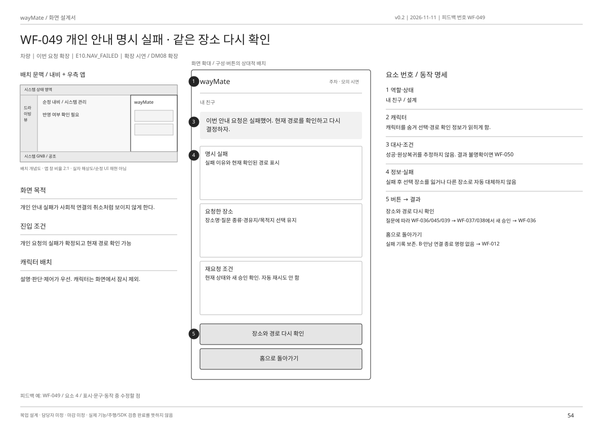

범위 E · E10.NAV_FAILED · 확장 시연 · DM08 확장 · 담당자 미정 · 마감 미정

**목적:** 개인 안내 실패가 사회적 연결의 취소처럼 보이지 않게 한다.

**진입:** 개인 요청의 실패가 확정되고 현재 경로 확인 가능

**조건:** 성공·원상복귀를 추정하지 않음. 결과 불명확이면 WF-050

**실패·분기:** 실패 후 선택 장소를 잃거나 다른 장소로 자동 대체하지 않음

| 버튼 | 동작·조건 | 다음 번호 |
|---|---|---|
| 장소와 경로 다시 확인 | 질문에 따라 WF-036/045/039 → WF-037/038에서 새 승인 | WF-036 |
| 홈으로 돌아가기 | 실패 기록 보존. B·만남 연결 종료 명령 없음 | WF-012 |

### WF-050. 개인 안내 결과 미확인 · 재요청 잠금

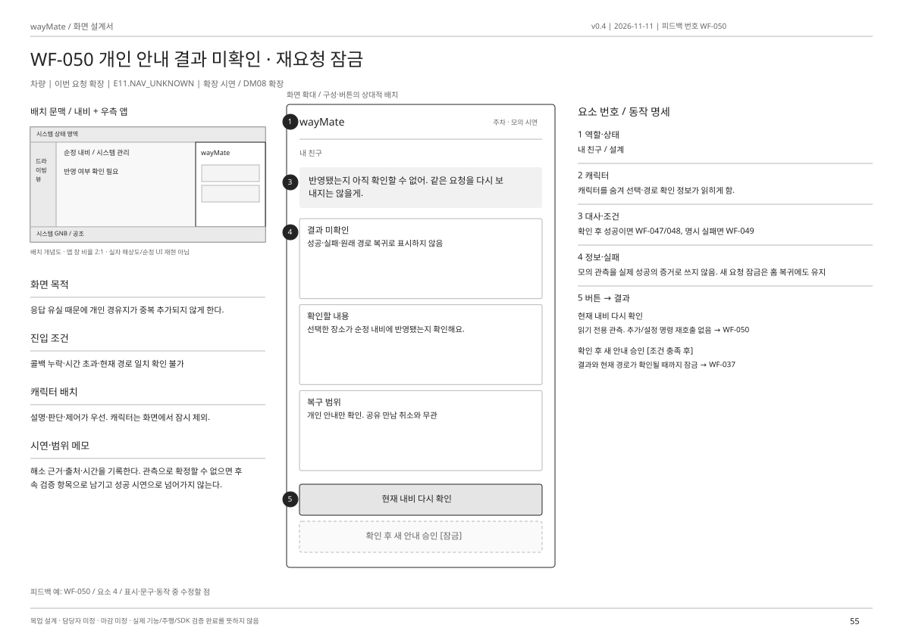

범위 E · E11.NAV_UNKNOWN · 확장 시연 · DM08 확장 · 담당자 미정 · 마감 미정

**목적:** 응답 유실 때문에 개인 경유지가 중복 추가되지 않게 한다.

**진입:** 콜백 누락·시간 초과·현재 경로 일치 확인 불가

**조건:** 확인 후 성공이면 WF-047/048, 명시 실패면 WF-049

**실패·분기:** 모의 관측을 실제 성공의 증거로 쓰지 않음. 새 요청 잠금은 홈 복귀에도 유지

| 버튼 | 동작·조건 | 다음 번호 |
|---|---|---|
| 현재 내비 다시 확인 | 읽기 전용 관측. 추가/설정 명령 재호출 없음 | WF-050 |
| 확인 후 새 안내 승인 (조건 충족 후) | 결과와 현재 경로가 확인될 때까지 잠금 | WF-037 |

**메모:** 해소 근거·출처·시간을 기록한다. 관측으로 확정할 수 없으면 후속 검증 항목으로 남기고 성공 시연으로 넘어가지 않는다.

### WF-051. 주행 중 상대 캐릭터와 음성 대화

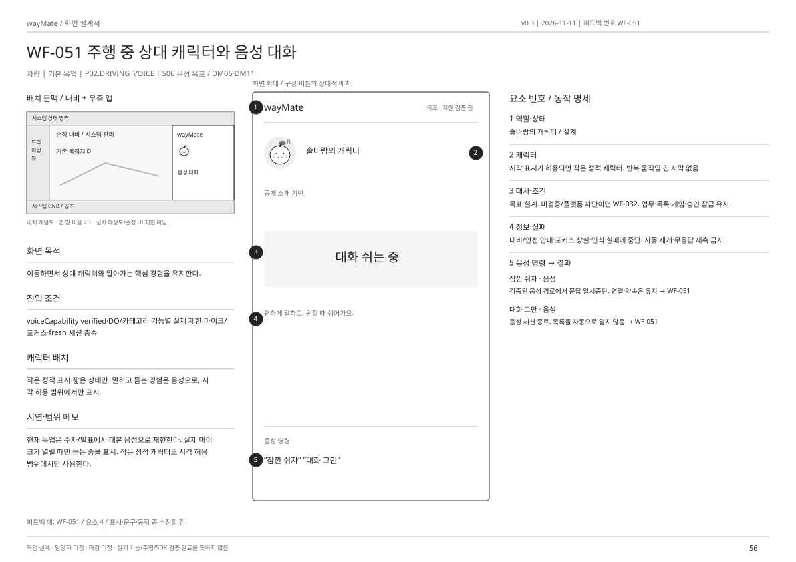

범위 B · P02.DRIVING_VOICE · S06 음성 목표 · DM06·DM11 · 담당자 미정 · 마감 미정

**목적:** 이동하면서 상대 캐릭터와 알아가는 핵심 경험을 유지한다.

**진입:** voiceCapability verified·DO/카테고리·기능별 실제 제한·마이크/포커스·fresh 세션 충족

**조건:** 목표 설계. 미검증/플랫폼 차단이면 WF-032. 업무·목록·게임·승인 잠금 유지

**실패·분기:** 내비/안전 안내·포커스 상실·인식 실패에 중단. 자동 재개·무응답 재촉 금지

| 음성 명령 | 동작·조건 | 다음 번호 |
|---|---|---|
| 잠깐 쉬자 · 음성 | 검증된 음성 경로에서 문답 일시중단. 연결·약속은 유지 | WF-051 |
| 대화 그만 · 음성 | 음성 세션 종료. 목록을 자동으로 열지 않음 | WF-051 |

**메모:** 현재 목업은 주차/발표에서 대본 음성으로 재현한다. 실제 마이크가 열릴 때만 듣는 중을 표시. 작은 정적 캐릭터도 시각 허용 범위에서만 사용한다.

## 7. 구현·검수와 피드백

51개 WF는 화면 설계 단위이며 모두 별도 Android Activity라는 뜻은 아니다. 기존 P01~P04 안의 상태를 재사용한다. 앱 코드·공통 API·실제 내비 구현을 이 산출물로 변경하지 않는다.

- 기본 B: 05의 Q와 연결·공개·선택형 콘텐츠·두 결말·취소/정리·모의 결과·finalRound 규칙 대조.
- E 확장: 개인 제안의 식별자·승인·설정/경유지 구분·중복·실패/unknown·취소·현재 경로 변경 감지를 별도 계약으로 확정.
- V01~V05: 캐릭터 효과·동행감·상대 응답 시점·총 시간 부담·실제 주행 실현성 검증. 목업을 클릭했다는 이유로 통과 처리하지 않음.
- Connect-S/W·좁은 창·가로·앱 가림·글자 확대에서 잘림, 초점, 읽기·실행 영역 확인.
- 자유 입력: 예시 없는 입력·초안 수정·이모지/줄바꿈·500자 경계·실패/재시도·원문 비공개·미확인 소개값·v2 거부/목표 v3 전환 검수.

- 주행 음성: parked/driving_voice/blocked·실제 지원 증빙·마이크/포커스/제한·음성 종료·자동 재개 방지를 V05에서 검증.

- 모든 담당자·마감·추가 실제 검증 결과는 미정/미실시 유지.

| 피드백 번호 | 요소 | 관찰한 문제 | 원하는 변경 | 담당자 | 마감 |
|---|---|---|---|---|---|
| WF-___ | 1~5 | 작성 | 작성 | 미정 | 미정 |

## 8. 공식 근거와 확인 범위

확인일 2026-11-11. 공식 API가 있다는 사실과 이 프로젝트에서 실행·권한·SDK가 검증됐다는 사실은 구분한다. 아래 요약은 설계 기준이며 실제 법적 판단·앱 심사·차종별 지원 확인을 대신하지 않는다.

- **L1 [도로교통법 제49조](https://www.law.go.kr/LSW/lsLinkCommonInfo.do?chrClsCd=010202&lsJoLnkSeq=1031179261)**: 확인한 현행 조문은 2026-10-13 시행본. 지리안내 표시 예외와 표시장치 조작 제한은 별개다. 본 목업의 상세 조작은 안전한 주차 상태로 한정한다.
- **P1 [Pleos Display Layout](https://document.pleos.ai/docs/connect/guide/docs-design/getting-started/layout)**: 시스템 상태·드라이빙뷰·GNB와 앱 창은 별도 영역이다. 앱 창은 한 개 또는 두 개이며 가로·세로 대응이 필요하다.
- **P2 [Pleos Window Policy](https://document.pleos.ai/docs/connect/guide/docs-design/getting-started/window)**: Connect-S 두 앱은 1:1, Connect-W는 2:1 또는 1:2 배치. 새 앱 실행·딥링크는 창을 재배치할 수 있어 우측 고정을 보장하지 않는다.
- **P3 [Pleos 주행 제한](https://document.pleos.ai/docs/pleos-only/vehicle-app-planning-guide/driving-restiction-policy)**: DO 미선언 앱은 주행 중 사용할 수 없다. DO 선언 자체도 모든 기능의 허용을 뜻하지 않는다. 실제 제한·카테고리·지역·버전 확인이 필요하다.
- **P4 [Pleos 주행 안전 설계](https://document.pleos.ai/docs/pleos-only/vehicle-app-planning-guide/driver-distraction-guideline)**: CarUxRestrictions를 기준으로 기능을 제한하고 움직이는 장식을 줄이며 내비 오디오 안내를 우선한다. 이 설계는 주행 중 캐릭터 재생을 허용한다고 판정하지 않는다.
- **N1 [NaviHelper 목적지](https://document.pleos.ai/docs/pleos-only/connect-sdk-pleos/NaviHelper/destinations)**: requestRoute는 목적지 설정 요청이다. 호출 반환만으로 완료를 표시하지 않고 이벤트·현재 목적지를 확인한다.
- **N2 [NaviHelper 경유지](https://document.pleos.ai/docs/pleos-only/connect-sdk-pleos/NaviHelper/waypoint-settings)**: addWaypoint·removeWaypoint·getWaypointInfo의 역할을 구분한다. 기존 목적지 유지·자기 경유지 식별·결과 확인은 별도 검증한다.
- **N3 [NaviHelper 권한](https://document.pleos.ai/docs/pleos-only/connect-sdk-pleos/NaviHelper/declaring-permissions)**: 조회·경로 변경·내비 화면 요청의 권한은 다르다. 실제 제공 SDK와 프로젝트 권한을 시험한 범위만 실제 연동으로 기록한다.
- **P5 [Pleos 핸즈프리 음성 인터랙션](https://document.pleos.ai/docs/connect/guide/docs-design/Introduction/intro)**: 핸즈프리로 말하고 듣는 인터랙션을 다룬다. 자유로운 소셜 캐릭터 대화의 심사 승인이나 주행 허용이 확정됐다는 뜻은 아니다.
- **S1 [SDK 사용 신청 상태](https://document.pleos.ai/docs/pleos-only/create-my-project)**: 2026-11-11 공개 안내에는 STT/TTS가 준비 중이다. API 문서 존재와 프로젝트 콘솔·제공 SDK의 실제 사용 가능 여부를 구분한다.
- **G1 [Gleo Interface](https://document.pleos.ai/docs/pleos-only/app-integration-guide/guide/core-concepts)**: 앱 function과 schema로 음성 명령을 연동한다. 캐릭터 목소리·자유 대화·주행 심사를 자동 제공하거나 승인하는 기능으로 설명하지 않는다.

## 9. 재생성

원본은 [spec.py](wireframes/v1/source/spec.py), 렌더러는 [build.py](wireframes/v1/source/build.py)다. ReportLab과 한국어 TrueType 폰트가 있는 Python에서 build.py를 실행하면 PDF·SVG·목록을 같은 데이터로 만든다. PDF와 각 SVG의 화면 번호·내용을 함께 수정한다.
