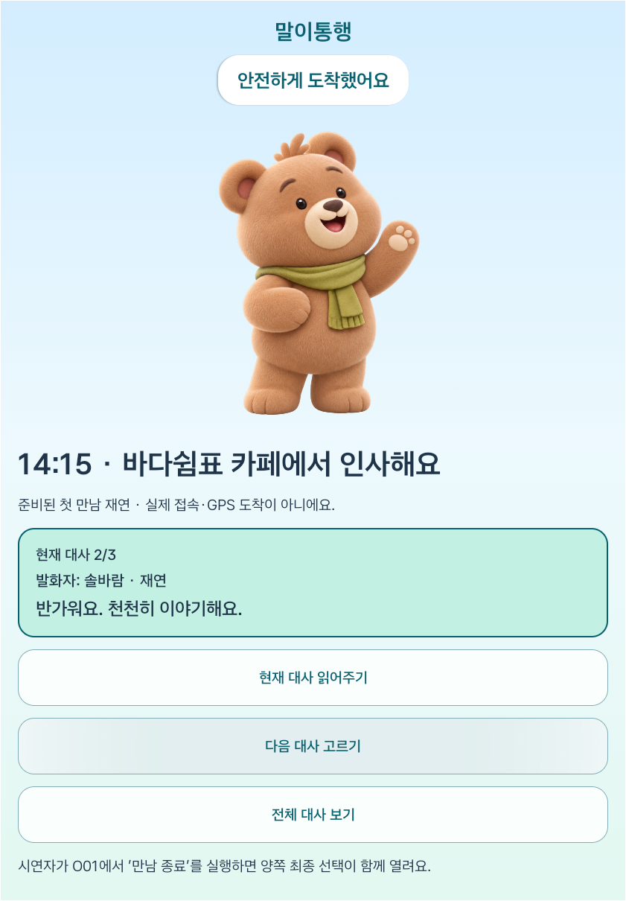

# UI #15·#16 마감과 회귀

2026-11-14 · PR #22를 main `d7d159a`로 머지한 뒤 착수했다. 아래는 후속 수정 브랜치의 구현·검증 결과이며 main 반영은 해당 수정 PR의 머지로 구분한다. 요구사항은 28번 APP-04·APP-05와 이슈 [#15](https://github.com/ho72/wayMate/issues/15)·[#16](https://github.com/ho72/wayMate/issues/16), 차량 표시 기준은 31번을 따른다.

## #15 현재 대사·발화자

만남 재연과 함께 결말의 첫 화면에 **현재 대사 번호/전체 수 · 발화자 · 문장**을 큰 민트 카드와 테두리로 표시한다. ‘현재 대사 읽어주기’는 그 카드의 문장을 읽고, ‘다음 대사 고르기’는 기존 낭독을 중단한 뒤 다음 문장으로 바꾼다. 마지막 다음은 첫 문장이다. 선택·목록 펼치기만으로 자동 재생하지 않는다.

전체 대사는 ‘전체 대사 보기’로 펼친다. 목록에도 현재 카드를 표시하고 접근성 selected 값을 제공한다. 회차·장면·대사 내용이 바뀌면 첫 문장으로 초기화하고 이전 낭독을 중단한다. 빈 대사에는 선택/낭독 버튼을 만들지 않는다. 주행·차단·사용 불가 음성·정차/포커스 복귀의 기존 잠금과 수동 재개 정책은 유지한다.

[3분할 앱 창의 현재 대사](evidence/ui-qa15-16-2026-11-14/meeting-841.png) · [확장 창 함께 결말](evidence/ui-qa15-16-2026-11-14/together-1682.png) · [130% 글자·실제 3분할](evidence/ui-qa15-16-2026-11-14/font130-together-ending.png) · [텍스트 측정](evidence/ui-qa15-16-2026-11-14/font130-together-ending.json)

## #16 캐릭터 이미지 재검수·잔여 문제 수정

#19의 최초 선택 반영 코드는 정상이다. 실제 브라우저에서 곰↔드래곤 전환, 저장 전 초안 새로고침, 곰 저장·재접속을 확인했다. 다만 **곰을 저장한 뒤 ‘내 여행 → 나눈 이야기’로 돌아와 드래곤을 고르면 상단 그림·alt가 계속 곰을 가리키는 문제**가 남아 있었다. 저장된 profile을 항상 먼저 사용하던 것이 원인이다.

- 수정 전: 선택 `a-01`, 상단 `/bear.png`, alt ‘함께 여행할 포근한 곰 친구’.
- 수정 후: 편집 화면은 현재 radio의 미리보기를 표시한다. 드래곤 선택 시 `/character.png`와 드래곤 alt가 즉시 일치한다.
- 아직 저장하지 않고 여행 등 다른 화면으로 이동하면 확정 profile의 외형을 표시한다. 미리보기만으로 profile·차량 전달본은 바꾸지 않는다.
- 확정 뒤 재접속하면 radio·상단 이미지·소개가 저장한 외형으로 일치한다. HTTP 차량 전달본의 owner.avatarId도 두 외형 각각 검사했다.
- 새 회차를 정리한 뒤 흐름·편집 상태를 판정하고 이미지를 갱신하도록 렌더 순서를 맞췄다.

[재저장·재접속 후 모바일](evidence/ui-qa15-16-2026-11-14/character-after.png) · [데스크톱](evidence/ui-qa15-16-2026-11-14/character-desktop.png)

별도 3006 서버·검수 브라우저·가상 입력만 사용했다. 430px에서 선택·다시 보기·저장·재접속·본인 여행 전달 준비를 직접 조작했고, 최종 전달본 `my_trip / owner.avatarId=a-01 / peer=null`을 대조했다. 320px·1360px에서 페이지와 대화 영역 가로 넘침이 없고 콘솔 오류/경고 0이다. 검수 후 별도 브라우저·서버는 종료했다. 기존 3000/3002/3004 서버의 개인 상태를 초기화하지 않았다.

## 회귀와 검증 범위

| 검증 | 결과 |
|---|---|
| 기존 서버·계약·HTTP | **332/332**: 기존 328 + 캐릭터 회귀 4 |
| 실제 모바일 서비스 | **42/42**, 이번 변경은 기존 시연 모바일의 외형 표시다. 새 서비스 계정↔차량 연결을 추가하지 않았다. |
| 차량 JVM | **46/46** |
| 빌드 | mock/real 앱과 각 Android 테스트 APK 통과 |
| Lint | mock/real Error/Fatal 0, 기존 Warning 각각 33 |
| 최종 기기 회귀 | **24/24**: 신규 8 + 기존 16. 실제 앱 창 841×1210dp·1682×1210dp, 130% 글자·포커스·주행 UI 포함 |
| 실제 내비 기록 | journal SHA-256 전후 동일. 이 검수는 경유지 SDK 추가/제거 시험이 아니다. |
| 외부 AI | 새 호출 없음 |

새 Node 회귀는 production app.js 전체와 실제 DemoClient/ConsultationClient를 실행하고 실제 임시 HTTP 서버로 저장·전달본을 검사한다. DOM·타이머만 대역이며 이미지 디코딩·실제 크기·접근 가능한 이름은 위 브라우저 검수로 보완했다. 저장 외형 재편집 검사는 수정 전 1개가 실패하고 수정 후 4개 모두 통과했다.

새 기기 검사는 같은 production Compose 화면을 쓰는 오프라인 호스트다. 선택·순환·실제 콜백에 전달되는 문장·낭독 중단·빈 대사·다른 회차·차단/복귀와 두 외형의 차량 홈을 두 창 크기에서 검사했다. 실제 음성 엔진 성공으로 집계하지 않는다. 기존 창 포커스·수명주기 회귀는 준비 음원 재생/중단 경계를 별도로 확인한다.

130% 기존 검사의 ‘모든 대사가 처음부터 펼쳐짐’ 전제를 새 UI에 맞춰 다음 버튼으로 B 대사를 선택하는 흐름으로 바꿨다. 그 상태의 문장·현재 번호·발화자 줄바꿈/잘림을 직접 측정하고 최종 기기 24개를 다시 통과했다. 앞선 구 단계의 실패 결과를 마지막 통과 수에 합산하지 않는다.

공유 수치·소스/로그 해시·경계는 [validation.json](evidence/ui-qa15-16-2026-11-14/validation.json)에 있다. 전체 로컬 로그는 Git 제외 `mock-app/runtime/ui-qa15-16/`에 보존한다. 사용자 로컬 Gradle 변경과 실제 journal은 유지했다.

## 다음 작업

#15·#16의 수정과 재검수는 이 브랜치에서 완료했으며 이슈 종료는 수정 PR 머지 때 확인한다. #17 제출 범위/발표자 리허설과 새 계정의 인증된 차량 페어링·여행 전달은 여전히 후속이다. 순정 내비 도로 배경 보류, 미채택 MC·후기·게임·정밀 3D 범위는 그대로 유지한다.
