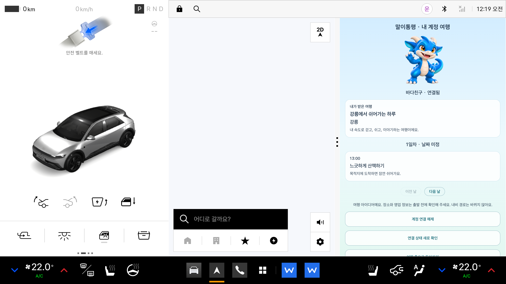

# 계정·차량 페어링과 확정 여행 전달

2026-11-15 · 이슈 [#24](https://github.com/ho72/wayMate/issues/24). PR #23을 머지한 main `7efe6ae`의 Node 332·서비스 42·JVM 46·차량 UI 24개, 빌드/Lint·원격 CI를 검증한 뒤 착수했다. 새 구현은 `feat/account-vehicle-pairing-review` 브랜치이며 main 반영 전이다. 아래 계약·기기 검수 결과를 구분한다. 공유 폴더에서 병행 중인 이름/추가 화면 변경은 별도 작업 폴더로 분리해 이 PR에 포함하지 않았다.

## 이번 범위

실제 서비스 계정(3004)에서 확정한 본인 여행을 인증한 차량으로 전한다. 기존 v4 시연·역할 헤더·고정 여행·내비 journal과 저장소를 섞지 않는다. 목적지·POI 검증, 경로 변경·매칭·음성은 이번 전달 계약에 포함하지 않는다.

1. 정차한 차량에서 연결 시작. 설치별 임의 장치 ID와 256비트 자격 증명을 먼저 안전하게 저장한다.
2. 차량에 5분짜리 8자리 코드 표시 → 로그인한 모바일 마이의 내 차 연결에 입력.
3. 모바일 요청만으로 연결하지 않는다. 차량에 별명/캐릭터를 표시하고 정차 상태에서 수락한다. 코드는 일회용이며 다른 계정 재사용을 막는다.
4. 모바일에서 저장한 여행·연결 차량·별명/캐릭터를 확인한 뒤 명시적으로 전송한다.
5. 차량은 새 여행을 미리 보고 ‘이 여행 받기’를 직접 누른다. 별도 파일에 원자적으로 저장한 뒤 같은 연결·전달 ID·revision을 ACK한다.
6. 모바일은 ACK 전에는 수신 대기로 표시한다. 재전송은 같은 requestId/본문을 사용한다.
7. 재접속·서버 재시작 뒤에도 연결·여행·ACK를 복원한다. 네트워크/현재 연결 확인 전에는 저장한 개인정보를 화면에 내보내지 않는다. 해제·새 계정 연결 후 과거 전달/ACK를 재적용하지 않는다.

## 생산자·소비자와 버전

- 생산자: `service/server`의 인증 세션·SQLite 확정 여행.
- 모바일: `service/web`의 차량 연결·해제·전송 확인·결과 확인.
- 소비자: 차량의 별도 개인 여행 Activity·Repository·원자적 수신 파일. 기존 v4 실행권·SDK를 호출하지 않는다.
- 계약: `schemaVersion=1`, `scope=account-trip-v1`. v4 handoff DTO로 자동 변환하지 않는다.
- 전달 내용: 전송 확인 시점 profileVersion, 본인 별명·캐릭터, 선택한 여행 1건의 확정 일정. 채팅 원문·비공개 자기소개·취향·다른 여행은 제외한다.

## API

| 경로 | 인증·동작 |
|---|---|
| POST /api/vehicle/enroll | 설치별 ID/임의 장치 키. 이미 존재하는 ID는 같은 키가 필요. 새 코드 또는 현재 연결 반환 |
| POST /api/vehicle/sync | 장치 Bearer+ID. 현재 실제 UXR/foreground 보고·연결과 최신 전달 조회 |
| POST /api/vehicle/confirm | 장치 인증. 현재 pairingId의 요청을 수락/거절. fresh 정차 확인 필수 |
| POST /api/vehicle/ack | 장치 인증. 원자 저장 후 최신 pairingId/deliveryId/revision 확인. fresh 정차 필수 |
| POST /api/vehicle/unpair | 장치 인증. 같은 연결을 해제 |
| GET /api/vehicles | 모바일 세션. 본인의 요청/활성 연결과 전달/ACK 요약만 조회 |
| POST /api/vehicles/pair | 모바일 세션·Origin/CSRF. 코드로 연결 요청, 차량 확인 대기 |
| POST /api/vehicles/:id/deliveries | 세션·Origin/CSRF. requestId/pairingId/expectedRevision/tripId/profileVersion으로 명시 전송 |
| POST /api/vehicles/:id/revoke | 세션·Origin/CSRF. 본인의 pairingId만 해제 |

장치 경로는 브라우저 Origin·Cookie를 받지 않는다. 에뮬레이터 `10.0.2.2` Host 예외는 로컬 HTTP의 장치 경로에만 적용한다. 기존 웹 Host/Origin/CSRF 검사는 유지한다. 장치 키·세션은 원문을 DB에 저장하지 않고 해시로 검증하며, 연결 코드는 키와 pairingId로 재구성해 재시도에도 같은 코드를 돌려준다. 코드 해시는 만료/확정/해제 시 제거한다. 코드 입력·등록·전송은 요청 제한을 적용한다.

## 동시성·복원·제한

pairingId는 연결 세대이고 revision은 해당 연결의 단조 증가 전달 순번이다. 한 기기의 활성 연결은 하나다. 동일 requestId의 같은 본문은 기존 결과로 응답하며, 다른 본문은 거절한다. 두 화면의 전송 경쟁·오래된 profileVersion·이전 revision·다른 사용자 tripId·다른 장치 ACK는 거절한다. 최신 전달보다 오래된 수신 ACK는 적용하지 않는다.

모바일 해제는 언제든 가능하며 새 연결 승인은 정차 시만 가능하다. 차량과 서버는 UXR known·foreground·DO 불필요·raw mask 0 및 짧은 fresh 기간을 요구한다. 이는 인증한 차량의 상태 보고이며 원격 플랫폼 attestation으로 설명하지 않는다. 미확인·주행·비활성·오프라인은 입력/수신을 잠그고 개인정보를 숨긴다. 정차나 포커스 복귀로 연결 승인·수신·ACK를 자동 재실행하지 않는다.

SQLite는 기존 v1 데이터를 보존해 v2 스키마로 이행한다. 차량 자격 증명/파일은 기존 시연·실제 내비 journal과 별도로 관리하고 앱 갱신 시 데이터를 삭제하지 않는다.

## 화면과 입력 기준

- 차량의 정차 홈에서 **내 계정 여행**으로 진입한다. 내부 Activity·Repository가 별도의 장치 자격 증명·파일·3004 API를 사용한다. mock/real 공통 코드이며 이 화면에서 SDK 내비 드라이버를 만들지 않는다.
- 모바일 **마이 → 내 차와 연결**: 8자리 코드 입력, 차량 확인 대기/연결 완료, 연결 해제 확인.
- 모바일 **내 여행 → 저장 여행 열기 → 이 여행을 내 차로**: 연결 차량 선택, 별명·캐릭터·선택 여행 검토, 직접 전송. 응답을 잃으면 **이전 전송 결과 확인**으로 같은 요청을 재조회한다.
- 차량: 요청한 계정 별명·캐릭터 확인 → 연결 승인. 도착한 여행은 받기 전 미리보기로 구분하고, **이 여행 받기 → 확인** 뒤 저장·ACK한다. 별명·외형은 전송 확인본을 사용하며 이후 모바일 프로필 변경이 이미 받은 여행을 덮어쓰지 않는다.
- 수신 후 날짜별 일정·시간·설명·메모와 이전/다음 날을 표시한다. 원래 내비 목적지나 경유지는 바꾸지 않는다. 정차에서는 큰 버튼과 세로 스크롤을 사용하고 주행에서는 정적 캐릭터·정차 안내만 표시한다.

## 실행

서비스는 [service README](../service/README.md)대로 3004에서 실행한다. 이미 실행 중인 구 서버에는 새 라우트가 생기지 않으므로 정상 종료·일관된 DB 백업 후 새 코드를 시작한다. v1→v2 이행은 같은 계정·세션·대화·초안·확정 여행을 보존한다. v2 DB를 이전 v1 서버로 열 수 없으므로 코드만 되돌리지 않는다. 되돌릴 때는 서버를 종료하고 이행 전 백업을 함께 복원한다.

차량 빌드는 `mock-app/vehicle`에서 실행한다. 기본 개인 서비스 포트는 3004이며 기존 v4 포트 3000과 독립이다.

```sh
./gradlew :app:assembleMockDebug :app:assembleRealDebug
# 별도 합성 계정 서버를 검수할 때만: -PwaymatePersonalApiPort=3006
adb install --user 10 -r app/build/outputs/apk/mock/debug/app-mock-debug.apk
```

공통 JSON: [스키마](../service/contracts/vehicle-v1.schema.json), [수신 완료 예제](../service/contracts/examples/received.json). 같은 예제를 Android 테스트 asset과 대조한다. 최대 14일·일별 12개 일정과 4바이트 Unicode 문자열이 들어가도 수신 상한 1MiB 안에 들어오고 실제 네이티브 HTTP/decoder로 읽는지 검사한다. APK/브라우저에는 OpenAI 키를 넣지 않는다.

## 검증 결과

| 검증 | 이번 결과 |
|---|---|
| PR #23 main 통합 | `7efe6ae`: Node 332·서비스 42·JVM 46·차량 기기 24, mock/real 앱·테스트 APK, Lint Error/Fatal 0, 생성 예제 diff 0, main CI 2개 통과 |
| 실제 서비스 자동 회귀 | **73/73**: 기존 42 + 차량 인증·계약·코드/수락/해제·버전·유실 응답·소유권·이행/복원·모바일 경합/계정 전환·로그인 패턴 31 |
| 기존 시연 회귀 | **332/332**. 새 개인 여행을 v4 내비 명령으로 변환하지 않는다. |
| 차량 JVM·빌드·Lint | JVM **46/46**, mock/real 앱 및 양쪽 AndroidTest APK 빌드 통과. Lint Error/Fatal 0, 기존 Warning 각 33 |
| 최종 기기 회귀 | **35개**: 기존 24 + 새 개인 화면/decoder 7·실제 HTTP/저장 4. 확인 취소·주행 전환·이전 데이터 숨김·확정 외형·메모·서버 통신·앱 재시작·원자 저장 실패 무ACK·최대 Unicode 일정 |
| 별도 실제 종단 검수 | 합성 계정·실제 서비스/SQLite 3006 → 모바일 코드 입력 → 차량 연결 승인 → 모바일 선택/확인/전송 → 차량 직접 수신·원자 저장 → 모바일 수신 완료. 841×1210dp 3분할·다음 날·Activity 재생성 통과 |
| 실제 UXR 전환 | Console P/0 → D/36km/h → P/0. 실제 Activity에서 상세 여행과 승인창 폐기·개인정보 숨김·복귀 후 무승인/무ACK·새 직접 승인 확인. finally에서 P/0 복원 |
| 모바일 브라우저 | 320/430/1360px 페이지·여행 Dialog 가로 넘침 0. 로그인 HTML pattern의 최신 브라우저 v 플래그 오류를 수정하고 재로딩/여행 흐름 새 오류 0 확인 |
| 실제 서비스 DB 이행 | 종료된 구 PID 확인 → 일관된 비공개 백업 → 3004 새 서버 시작. v1→v2 후 기존 users/sessions/chats/turns/drafts/trips의 모든 행 동일. 합성 데이터는 별도 DB에만 생성 |
| 보존·미실시 | 사용자 Gradle 파일·실제 내비 journal 유지. 이번 전달 검수에서 경유지 SDK 호출·외부 AI 호출·메일 발송 없음. 순정 지도 배경은 기존 보류 상태 |

[검수 요약·로그/소스 해시](evidence/account-vehicle-2026-11-15/validation.json)와 [main 통합 결과](../docs_개발/evidence/main-pr23-validation-2026-11-15.json)를 참조한다. 전체 로그·개인 DB 백업·키·장치 토큰은 Git 제외 `mock-app/runtime/pairing-v1/`에 둔다.

새 자동 기기 검사는 production Compose 화면 및 production Repository를 사용한다. HTTP/디스크 검사는 Android 기기 내부의 통제 서버이며 실제 서비스와의 종단 검수는 별도다. [종단 검수 소스](evidence/account-vehicle-2026-11-15/PairingE2ETest.kt)는 3006 합성 계정의 미수신 전달과 Console이 필요한 일회 시나리오이므로 일반 CI 대상에 넣지 않는다. 반복 시 같은 여행을 다시 명시 전송해야 한다. 새 기기 회귀는 `PersonalTripReviewTest,PersonalTripRepositoryTest`로 실행할 수 있다.

### 화면 근거

모든 공개 캡처는 합성 계정·일정이다. 지도 중앙의 빈 배경은 기존 순정 내비 문제다.



[차량 받기 확인](evidence/account-vehicle-2026-11-15/receive-review-841.png) · [실제 주행 잠금](evidence/account-vehicle-2026-11-15/driving-blocked-841.png) · [다음 날](evidence/account-vehicle-2026-11-15/received-day2-841.png) · [모바일 보내기 확인](evidence/account-vehicle-2026-11-15/mobile-send-review.png) · [430px 수신 완료](evidence/account-vehicle-2026-11-15/mobile-received-430.png)

## 다음 경계

본인 여행의 인증된 전달·화면 표시까지다. 장소 문자열을 검증된 POI/좌표로 확정하는 계약과 동적 내비 승인·실행권·journal, 실제 두 사용자 추천/매칭, 차량 STT/자유 문답은 다음 작업이다. 새 전달본의 일정 장소를 기존 만남 전용 실행권에 넣지 않는다. 공개 HTTPS 배포·실차/스토어 DO 심사는 별도다.
