# 두루밋 답장·음성 상태 캡처

[최신 두루·루밋 전체204장](../vehicle-ui-latest-2026-11-15/GALLERY.md) · [최신 애니메이션](../vehicle-ui-latest-2026-11-15/ANIMATIONS.md)

정차에서만 실행하는 오프라인 UI 캡처입니다. 듣기·처리·주행용 대화는 시연이며 마이크·실시간 전송은 연결하지 않았습니다.

## 정차 · 말하기

<table><tr><th>2분할</th><th>3분할</th></tr><tr><td>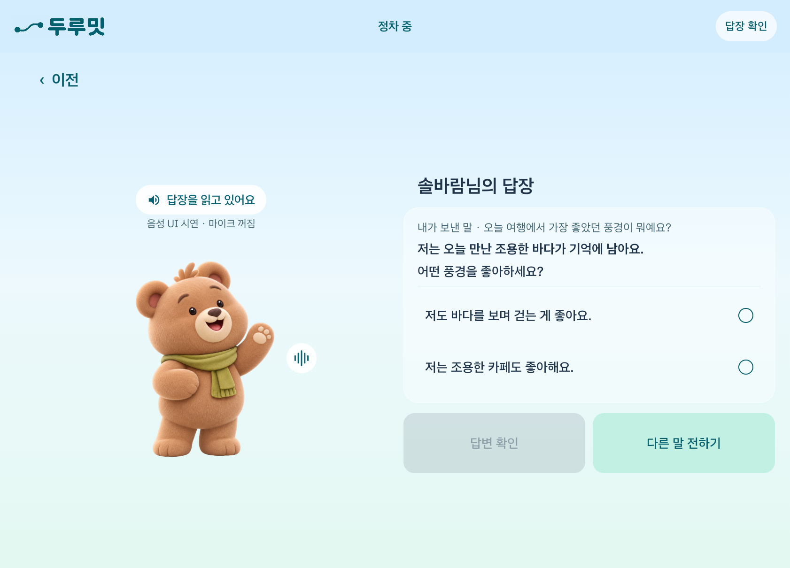</td><td>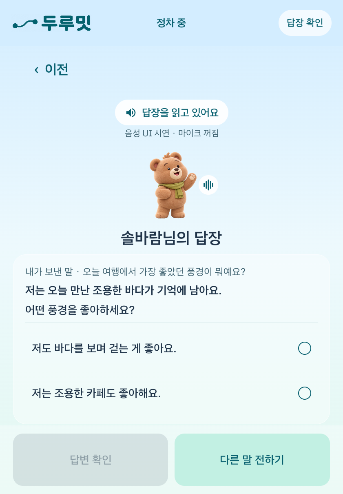</td></tr></table>

## 정차 · 듣기

<table><tr><th>2분할</th><th>3분할</th></tr><tr><td></td><td></td></tr></table>

## 정차 · 처리 중

<table><tr><th>2분할</th><th>3분할</th></tr><tr><td></td><td>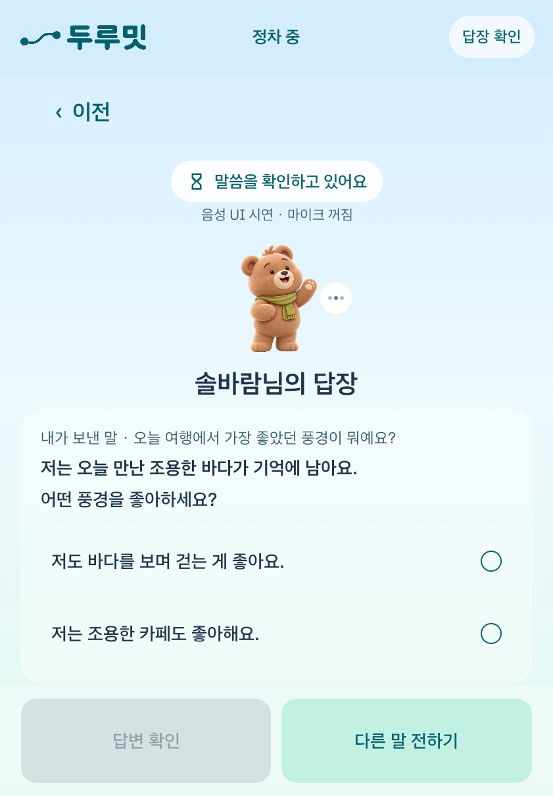</td></tr></table>

## 정차 · 대화 쉼

<table><tr><th>2분할</th><th>3분할</th></tr><tr><td></td><td></td></tr></table>

## 정차 · 대기

<table><tr><th>2분할</th><th>3분할</th></tr><tr><td></td><td></td></tr></table>

## 주행용 · 말하기

<table><tr><th>2분할</th><th>3분할</th></tr><tr><td></td><td>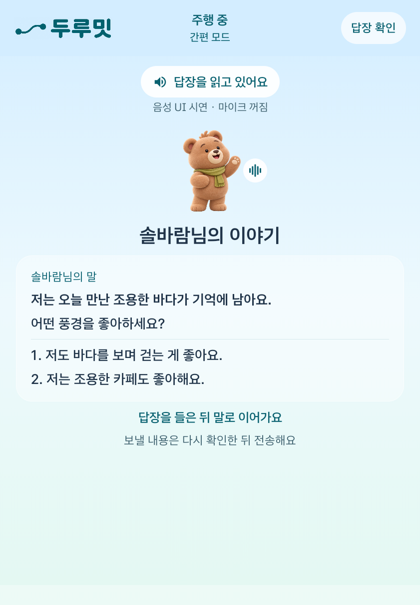</td></tr></table>

## 주행용 · 듣기

<table><tr><th>2분할</th><th>3분할</th></tr><tr><td></td><td></td></tr></table>

## 주행용 · 처리 중

<table><tr><th>2분할</th><th>3분할</th></tr><tr><td></td><td>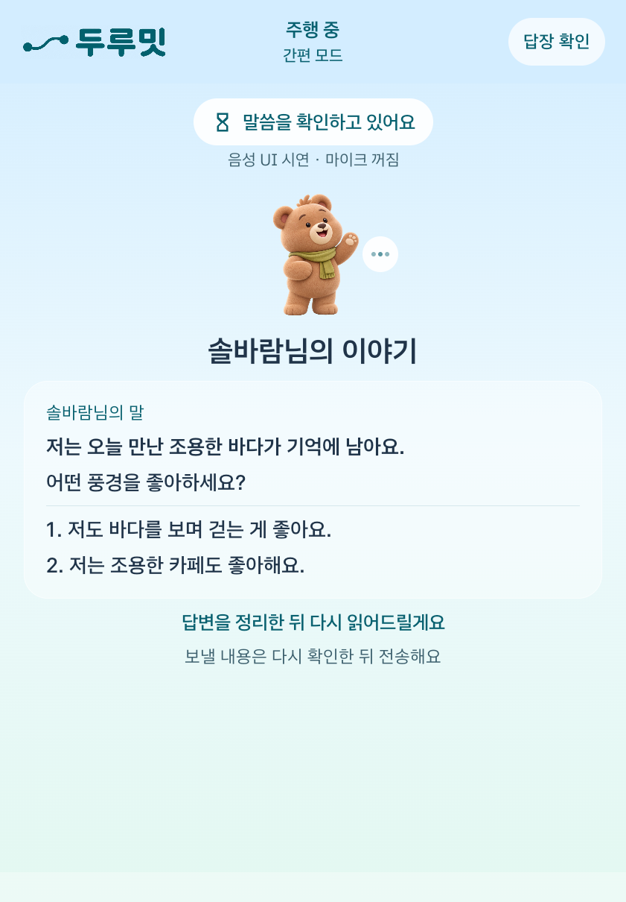</td></tr></table>

## 주행용 · 대화 쉼

<table><tr><th>2분할</th><th>3분할</th></tr><tr><td>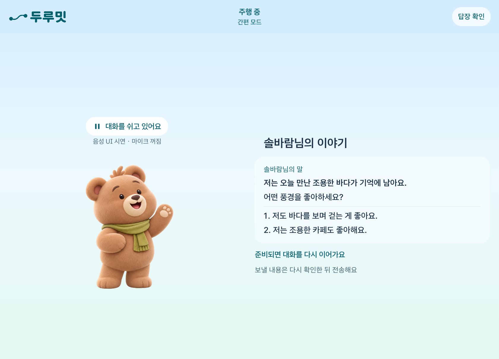</td><td></td></tr></table>

## 주행용 · 대기

<table><tr><th>2분할</th><th>3분할</th></tr><tr><td></td><td>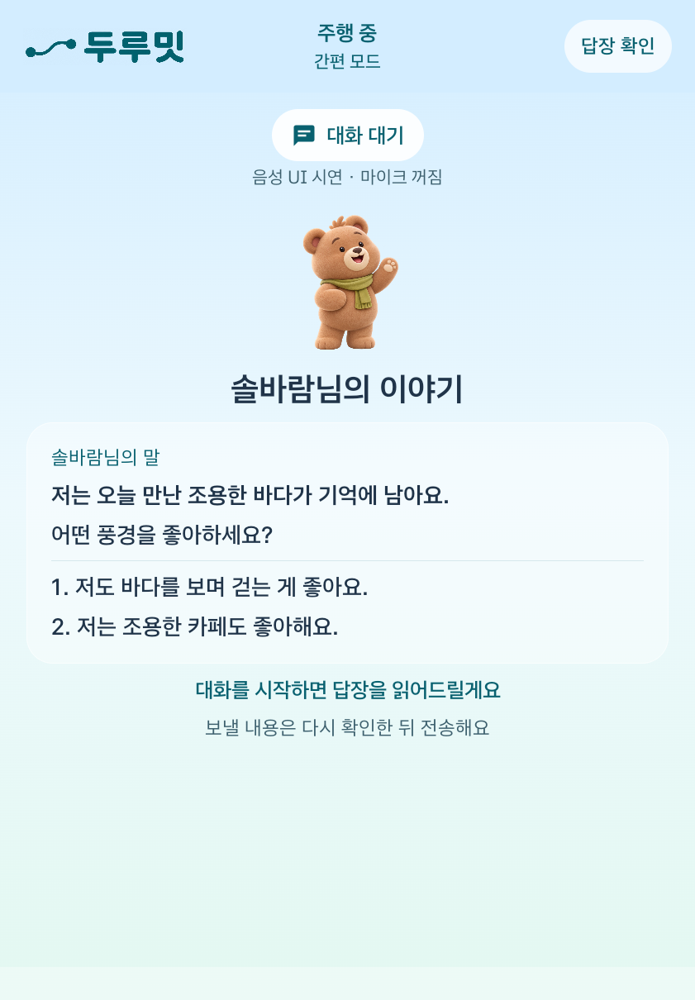</td></tr></table>

## 제품 연결 · 답장 확인

<table><tr><th>2분할</th><th>3분할</th></tr><tr><td></td><td>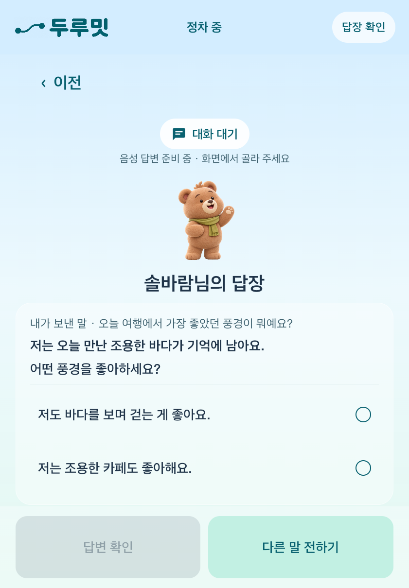</td></tr></table>

## 제품 연결 · 답장 대기

<table><tr><th>2분할</th><th>3분할</th></tr><tr><td>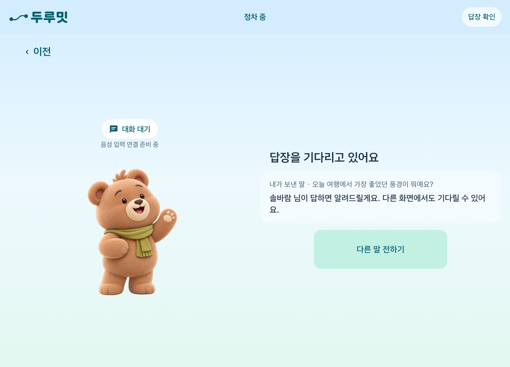</td><td>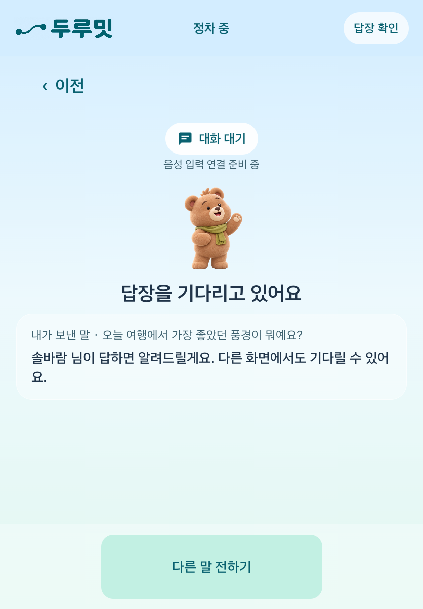</td></tr></table>

## 제품 연결 · 전달 완료

<table><tr><th>2분할</th><th>3분할</th></tr><tr><td>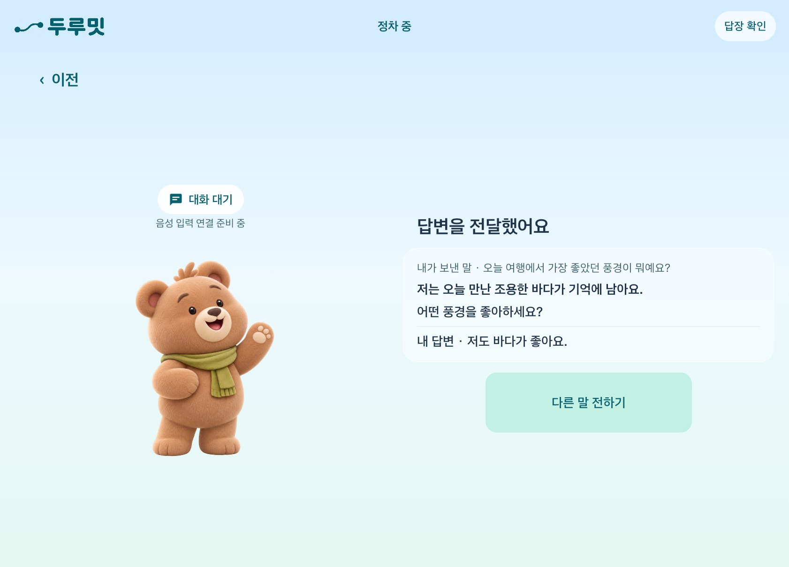</td><td>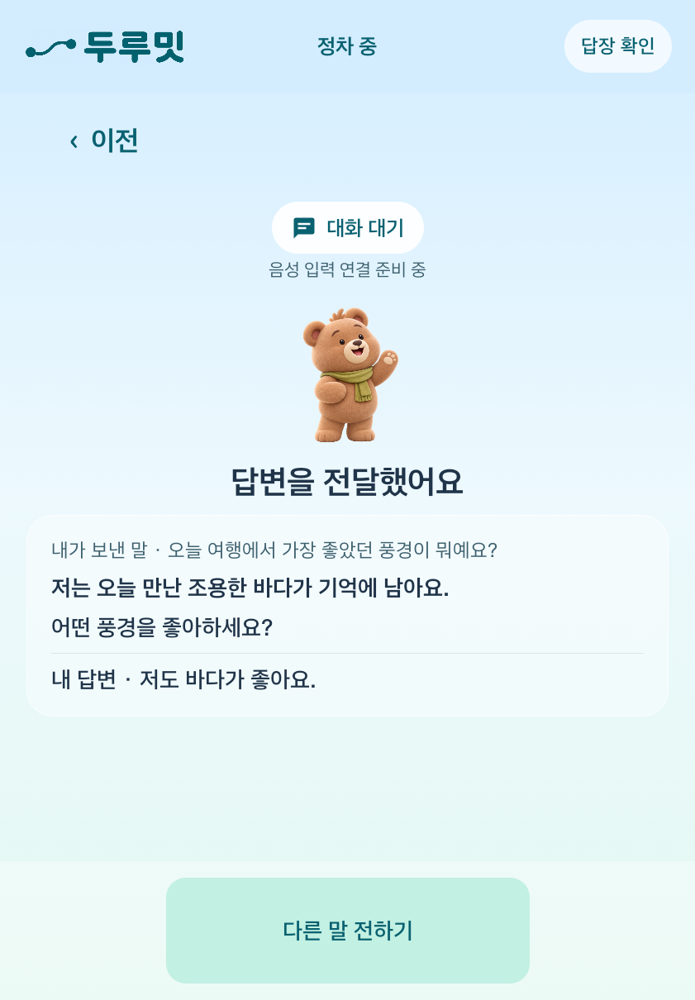</td></tr></table>

## 제품 연결 · 대화 종료

<table><tr><th>2분할</th><th>3분할</th></tr><tr><td>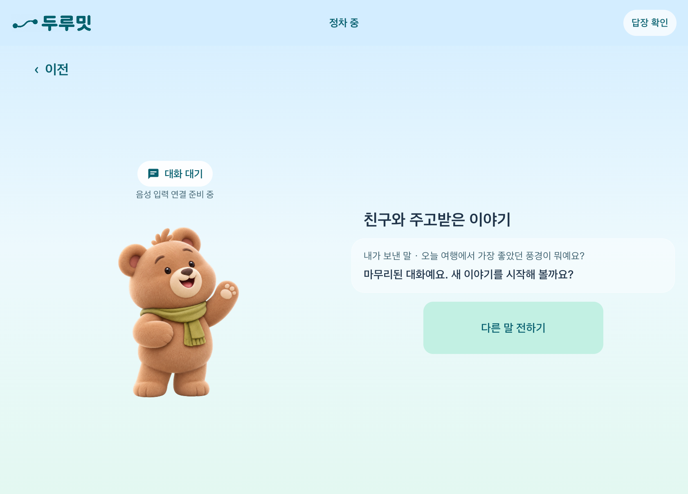</td><td>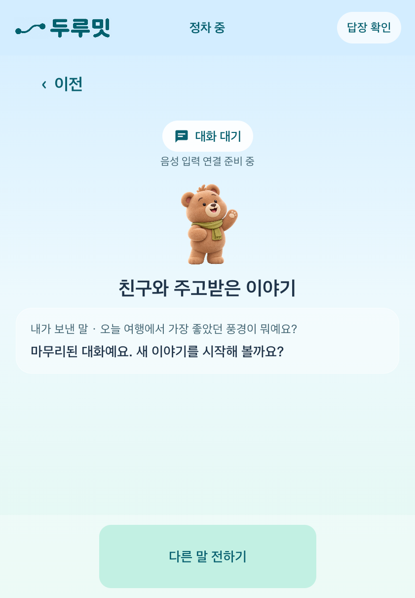</td></tr></table>
