# 두루밋 캐릭터 공통 음성 상태

[최신 두루·루밋 전체204장](../vehicle-ui-latest-2026-11-15/GALLERY.md) · [최신 애니메이션](../vehicle-ui-latest-2026-11-15/ANIMATIONS.md)

10개 장면 × 2분할/3분할 = 20장. 정차 Debug에서 촬영한 오프라인 UI이며 실제 음성 입력/실시간 통신과 구분합니다.

[말하기 맥동 영상](motion/speaking.mp4) · [곰 말하기 영상](motion/bear-speaking.mp4) · [주행 정적 영상](motion/driving-static.mp4)

## 정차 내 친구 · 말하기

<table><tr><th>2분할</th><th>3분할</th></tr><tr><td></td><td>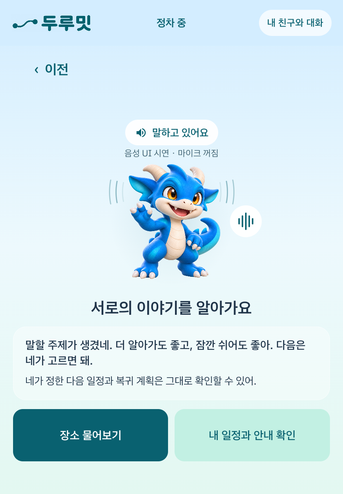</td></tr></table>

## 곰 캐릭터 · 말하기

<table><tr><th>2분할</th><th>3분할</th></tr><tr><td>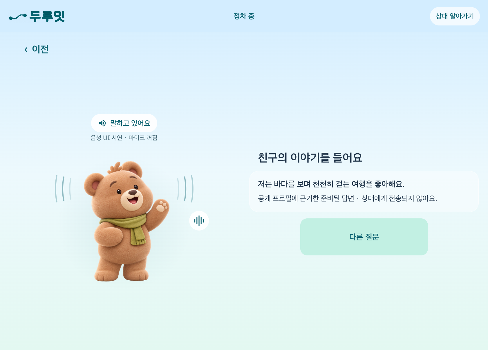</td><td>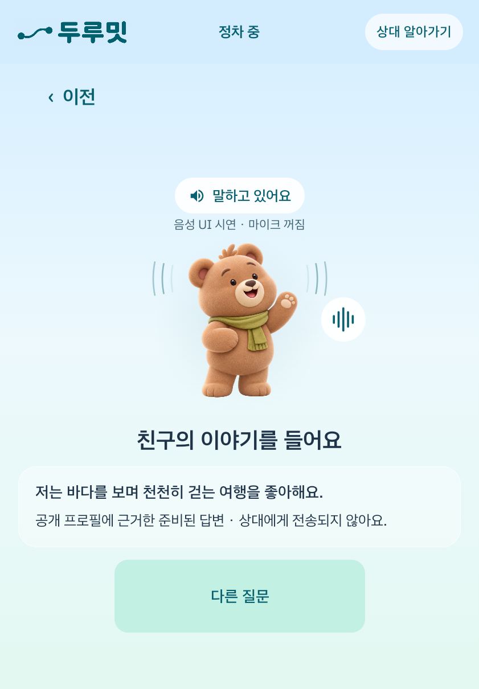</td></tr></table>

## 정차 장소 질문 · 말하기

<table><tr><th>2분할</th><th>3분할</th></tr><tr><td>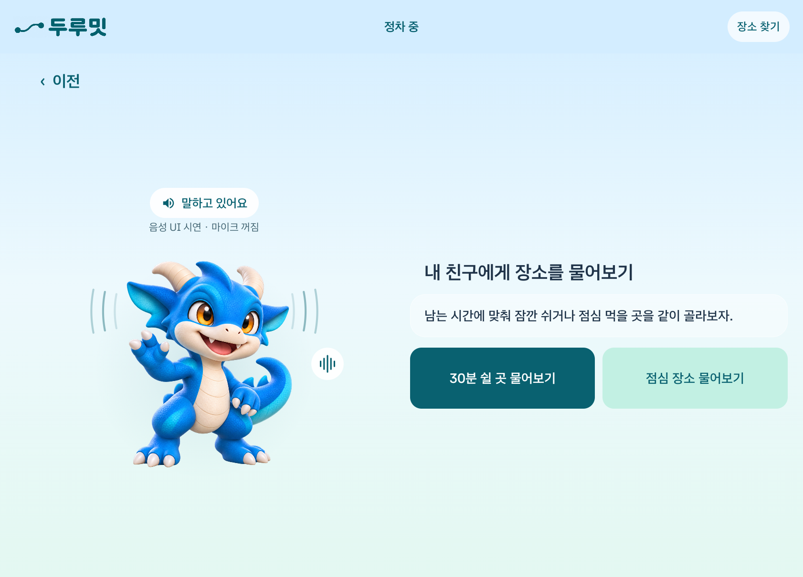</td><td>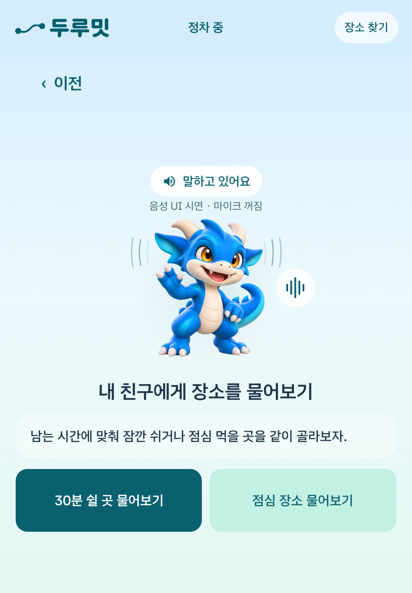</td></tr></table>

## 통화 · 현재 발화자

<table><tr><th>2분할</th><th>3분할</th></tr><tr><td>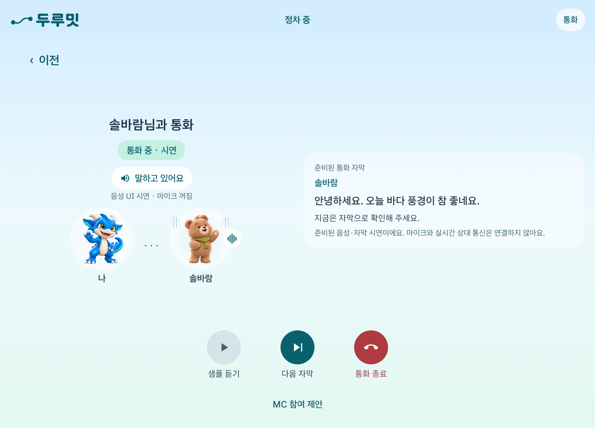</td><td>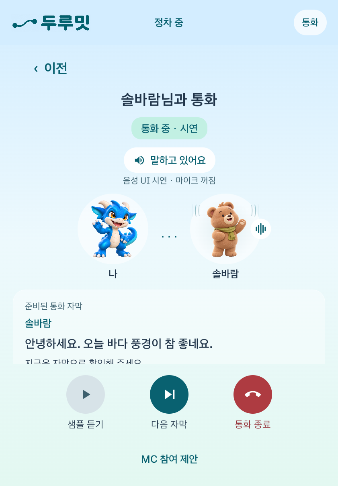</td></tr></table>

## 주행 추천 · 말하기 정적

<table><tr><th>2분할</th><th>3분할</th></tr><tr><td></td><td>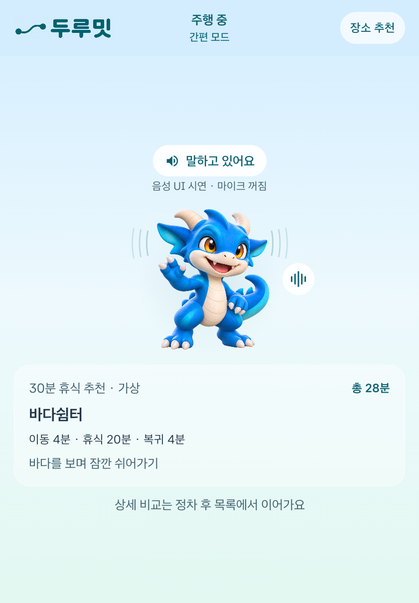</td></tr></table>

## 정차 내 친구 · 듣기

<table><tr><th>2분할</th><th>3분할</th></tr><tr><td>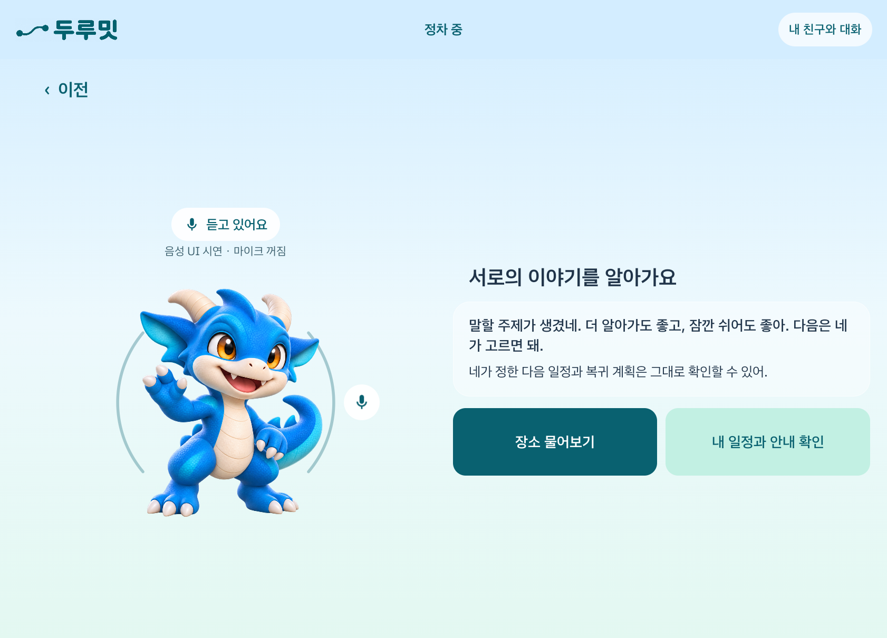</td><td></td></tr></table>

## 대기 · 주변 말하기 그래픽 없음

<table><tr><th>2분할</th><th>3분할</th></tr><tr><td>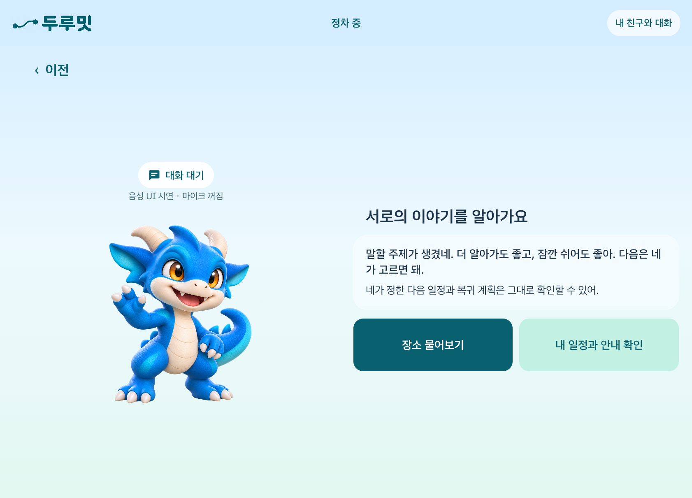</td><td></td></tr></table>

## 쉼 · 주변 말하기 그래픽 없음

<table><tr><th>2분할</th><th>3분할</th></tr><tr><td></td><td></td></tr></table>

## mc-active

<table><tr><th>2분할</th><th>3분할</th></tr><tr><td>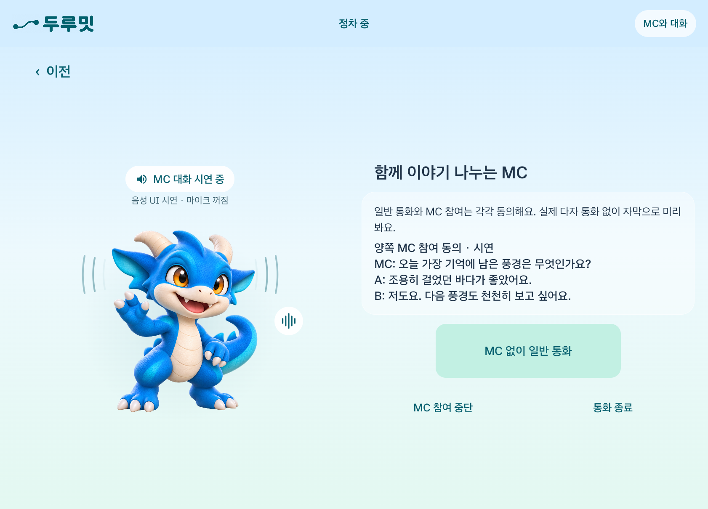</td><td>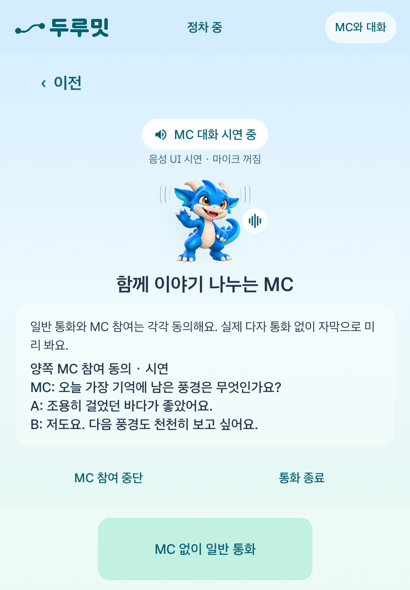</td></tr></table>

## voice-talking

<table><tr><th>2분할</th><th>3분할</th></tr><tr><td>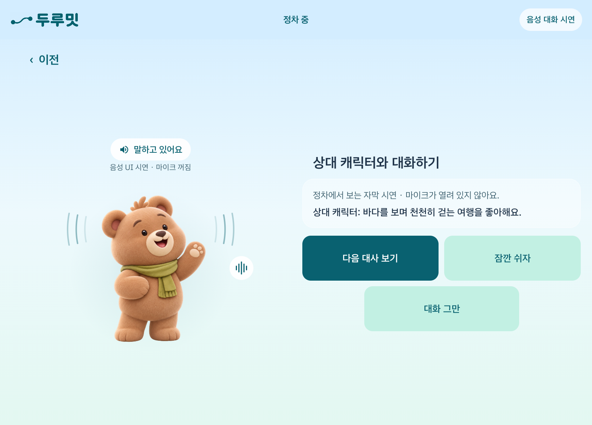</td><td>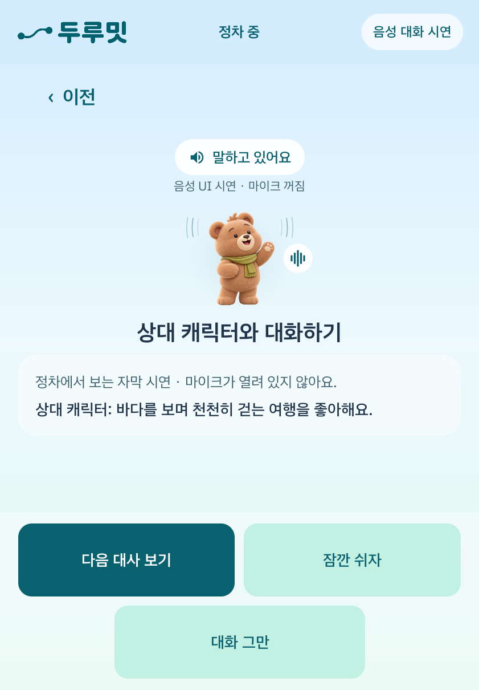</td></tr></table>
