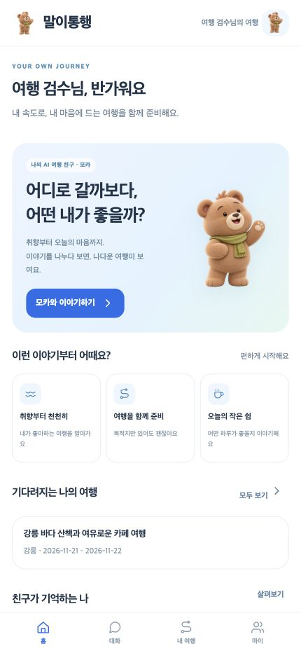
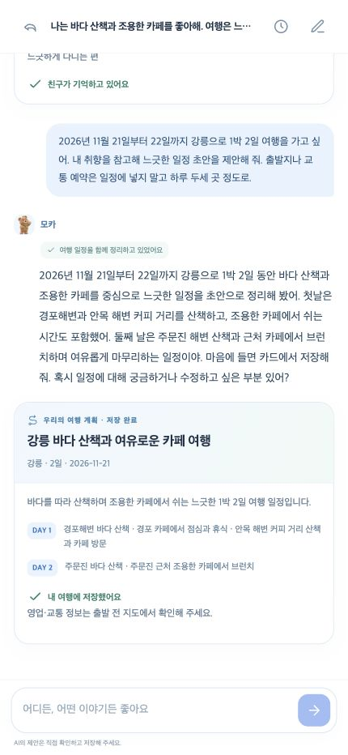
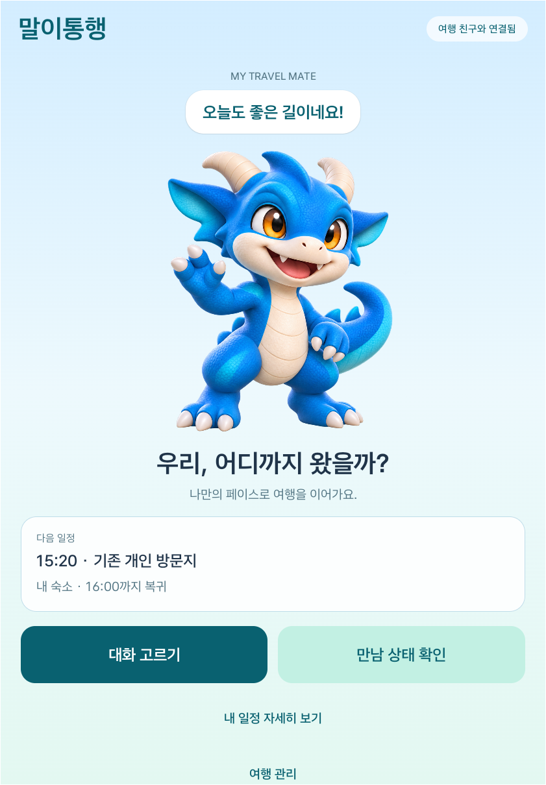
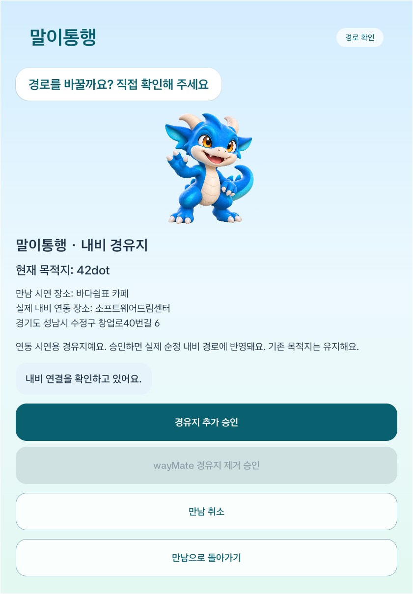
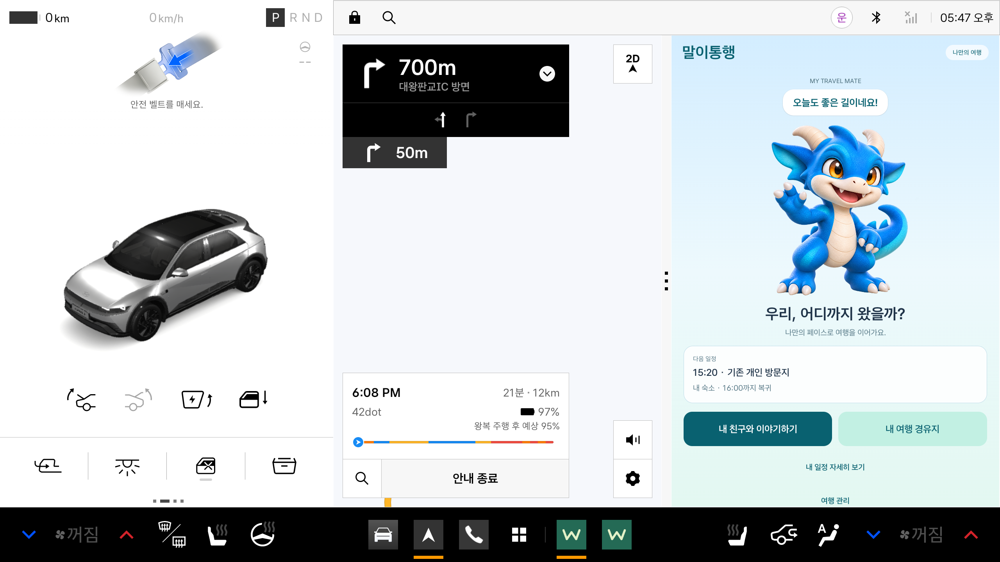

# wayMate 개발 현황·작업 이력

갱신일 **2026-11-14** · 앱 기준 **main `f60caf1`**. [PR #19](https://github.com/ho72/wayMate/pull/19) → [#20](https://github.com/ho72/wayMate/pull/20) → [#21](https://github.com/ho72/wayMate/pull/21)을 순서대로 머지하고 통합 검증했다. 서비스 **42/42**, 기존 서버 **328/328**, 차량 JVM **46/46**과 빌드·Lint·main CI가 통과했다. 자세한 실행 범위는 [5절](#5-최신-main-통합-검증)을 따른다.

**1차 차량 시연은 완료했고, 실제 개인 AI 모바일 서비스도 구현했다. 두 실행계의 연결은 다음 개발 범위다.** 기존 시연은 모바일 최종 매칭 → 차량 콘텐츠·만남 동의·내비 승인 → 독립 선택·두 결말 → 안전한 초기화로 이어진다. 새 모바일 서비스는 실제 계정·대화·취향·여행을 저장하지만 아직 그 계정의 여행을 차량으로 보내거나 실제 상대 사용자와 매칭하지 않는다.

기능·화면·계약 기준은 [docs_prototype](../docs_prototype/README.md)이다. [29 실제 모바일 서비스](../docs_prototype/29_모바일_실제_에이전트_서비스.md), [30 QA 수정](../docs_prototype/30_QA12_14_수정_및_회귀.md), [31 v5 디자인](../docs_prototype/31_v5_디자인_적용_및_검수.md), [32 리뷰 회귀](../docs_prototype/32_PR19_21_리뷰_반영_및_회귀.md)를 함께 읽는다. 01~05의 초기 ‘미실시’ 표기와 과거 문서의 테스트 수는 이후 기록으로 대조하며, 이미 끝난 1차 작업을 새 미구현 작업으로 세지 않는다. 제출용 문서는 [docs_proposal](../docs_proposal/README.md)에서 별도로 관리한다.

## 1. 처음 읽는 순서

1. 이 문서에서 구현 범위·검증 결과·남은 작업을 확인한다.
2. [앱 실행 안내](../mock-app/README.md)와 [차량 빌드·설치 안내](../mock-app/vehicle/README.md)로 환경을 준비한다.
3. [01 범위](../docs_prototype/01_목업_기획_범위_정의서.md)·[03 화면](../docs_prototype/03_화면_및_상호작용_설계서.md)·[04 계약](../docs_prototype/04_개발_및_연동_명세서.md)을 읽는다.
4. 담당 경로는 [06 아키텍처·분담](../docs_prototype/06_개발_아키텍처_및_분담_가이드.md), 협업 방식은 [CONTRIBUTING](../CONTRIBUTING.md)을 따른다. 팀 5명의 실제 개발 담당은 아직 확정되지 않았다.
5. 발표 준비는 [24 시연 운영표](../docs_prototype/24_main_통합_확인_및_시연_운영표.md), 주행 모드 작업은 [26 구현·검수](../docs_prototype/26_캐릭터_중심_주행_정차_모드.md)를 확인한다.

## 2. 지금 구현된 사용자 흐름

| 영역 | 현재 구현 | 범위와 상세 근거 |
|---|---|---|
| 실제 모바일 서비스 | 가입·로그인·로그아웃, 자유 AI 상담/스트리밍, 사용자별 대화 기록·보관/복원, 확인 후 취향·여행 저장, 캐릭터·프로필 수정 | `service/`·3004번·별도 SQLite. 실제 OpenAI 도구를 사용한다. 차량 페어링·실사용자 매칭·실시간 장소 도구는 후속이다. [29 구현·경계](../docs_prototype/29_모바일_실제_에이전트_서비스.md) |
| 시연 모바일 M01~M04 | 자유 입력 대화형 준비, 본인이 확인한 소개·공개 범위·여행 저장, 후보와 이유·연결 요청/수락·공통 시간·최종 매칭 확인 | 기본 3000번 시연은 준비된 대화 분기다. [27번](../docs_prototype/27_실제_AI_상담_및_소개_초안.md)의 별도 AI 설정에서는 실제 생성형 상담·소개 초안을 사용한다. 추천 후보·상대 B의 응답은 계속 시연 데이터다. [13 v4 연동](../docs_prototype/13_v4_화면_전환_및_연동.md) |
| 공통 서버·JSON | v4 명령·역할별 상태·영수증·버전 검증, connected/my_trip 전달, 차량 수신·ACK·복원 | 상담 원문은 본인 웹/서버에 보존하고 차량·상대에게 확인한 소개만 전달한다. 모바일이 최종 매칭 권한을 가진다. [04 계약](../docs_prototype/04_개발_및_연동_명세서.md) |
| 차량 P01·본인 여행 | 큰 드래곤 홈, 다음 일정·복귀 계획, 모바일 여행 불러오기·확인 후 직접 시작, 재접속 복원 | 모바일에서 연결을 마친 뒤 차량으로 이어간다. 차량에서 신규 후보 추천·최종 매칭을 수행하지 않는다. [13 역할 전환](../docs_prototype/13_v4_화면_전환_및_연동.md) |
| 차량 P02 | 공개 문답·캐릭터 소개·말 전달, 일반 통화의 제안·수락·거절·취소·샘플 시작·종료 | 양쪽 동의와 직접 선택을 적용한다. 실제 마이크·상대방 실시간 통신은 없다. [15 P02](../docs_prototype/15_P02_캐릭터_대화_및_말_전달.md), [23 통화 마감](../docs_prototype/23_1차_개발_완료_및_검수.md) |
| 차량 P03·순정 내비 | 만남 제안·양쪽 동의 뒤 운전자 승인으로 경유지 추가, 취소/정리 시 별도 제거 승인 | real 앱에서 실제 NaviHelper 호출·결과 조회·소유권 기록을 사용한다. 원래 목적지는 유지한다. [11 SDK 검증](../docs_prototype/11_실제_내비_좌표_및_경유지_검증.md), [12 승인 연동](../docs_prototype/12_차량_앱_내비_승인_연동.md) |
| 만남 재연·P04 | 만남 뒤 A·B 독립 선택, 상대 선택 비공개, 두 결말, 최종 선택 재시연 | 양쪽 제출 뒤 결과를 확정한다. 재시연으로 실제 내비를 다시 호출하지 않는다. [16 결말·재시연](../docs_prototype/16_만남_재연_및_P04_두_결말.md) |
| 시연자 O01 | B의 응답·선택 재현, 모의 내비 실패/미확인·후속 결과, 안전한 전체 초기화 | 내비 정리와 필요한 동일 기기 ACK 전에는 새 회차를 열지 않는다. 실제 미확정을 모의 성공으로 풀지 않는다. [14 O01](../docs_prototype/14_O01_안전한_전체_초기화.md), [23 검수](../docs_prototype/23_1차_개발_완료_및_검수.md) |
| 캐릭터·음성 | v5 파도(드래곤)·모카(곰) 렌더 이미지, 정차 시 대기/발화/중단 동작, APK 내 한국어 준비 합성 음원 35개 | 실시간 3D 모델·정교한 립싱크·STT/자유 대화는 미구현이다. 창/오디오 포커스 상실·제한·비활성 시 중단하고 자동 재개하지 않는다. [23](../docs_prototype/23_1차_개발_완료_및_검수.md), [26](../docs_prototype/26_캐릭터_중심_주행_정차_모드.md) |

### 주행·정차 모드

MainActivity에 `distractionOptimized=true`를 선언하고 실제 `CarUxRestrictionsManager` 관측과 서버 상태를 함께 사용한다. 기어·속도만으로 앱이 정차를 추정하지 않는다.

| 모드 | 표시·조작 |
|---|---|
| `parked` | 캐릭터 동작과 기존 상세 화면. 각 기능의 동의·상태·허용 조건을 계속 확인한다. |
| `driving_limited` | 큰 **정적** 캐릭터·짧은 상태, `친구 한마디 듣기`·`음성 멈추기`. 준비 음원만 직접 재생한다. 목록·키보드·새 통화/말 전달·만남 동의·내비 승인·최종 선택은 잠근다. |
| `blocked` | 관측 미확인·미검증 제한·비활성·만료·초기화/복구 등에서 새 재생과 업무 조작을 잠근다. |

허용 마스크는 [공통 설정](../mock-app/shared/config/driving-policy.json)의 `0`·`80(0x50)`이며 DO 요구 여부도 함께 판정한다. 서버는 JSON을 직접 읽고 차량 빌드는 Kotlin 정책을 생성한다. `RestrictionSnapshot`을 한 번 캡처해 known/restricted/raw를 함께 보고하며, 음성 유효 기간에서는 HTTP·저장 지연을 차감한다. 정차·포커스 복귀만으로 음성이나 승인 작업을 재실행하지 않는다. DO 선언과 에뮬레이터 검증은 앱 심사 승인을 대신하지 않는다.

### 화면 미리보기

아래는 **2026-11-14에 이미 촬영해 main에 포함된 검증 캡처 5장**이다. 이번 README 정리에서 새로 촬영하지 않았다. 모바일은 29번의 실제 서비스 검수용 계정·여행이며, 차량 단일 화면은 31번의 production Compose를 사용하는 오프라인 표시 fixture다. 차량 화면에 표시된 연결·장소만으로 실제 SDK 성공을 판정하지 않는다.

| 실제 모바일 홈 | AI 상담·확인 후 여행 저장 |
|---|---|
|  |  |

| 차량 홈·다음 일정 | 운전자 내비 승인 화면 |
|---|---|
|  |  |

내비 화면은 조회 대기 상태의 디자인 캡처다. 가상 이야기의 바다쉼표 카페와 실제 SDK 시험 장소인 소프트웨어드림센터를 구분한다. #20에서 수정한 취소 확인창은 [별도 회귀 캡처](../docs_prototype/evidence/qa12-14-2026-11-14/meeting-cancel-confirmation.png)로 확인한다.

**대표 3분할: 계기판 / 순정 내비 / wayMate**



순정 내비의 도로 배경 누락도 이 캡처에 그대로 남아 있다. 배경 지도 문제는 보류 상태이며 경유지 SDK 검증과 별개다. 원본·검수 조건은 [29번](../docs_prototype/29_모바일_실제_에이전트_서비스.md)과 [31번](../docs_prototype/31_v5_디자인_적용_및_검수.md)을 따른다.

## 3. 개발 작업 이력

| 단계 | 완료한 작업 | 기록 |
|---|---|---|
| 환경·저장소 기반 | Mac Android Studio·SDK·Pleos ARM 에뮬레이터, Kotlin/Compose 기본 차량 화면, 웹/서버/차량/공통 계약 경로와 협업 구조 | [06](../docs_prototype/06_개발_아키텍처_및_분담_가이드.md), [차량 실행](../mock-app/vehicle/README.md) |
| 첫 웹→차량 전달 | 공통 JSON·최소 서버·웹 저장·차량 HTTP 수신/ACK, 이후 v3 여행 준비·홈으로 확장 | [07 v2 기록](../docs_prototype/07_첫_전달_실행_및_계약.md), [10 v3 기록](../docs_prototype/10_v3_여행_준비_차량_홈_및_내비_시험.md) |
| 실제 내비·v4 전환 | 좌표/POI 불일치 확인·보정, 실제 경유지 추가/제거, 운전자 승인·실행권·journal, 모바일 최종 매칭과 차량 만남/내비 연결 | [11~13](../docs_prototype/13_v4_화면_전환_및_연동.md), [PR #2](https://github.com/ho72/wayMate/pull/2) |
| O01 안전한 초기화 | 정리 중 잠금, 내비 제거 별도 승인, 같은 차량 ACK, 원자적 새 회차와 회귀 | [14](../docs_prototype/14_O01_안전한_전체_초기화.md), [PR #3](https://github.com/ho72/wayMate/pull/3) |
| P02 대화·말 전달 | 공개 범위·역할·대상·영수증/재접속 검증과 캐릭터 콘텐츠 | [15](../docs_prototype/15_P02_캐릭터_대화_및_말_전달.md), [PR #4](https://github.com/ho72/wayMate/pull/4) |
| 만남·독립 선택·두 결말 | A/B 독립 제출·비공개·제출 순서·최종 재시연과 회귀 | [16](../docs_prototype/16_만남_재연_및_P04_두_결말.md), [PR #5](https://github.com/ho72/wayMate/pull/5) |
| 3분할·화면 검수 | 계기판 / 순정 내비 / wayMate의 배치·조작, 확장 창·130% 글자 검수 | [17](../docs_prototype/17_3분할_검수_및_순정_지도_진단.md), [18](../docs_prototype/18_확장_창_및_글자_확대_검수.md), [PR #6](https://github.com/ho72/wayMate/pull/6) |
| 순정 지도 배경 진단 | Playground·공식 문서·배포본·빈 스타일 분기 확인, 기존 환경을 유지한 별도 AVD 내부 스타일 변경 실험. 해결 완료로 처리하지 않고 보류 | [19](../docs_prototype/19_순정_지도_추가_진단_및_Playground_설정.md)·[20](../docs_prototype/20_지도_스타일_분기_및_배포본_확인.md)·[21](../docs_prototype/21_순정_내비_공식_문서_재검토.md)·[22](../docs_prototype/22_순정_내비_내부_스타일_변경_실험.md) |
| 1차 개발 마감 | 일반 통화·준비 음성·캐릭터 동작·모의 실패/미확인·복원·전체 여정·인계, 저장 지연/정상 종료 보완, 창 포커스 중단 리뷰 반영 | [23](../docs_prototype/23_1차_개발_완료_및_검수.md), [PR #7](https://github.com/ho72/wayMate/pull/7) |
| SDK 점검·시연 운영 | NaviHelper·실제 제한 리스너·Android TTS 상태 점검, SDK 연결/미연결 구분, 발표자/O01 운영표. 리뷰에서 `stop()` 검증 범위를 명확히 함 | [24](../docs_prototype/24_main_통합_확인_및_시연_운영표.md), [25](../docs_prototype/25_SDK_연동_점검_및_주행_모드_조건.md), [PR #8](https://github.com/ho72/wayMate/pull/8) |
| 캐릭터 중심 주행 모드 | DO·주행/정차/차단 분리, 실제 Console 전환 검수, 제한 관측 동시성 버그 수정·공통 마스크 설정·회귀 | [26](../docs_prototype/26_캐릭터_중심_주행_정차_모드.md), [PR #9](https://github.com/ho72/wayMate/pull/9) |
| 이전 main 통합 검증 | #8→#9 순차 머지, main 새 빌드·계약 예제·전체 자동 회귀·기기 전환·내비 기록 보존·자동 검사 | [검증 요약](evidence/main-pr8-pr9-validation-2026-11-13.json) |
| 개발 인계·실제 상담 확장 | 개발 현황 정리와 별도 3002번 AI 상담·확인 소개 초안, 실패/미확인 결과 복구 | [27](../docs_prototype/27_실제_AI_상담_및_소개_초안.md), [PR #10](https://github.com/ho72/wayMate/pull/10)·[#11](https://github.com/ho72/wayMate/pull/11) |
| v5 디자인·QA 수정 | 차량·시연 모바일 디자인, 만남 취소/거절 후 연결 종료·모의 취소 확인·부분 공개 중립 대사/음원 | [30](../docs_prototype/30_QA12_14_수정_및_회귀.md)·[31](../docs_prototype/31_v5_디자인_적용_및_검수.md), [PR #19](https://github.com/ho72/wayMate/pull/19)·[#20](https://github.com/ho72/wayMate/pull/20) |
| 실제 개인 AI 서비스·리뷰 수정 | 계정·SQLite·도구·여행 저장, 지연 응답의 대화 대상 고정·미선언 도구/과거 이력 방어, 회귀 27개 추가 | [29](../docs_prototype/29_모바일_실제_에이전트_서비스.md)·[32](../docs_prototype/32_PR19_21_리뷰_반영_및_회귀.md), [PR #21](https://github.com/ho72/wayMate/pull/21) |
| 최신 main 통합 검증 | #19→#20→#21 순차 머지, 최종 main과 검증한 서비스 head의 파일 트리 일치·전체 회귀·빌드/문서 점검 | 아래 5절과 [검증 요약](evidence/main-pr19-pr21-validation-2026-11-14.json) |

## 4. 코드 구조와 변경 책임

기존 차량·시연 실행 코드는 `mock-app/`에 있고, 실제 계정 기반 개인 AI 서비스는 `service/`에 있다. 두 서버의 저장소와 인증 계약을 혼용하지 않는다. 차량 연동 개발은 **v4**를 기준으로 하며 v2/v3 파일은 기존 실행·계약 검증 이력으로 보존한다.

| 경로 | 역할·함께 확인할 부분 |
|---|---|
| [service/web/](../service/web/) | 실제 서비스의 홈·대화·여행·프로필·계정 UI. |
| [service/server/](../service/server/) | 세션·소유권·SQLite·API·OpenAI 도구와 스트림. 새 차량 연동의 생산자이며 기존 v4와 별도 계약이 필요하다. |
| [service/tests/](../service/tests/) | 실제 HTTP/DB와 가짜 provider를 사용하는 42개 회귀. 실제 AI 호출/과금을 요구하지 않는다. |
| [web/](../mock-app/web/) | 모바일 대화·공개/여행·추천/매칭·O01. 서버의 역할별 projection을 사용한다. |
| [server/v4/](../mock-app/server/v4/) | 기준 상태·명령 검증·공개 경계·영수증·내비/통화·초기화·복구. 웹/차량과 계약을 함께 변경한다. |
| [shared/](../mock-app/shared/) | `contracts/handoff-v4.schema.json`, `examples/v4/`, 공통 config·소재 manifest. 계약 변경 시 예제와 생산자/소비자 회귀를 함께 갱신한다. |
| [vehicle/app/src/main/](../mock-app/vehicle/app/src/main/) | Compose 화면·Repository·API·주행 제한·음성·순수 정책. UI가 HTTP·SDK를 직접 호출하지 않게 유지한다. |
| [vehicle/app/src/real/](../mock-app/vehicle/app/src/real/) | 실제 NaviHelper 어댑터·실행권·AtomicFile journal·결과 관측. |
| [vehicle/app/src/mock/](../mock-app/vehicle/app/src/mock/) | 별도 모의 내비 어댑터. 실제 내비 기록을 모의 결과로 바꾸지 않는다. |
| [assets/](../mock-app/assets/) | 캐릭터 렌더·준비 음성·출처. Gradle이 공통 소재를 차량 리소스/assets로 복사한다. |
| [tests/](../mock-app/tests/)·[차량 단위 테스트](../mock-app/vehicle/app/src/test/) | 계약·서버·HTTP·상태 전환과 차량 순수 정책 회귀. 기기 검사는 `src/androidTestMock/`·`src/androidTestReal/`에 있다. |
| `mock-app/runtime/` | 개인 상태·SDK journal 백업·전체 로그·로컬 APK 전달본. Git 추적 제외이며 공유 문서에 원본 상태를 복사하지 않는다. |

### 실제 SDK와 시연 동작 구분

- **선택적 실제 AI 외부 API([27번](../docs_prototype/27_실제_AI_상담_및_소개_초안.md)):** `WAYMATE_AI_PROVIDER=openai`와 서버 전용 로컬 `.env` 키를 설정한 3002번 서버에서 실제 OpenAI 상담·소개 초안을 사용한다. 원문/자유 소개는 본인 모바일에만 표시하고, 직접 확인한 요약만 기존 공개·차량 전달에 연결한다. 기본 3000번 시연은 준비된 분기를 유지한다. 키는 저장소·웹·APK에 넣지 않는다. 첫 호출이 확정 실패하면 입력을 보존해 기본 시연으로 돌아갈 수 있으며, 미확인 저장 결과는 먼저 확인한다.
- **실제 연결:** NaviHelper **3.0.5**의 목적지·경유지·경로 조회/승인 후 추가·제거, AAOS `CarUxRestrictionsManager`, Android `MediaPlayer`·오디오/창 포커스.
- **시연 재현:** 추천 후보 데이터·B의 응답/선택·만남 재연·일반 통화 샘플·준비 합성 음성. 모의 내비는 별도 source로 관리한다.
- **미연결:** Pleos Vehicle State/Control, Pleos STT/TTS·마이크·Gleo·FusedLocation. 현재 Android 기기 TTS는 초기화 오류·엔진 없음으로 관측됐다. 준비 음원 재생 성공을 플랫폼 TTS 성공으로 기록하지 않는다.
- 현재 구현한 내비·UX 제한·준비 음원에는 추가 키/Secret을 요청하지 않았다. Playground 사용 가능 표시와 실제 API 연동 완료는 별개다. 이후 서비스의 인증값은 저장소·채팅·APK에 넣지 않는다.

## 5. 최신 main 통합 검증

2026-11-14 · **`f60caf166d83f57aa9bc1ad26b9a769389b3f1b6`**. #19 → #20 → #21 순서로 머지했다. #20·#21은 각 선행 머지 후 base를 main으로 바꿨고, 최종 파일 트리는 검증한 #21 `c6046f5`와 같다. 환경은 Node **22.22.2**, JDK **21**, 컴파일 SDK **35**다.

| 검사 | 결과·범위 |
|---|---|
| 실제 서비스 자동 회귀 | **42/42**: 기존 15 + 대화 전환/계정 경계 20 + 도구/과거 이력 7 |
| 기존 서버·계약·HTTP 회귀 | **328/328** |
| 차량 | mock/real 앱 및 양쪽 Android 테스트 APK 빌드·JVM **46/46** 확인. 로컬 Gradle은 동일 입력의 유효 산출물을 재사용했다. |
| Lint | mock/real Error·Fatal **0**, 기존 Warning 각각 **33** |
| 계약 예제 | 재생성 후 추적 파일 diff **0** |
| 문서·QA 증거 | 당시 문서 상대 링크 **444개**, QA 체크섬 **37/37** 통과 |
| main push CI | [서비스 통과](https://github.com/ho72/wayMate/actions/runs/43596562019) · [서버·계약 통과](https://github.com/ho72/wayMate/actions/runs/43596505326) · [차량 빌드·JVM·Lint 통과](https://github.com/ho72/wayMate/actions/runs/43596505309) |
| 보존·미실시 | 기존 실행 서버·DB·인증값·사용자 Gradle 변경 보존. 이번 main 검수에서 기기 조작·외부 AI 호출을 반복하지 않았다. |

[공유 검증 JSON](evidence/main-pr19-pr21-validation-2026-11-14.json)에 커밋·검사 범위·CI 링크를 보존했다. 서버/차량 push CI는 해당 경로가 마지막으로 바뀐 #20 merge `2d361cc` 기준이며 최종 main까지 해당 코드·workflow의 diff가 없다. 서비스 CI는 최종 `f60caf1` 기준이다. 전체 로컬 로그는 Git 제외 `mock-app/runtime/main-integration-2026-11-14/`에 있다.

32번의 브라우저 검증은 격리 계정·가짜 에이전트로 지연 전송과 입력 보존을 확인한 결과다. 29번의 최초 실제 AI 3건, 30번의 Pleos mock 기기 27개, 31번의 디자인·실제 제한 전환 기기 검수는 각각 당시 결과로 보존하며 이번 실행 수에 합산하지 않는다.

<details>
<summary>이전 #8·#9 main 통합 검증과 선택 AI 확장 기록</summary>

검증 대상은 #8 머지 `6de2f79` 이후 #9까지 합친 **`901a3250b6e3b3a367c59b3bcf5ace753a2930f9`**다. 환경은 Node **22.22.2**, JDK **21**, 컴파일 SDK **35**, Pleos Connect **ARM 2.1.0 / API 34**다.

| 확인 항목 | 결과 |
|---|---|
| Node 계약·서버·HTTP 회귀 | **273개 통과** |
| Kotlin/JVM 차량 로직 | **46개 통과** |
| 실제 기기 검사 | **5개 통과**: production 화면 Console 전환 1 + SDK 점검 4 |
| 모의 기기 검사 | **9개 통과**: 음성·화면·포커스·수명주기·주행 화면 |
| clean 빌드 | real/mock 앱 및 양쪽 기기 테스트 APK 통과 |
| Lint | 오류·치명 오류 0, real/mock 경고 각 26개 |
| 생성 예제 | v3/v4 예제 갱신 후 추적 파일 차이 없음 |
| main 자동 검사 | [Handoff checks 통과](https://github.com/ho72/wayMate/actions/runs/43444563199), [Vehicle checks 통과](https://github.com/ho72/wayMate/actions/runs/43444563133) |
| 실제 전환 | P/0 → D/36km/h → P/0, 앱 표시·실제 제한 보고·직접 음성 시작·승인창 폐기·복귀 후 무재실행 확인 |
| 내비 보존 | 기존 목적지 42dot·경유지 0, SDK journal **16개 전후 바이트/해시 동일**. 이 통합 검사는 경유지 추가/제거 재실행이 아니다. |

[공유 가능한 통합 검증 JSON](evidence/main-pr8-pr9-validation-2026-11-13.json)에 커밋·로그 해시·자동 검사 링크를 기록했다. 전체 상태 파일·개인 데이터는 포함하지 않았다. 앞선 [PR 리뷰 수정 검증](../docs_prototype/evidence/pr8-pr9-review-fixes-2026-11-13.json)과 [최초 주행 모드 증거](../docs_prototype/evidence/driving-mode-validation-2026-11-13.json)는 별도 시점 기록이다. 테스트 수를 서로 더하지 않는다.

선택적 AI 확장의 #11 리뷰 후 서버 회귀는 **314개(AI 41개 포함)**다. [27번 후속 검수](../docs_prototype/27_실제_AI_상담_및_소개_초안.md)에 첫 실패 뒤 시연 복귀·입력 보존·동시 작업/늦은 응답·기존 빈 기록 복구를 기록했다. 위 main 273개 및 최초 AI 293개와는 서로 다른 시점이며 합산하지 않는다.

화면·서버 복원 중 사용자가 에뮬레이터에서 직접 시연을 진행한 사실을 확인했다. 중간 백업 복원이 사용자 조작과 겹친 뒤에는 현재 선택 상태를 유지했다. 최종 시연 선택 상태를 전부 자동 검사 결과라고 기록하지 않는다. 기기 검수·초기화·상태 복원 전에는 진행 중인 수동 시연과 조율한다.

</details>

## 6. 실행·재검증·인계

Node 22.22.2를 사용한다. 실행계는 세 개다. 각 서버는 별도 터미널에서 시작하며 같은 상태 파일/DB를 두 프로세스가 동시에 열지 않는다.

| 실행계 | 경로·시작 | 주소·저장 | 차량 연결 |
|---|---|---|---|
| 실제 개인 AI 서비스 | `service/`에서 `npm ci --ignore-scripts`, `npm start` | `127.0.0.1:3004` · SQLite | 아직 연결 안 됨 |
| 기본 대본 시연 | `mock-app/`에서 아래 명령 | `127.0.0.1:3000` · v4 상태 파일 | 기존 시연 차량 |
| 시연의 실제 AI 상담 확장 | `mock-app/`에서 `npm run start:ai` | `127.0.0.1:3002` · 별도 v4 상태 파일 | 해당 포트로 빌드한 시연 차량 |

실제 서비스의 키는 로컬 env에서만 읽는다. 상세 실행·백업·API는 [서비스 README](../service/README.md)를 따른다. Android Studio에서는 `mock-app/vehicle/`을 연다.

```sh
cd mock-app
npm ci --ignore-scripts
npm start
```

시연 모바일은 `http://127.0.0.1:3000`, O01은 `http://127.0.0.1:3000/operator`, 차량 API는 `http://10.0.2.2:3000`이다. 로컬 프로토타입이며 실제 휴대폰용 공개 서버·운영 인증 체계를 제공하는 배포본은 아니다.

별도 터미널에서 자동 검사를 실행한다.

```sh
cd mock-app
npm test
npm run examples
git diff --exit-code -- shared/examples
cd vehicle
./gradlew :app:assembleMockDebug :app:assembleRealDebug :app:assembleMockDebugAndroidTest :app:assembleRealDebugAndroidTest :app:testMockDebugUnitTest :app:lintMockDebug :app:lintRealDebug
```

실제 서비스 회귀는 저장소 루트의 별도 터미널에서 실행한다.

```sh
cd service
npm test
```

위 자동 테스트는 실제 외부 AI 호출을 하지 않는다. 이번 README 변경은 문서·링크·이미지만 확인하며 앞선 main 앱 검증을 새 실행으로 집계하지 않는다.

자동 검사와 실제 Pleos 실행은 별개다. 주행 전환 기기 검사는 [26번 반복 실행](../docs_prototype/26_캐릭터_중심_주행_정차_모드.md), 확장 창·글자 확대는 [18번](../docs_prototype/18_확장_창_및_글자_확대_검수.md)을 따른다. 기본 배치는 **계기판 / 순정 내비 / wayMate**, 앱 창은 841×1210dp·확장 시 1682×1210dp다. 현재 기기 사용자는 10이며 다른 기기에서는 실제 값을 확인한다.

상태는 `runtime/state-v4.json`, SDK 소유권/실행 기록은 차량 앱의 `files/navigation-journal-v1.json`에 있다. 앱 갱신은 데이터 보존 설치를 사용한다. 초기화는 O01의 내비 정리·동일 기기 ACK 절차로 수행하고, 잠금을 풀기 위해 앱 데이터·journal·실행 중인 서버 lock을 삭제하지 않는다.

기본 3000 포트로 APK를 빌드한 뒤 `mock-app/`에서 `node scripts/package-first-pass.mjs`를 실행하면 `runtime/first-pass/handoff/`에 소스·소재·두 APK와 `build-manifest.json`을 만든다. 커밋·APK SHA-256·포트를 확인하고 개인 상태·인증값은 제외한다. 이전 #8·#9 main 인계본은 로컬 `runtime/main-pr8-pr9-validation/`, 최신 통합 로그는 `runtime/main-integration-2026-11-14/`에 있다. GitHub에서 자동으로 다운로드할 수 있는 APK 배포본은 아니다.

## 7. 남은 작업과 권장 우선순위

**기준은 main `f60caf1`과 docs_prototype이며, 아래 순서는 개발 의존성과 사용자 요청에 따른 권장안이다.** 기존 DM01~09·DM11의 대표 시연은 23·26·30·31번까지 구현·검수돼 있다. 실제 AI·계정·개인 DB도 이미 구현돼 있으므로 이를 다시 신규 작업으로 잡지 않는다. 실제 서비스 전체 연결과 아래 추가 범위가 남아 있다.

### 먼저 마칠 작은 작업·인계

| 순서 | 남은 항목 | 현재 판단·완료 조건 | 근거 |
|---|---|---|---|
| 0-1 | 현재 대사·발화자 표시 | **미구현.** `EndingScreen.kt`는 다음 버튼에서 `lineIndex`만 바꾸고 카드에 선택 표시를 쓰지 않는다. 만남 재연/함께 결말에서 선택 문장·발화자·낭독 대상이 일치하도록 표시하고 첫/다음/순환·포커스/주행 중단을 검수한다. | [#15](https://github.com/ho72/wayMate/issues/15), [28 APP-04](../docs_prototype/28_QA_시연_검증_및_수정_인계.md) |
| 0-2 | 캐릭터 이미지 최종 재검수 | **반영 코드 있음·이슈 열림.** #19에서 상단 이미지와 alt를 선택 외형에 따라 갱신한다. 새 기능 재개발보다 곰↔드래곤·저장·재접속·전달본과 차량 외형의 일치를 확인하고 #16 완료 조건을 마무리한다. | [#16](https://github.com/ho72/wayMate/issues/16), [31 디자인](../docs_prototype/31_v5_디자인_적용_및_검수.md), [web/app.js](../mock-app/web/app.js) |
| 0-3 | 제출 범위·발표 리허설 정리 | **인계 작업 남음.** 실제 구현/준비 데이터 재현/후속 목표를 구분하고 STT·동적 장소·GPS 도착을 현재 기능으로 약속하지 않게 맞춘다. 24번의 7~8분 리허설은 실제 담당과 시간을 기록해야 한다. 외부 제출 문서의 현재 편집 상태는 이번 확인 범위에 넣지 않았다. | [#17](https://github.com/ho72/wayMate/issues/17), [28 SPEC](../docs_prototype/28_QA_시연_검증_및_수정_인계.md), [24 운영표](../docs_prototype/24_main_통합_확인_및_시연_운영표.md) |

### 실제 서비스로 이어가는 개발

| 우선 | 개발 단위·현재 빈 부분 | 첫 완료 기준·선행 관계 | 기준 문서 |
|---|---|---|---|
| **1** | **새 계정 ↔ 차량 페어링·확정 여행 전달.** 3004번의 저장 여행과 기존 차량/v4 서버는 분리돼 있다. | 본인 계정과 장치의 연결·해제, 선택한 확정 여행/공개 요약만 전달하는 새 계약, 차량 ACK·재접속 복원·다른 계정/장치 거부. 먼저 `my_trip`의 홈·일정 표시를 연결한다. 자유 채팅 원문이나 새 DB를 v4에 통째로 복사하지 않는다. | [29 다음 통합 경계](../docs_prototype/29_모바일_실제_에이전트_서비스.md), [04 계약](../docs_prototype/04_개발_및_연동_명세서.md) |
| **2** | **실제 장소 검증·동적 내비와 개인 휴식/식사 E 확장.** 일정은 장소 문자열/지도 검색 링크이며, 기존 내비는 검증한 고정 시험 장소를 사용한다. 저장 일정 표시는 구현돼 있지만 WF-035~050의 개인 장소 추천·새 목적지 안내 확장은 아직 없다. | 검증된 POI·주소·좌표·출처/시각을 확정 여행에 연결한다. E는 별도 목적/명령 계약부터 정의하고 기존 목적지 유지 경유와 새 목적지 설정을 구분한다. 명시 승인→실행권/journal→실제 관측/ACK·실패/unknown을 검수한다. 공유 만남 전용 승인 명령을 우회 사용하지 않는다. **1 이후** 진행하며 자유 일정 편집도 함께 정의한다. | [08 E 범위·화면](../docs_prototype/08_목업_화면_설계서_및_와이어프레임.md), [29 장소 도구 경계](../docs_prototype/29_모바일_실제_에이전트_서비스.md), [11~12 내비](../docs_prototype/12_차량_앱_내비_승인_연동.md) |
| **3** | **실제 두 사용자 추천·매칭·상대 응답.** 후보·B의 수락/답장/선택은 고정 데이터와 O01 이벤트다. 새 서비스에는 매칭 API가 없다. | 공개 동의·후보/요청/거절/취소·공통 시간·각 계정의 독립 선택을 실제 A/B 세션으로 구현한다. 모바일 최종 매칭 후 차량 만남 동의·운전자 승인으로 이어지며 상대 응답을 O01이 대신 만들지 않는다. **1의 계정/장치 계약, 동적 만남 장소는 2의 POI 계약이 선행**한다. | [01 DM03·04·06·08·09](../docs_prototype/01_목업_기획_범위_정의서.md), [13 v4 역할](../docs_prototype/13_v4_화면_전환_및_연동.md), [29 후속](../docs_prototype/29_모바일_실제_에이전트_서비스.md) |
| **4** | **차량 음성 에이전트·필요한 상태 안내.** 준비 음원은 있지만 STT/마이크·자유 문답·Pleos 음성 SDK·Vehicle State/Control은 미연결이다. | 우선 정차에서 실제 음성 입력→에이전트→음성 출력, 동의·중단·포커스·실패를 검증한다. 상태/제어는 사용할 항목별 지원을 선정한다. 주행 음성은 V05의 실제 지원·권한·기능별 UXR를 확인한 범위만 열고 현재 `driving_limited`를 임의 확장하지 않는다. **지원 조사만은 1~3과 병행 가능**하다. | [25 SDK 점검](../docs_prototype/25_SDK_연동_점검_및_주행_모드_조건.md), [26 현재 모드](../docs_prototype/26_캐릭터_중심_주행_정차_모드.md), [05 V05](../docs_prototype/05_제작_일정_업무_및_검수표.md) |
| **5** | **실시간 통신·운영 기능.** 상대방 실제 음성 통화, 계정 복구/삭제/내보내기, 운영 모니터링·공개 배포가 없다. | 실제 통화는 전송 채널과 별도 동의·취소/종료를 구현한다. 운영은 계정 수명주기·백업/복구·관측·접속/배포 환경을 준비하고 실사용자 데이터를 받기 전 확인한다. 공개 배포는 사용자 요청대로 뒤 단계다. | [29 후속](../docs_prototype/29_모바일_실제_에이전트_서비스.md), [01 DM07](../docs_prototype/01_목업_기획_범위_정의서.md) |

**추천 착수:** 0-1의 작은 화면 보완과 0-2 재검수를 끝내고, 다음 기능 개발은 **1번의 인증된 차량 페어링 → 본인 여행 전달·ACK**부터 시작한다. 2~5는 새 범위이므로 생산자·소비자·계약·예제·검수를 함께 갱신한다. 팀은 5명이지만 실제 개발 참여자/역량/마감은 미정이므로 사람별 일정은 정하지 않는다. [06 책임 경계](../docs_prototype/06_개발_아키텍처_및_분담_가이드.md)를 따라 웹·서버/계약·차량·QA·기획 역할로 나눌 수 있다.

### 보류·추가 선택·검증 과제

| 항목 | 상태 |
|---|---|
| 순정 내비 도로 배경 | **사용자 요청으로 계속 보류.** 경유지 SDK 조작 성공과 지도 표시 성공은 별개다. [19~22 진단](../docs_prototype/22_순정_내비_내부_스타일_변경_실험.md)과 별도 AVD 기록을 유지하며 메일 문의는 하지 않는다. |
| MC·후기/장식(DM10)·게임·선택 이유 | 기본 시연에서 **미채택**한 추가 기능이다. 채택하지 않은 것을 필수 미완료로 집계하지 않는다. [01 범위](../docs_prototype/01_목업_기획_범위_정의서.md), [23 완료 기준](../docs_prototype/23_1차_개발_완료_및_검수.md). |
| 캐릭터 정밀 3D·리깅·립싱크 | 현재는 3D 렌더 느낌의 PNG와 최소 동작이다. 디자인 적용은 완료했으며 정밀 애니메이션은 별도 품질 확장이다. [31](../docs_prototype/31_v5_디자인_적용_및_검수.md). |
| V01~V04·실차·주행/스토어 심사 | 사용자 효과 검증과 실차/지역별 지원·심사는 별도다. DO 선언·에뮬레이터 통과·준비 대사를 실증 결과로 바꾸지 않는다. [05 V 표](../docs_prototype/05_제작_일정_업무_및_검수표.md). |
| 실제 미확정 내비의 외부 복구 절차 | 검증·등록된 절차가 없다. 임의 체크박스/모의 성공으로 풀지 않고 근거를 갖춘 별도 절차와 시험을 추가할 때까지 잠금을 유지한다. [23 복구 경계](../docs_prototype/23_1차_개발_완료_및_검수.md). |

후속 작업은 새 검증 커밋·환경·관찰 결과를 남긴다. 이 우선순위 정리는 API/기능을 추가하거나 기존 미검증을 통과로 바꾸는 변경이 아니다.
