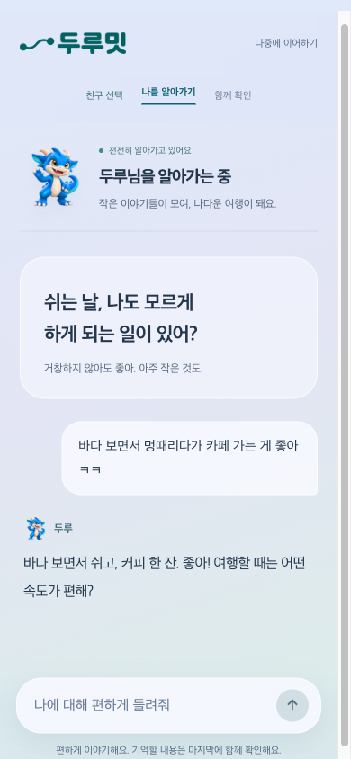
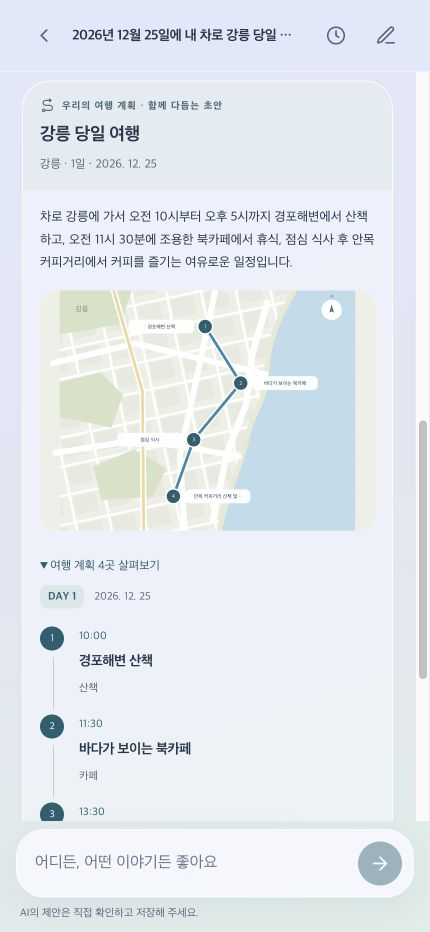
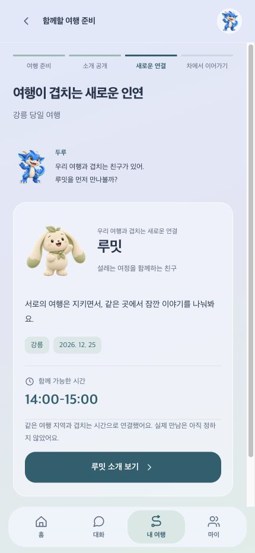

# Mobile web · 여행 준비 화면

AI 친구와 대화하고, 여행을 저장하고, 다른 여행자와 연결하는 반응형 웹입니다.

[전체 프로젝트](../README.md) · [백엔드·설정](../backend/README.md) · [차량 앱](../vehicle-app/README.md)

## 주요 화면

메인 README와 같은 기능 번호를 사용합니다.

<table>
  <tr><th>1. AI 친구와 대화</th><th>2. 여행 계획 확인·수정</th><th>3. 여행자 연결</th></tr>
  <tr>
    <td></td>
    <td></td>
    <td></td>
  </tr>
  <tr><td>대화에서 여행 취향을 정리하고,<br>확인한 취향을 AI 친구가 기억합니다.</td><td>일정의 장소·시간을 직접 수정하거나<br>AI에게 수정을 요청한 뒤 저장합니다.</td><td>공개 소개·여행 정보를 확인하고,<br>연결 요청과 공통 시간 확인을 진행합니다.</td></tr>
</table>

실제 웹 UI의 캡처이며 대화는 촬영용 고정 응답, 여행자 추천은 고정 후보입니다. 일정 지도는 SVG로 표현한 안내 이미지입니다. [캡처 출처·범위](../assets/README.md)

## 개발한 기능

| 기능 | 구현 내용 |
| --- | --- |
| 계정·첫 대화 | 가입·로그인, AI 친구 캐릭터 선택, 첫 대화에서 파악한 취향 검토·확정 |
| AI 채팅 | 답변 스트리밍·도구 실행 상태 표시, 답변 중단·재시도, 대화 기록 열기·보관·복원, 입력 초안 유지 |
| 취향 기억 | AI가 제안한 관심사·여행 스타일을 카드로 표시하고 사용자 확인 후 저장 |
| 여행 계획 | 대화 안의 일정 카드·지도, 장소·시간 직접 편집, 최신 초안을 바탕으로 AI 재수정, 확인 후 내 여행 저장 |
| 저장한 여행 | 여행 목록·상세 확인, 기존 여행을 대화에 불러와 수정·업데이트 |
| 여행자 연결 | 공개할 소개·일정 검토, 연결 요청·취소, 상대 수락 상태·공통 시간 확인, 차량으로 이어갈 여행 준비 |
| 내 차와 연결 | 차량 코드 입력, 차량 승인 대기, 보낼 여행 검토·전송, 차량 저장 후 수신 확인(ACK), 연결 해제 |
| 반응형 화면 | 모바일 중심 채팅·일정·연결 UI, 작은 화면의 카드·입력 영역 대응 |

AI 제안은 바로 저장되지 않습니다. 사용자가 취향·일정 카드에서 확인해야 반영합니다. 차량 전달도 요청 직후 성공으로 표시하지 않고 차량의 저장·ACK를 기다립니다.

여행자 후보·상대 답장·만남 진행은 고정 시나리오와 진행자 패널로 재현합니다. 실사용자 자동 매칭, 실시간 지도·교통 조회, 실제 상대와의 통화는 후속 개발 범위입니다.

## 코드 구조

| 경로 | 역할 |
| --- | --- |
| `src/` | 홈·가입·AI 대화·내 여행·연결·차량 전달 UI |
| `shared/` | 프런트와 서버가 함께 사용하는 캐릭터·여행 데이터 함수 |
| `demo/` | 기본 시연용 모바일 화면과 진행자 패널 |

[백엔드](../backend/)가 정적 파일과 API를 함께 제공합니다. 별도의 프런트 빌드나 개발 서버는 필요하지 않습니다.

| 주요 코드 | 역할 |
| --- | --- |
| [app.js](src/app.js) | 계정·채팅·취향·여행·차량 연결 화면과 사용자 동작 |
| [client.mjs](src/client.mjs) | API 호출·대화 스트리밍·요청 상태 관리 |
| [trip-ui.js](src/trip-ui.js) | 일정 카드·편집·지도 표시 |
| [journey.js](src/journey.js) | 여행자 연결·공통 시간·차량 전달 흐름 |
| [scenario-operator.mjs](src/scenario-operator.mjs) | 시연 상대의 수락·응답·만남·결말 진행 |
| [shared/](shared/) | 프런트와 서버의 공통 캐릭터·여행 데이터 처리 |

## 실행·필요한 설정

저장소 루트에서:

```sh
npm run setup
npm run start:demo   # http://127.0.0.1:3000 · 키 없는 기본 시연
npm start           # http://127.0.0.1:3008 · 실제 AI 키 필요
```

통합 시연의 계정·AI 키 설정은 [백엔드 안내](../backend/README.md)를 따릅니다. 모바일에서 확정한 여행을 차량이 저장·ACK한 뒤에만 수신 완료로 표시합니다.

`npm start` 후 `http://127.0.0.1:3008`에서 가입·AI 친구 설정을 진행합니다. 여행 저장 후 `/#trips`에서 여행을 열고 연결을 준비합니다. 상대 응답은 같은 계정의 `/scenario-operator`에서 진행합니다. `npm run start:demo`는 별도 `demo/` 화면을 제공하는 키 없는 기본 시연입니다.

## 검증 범위

루트의 `npm test`에서 서버 검사와 함께 [UI 요청 경쟁 상태](../backend/tests/ui-races.test.mjs), [차량 전달 클라이언트](../backend/tests/vehicle-client.test.mjs), [여행 연결 흐름](../backend/tests/scenario-flow.test.mjs)을 검사합니다. 자동 검사의 AI·음성 호출에는 테스트 대체 구현을 사용합니다.

[메인 구현 범위](../README.md#주요-화면) · [기본 시연 서버](../backend/demo/README.md)
