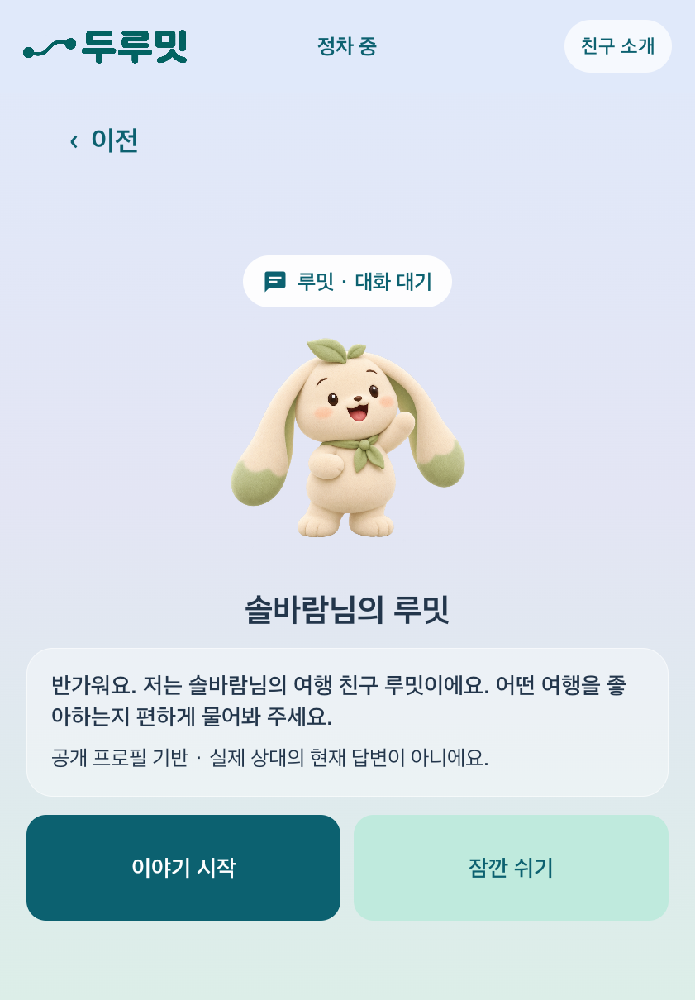
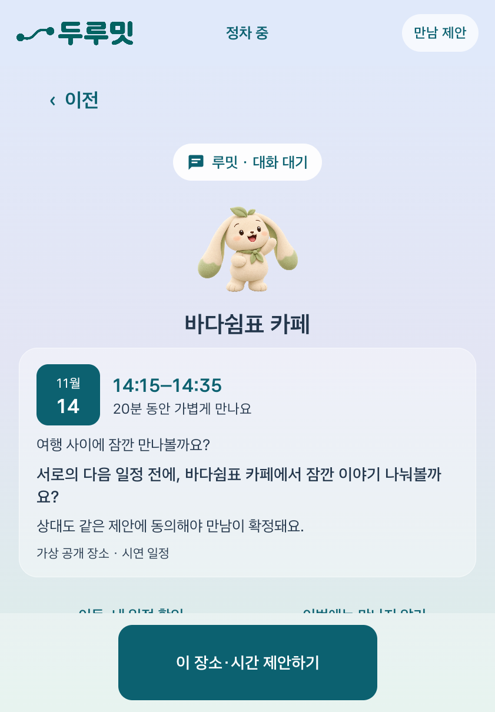
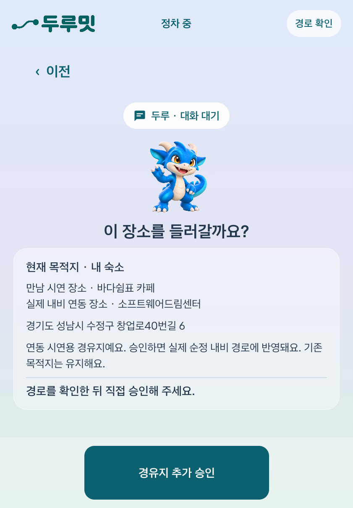
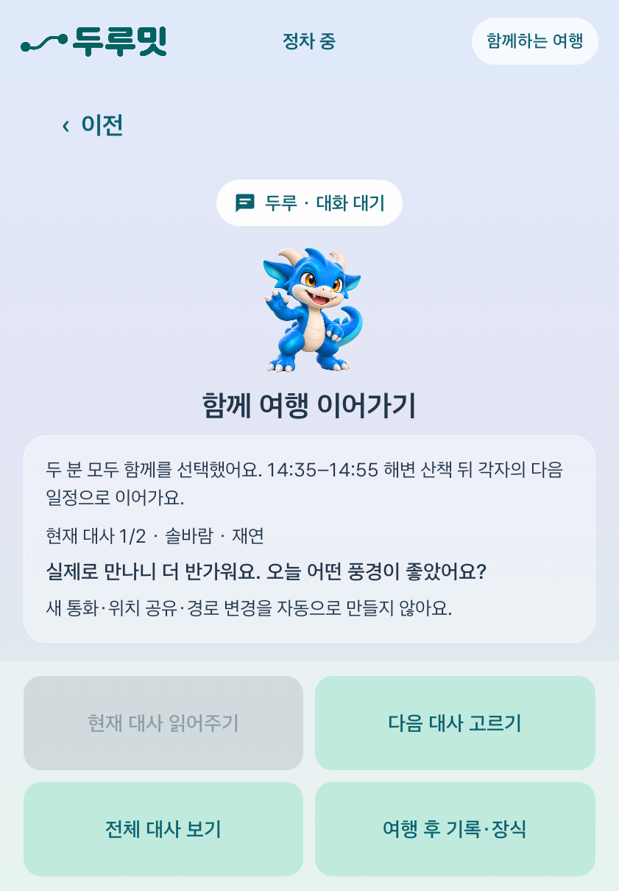
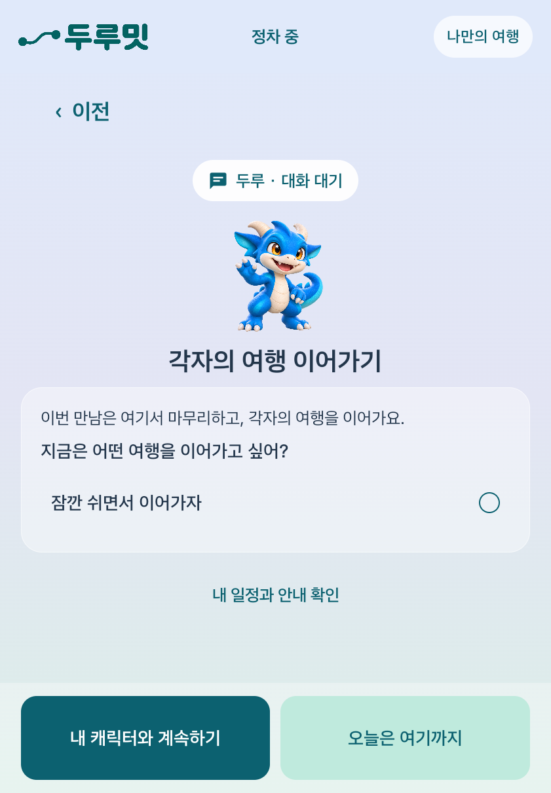

# Vehicle app · Pleos 차량 목업 앱

Kotlin·Jetpack Compose로 구현한 차량 앱입니다. Android Studio에서 이 폴더를 엽니다.

[전체 프로젝트](../README.md) · [제출 release APK](../apk/말할카말카_두루밋_release.apk) · [백엔드 설정](../backend/README.md)

## 주요 화면

모바일의 여행 준비 1–3번에 이어지는 차량 기능입니다. 메인 README와 같은 번호를 사용합니다.

<table>
  <tr><th>4. 상대 AI 친구와 첫 인사</th><th>5. 짧은 만남 제안</th><th>6. 경유지 추가 승인</th></tr>
  <tr>
    <td></td>
    <td></td>
    <td></td>
  </tr>
  <tr><td>공개 소개를 듣고 질문·메시지로 교류하며,<br>상대와의 만남을 준비합니다.</td><td>제안 장소·시간과 다음 일정을 살펴보고,<br>만남 진행에 동의합니다.</td><td>운전자 확인 후 경유지 추가를 요청하고,<br>취소·제거와 실행 결과를 구분합니다.</td></tr>
</table>

<table>
  <tr><th>7-A. 함께 여행 이어가기<br>IF: 두 사람 모두 동행 선택</th><th>7-B. 내 AI 친구와 여행 이어가기<br>IF: 한 사람이라도 각자 여행 선택</th></tr>
  <tr>
    <td></td>
    <td></td>
  </tr>
  <tr><td>모두의 제출·동의를 확인한 뒤<br>함께 이어갈 여행을 안내합니다.</td><td>상대의 선택을 존중하고<br>내 AI 친구와 원래 여행을 이어갑니다.</td></tr>
</table>

캡처는 Pleos 에뮬레이터의 오프라인 Debug 미리보기입니다. 제출 APK는 같은 오프라인 흐름의 `demoRelease`이며 실제 상대 통신·내비 변경을 수행하지 않습니다. [캡처 출처·범위](../assets/README.md)

## 개발한 기능

| 기능 | 구현 내용 |
| --- | --- |
| 차량 UI | 캐릭터 중심 Compose 화면, 공개 프로필·일정·메시지·만남·결말 화면, 2·3분할 영역 대응 |
| 정차·주행 전환 | Pleos 차량 UX 제한을 수신해 정차 상세/주행 간편 UI 전환, 현재 화면 맥락 유지, 제한 상태를 알 수 없을 때 상세 조작 제한 |
| 모바일 여행 수신 | 서버 연동 모드의 차량 연결·승인, 사용자가 확인한 여행 저장, 저장 후 ACK, 연결 상태·버전 복원 |
| 상대와 교류 | 공개 정보 확인, 질문·메시지 전송 확인·응답 상태, 통화 동의·준비 음성 샘플 재생 |
| 만남·경유지 | 장소·시간 동의, 다음 일정 확인, 운전자 승인, 경유지 추가·취소·제거 상태 관리 |
| 만남 이후 선택 | 독립 선택 제출·상대 제출 대기, 모두 동행/한 사람이라도 각자 선택에 따른 결말 표시 |
| 음성·사용 환경 | 준비 음성·TTS 재생 흐름, 동의 확인, 주행 제한·포커스 상실 시 재생 중단 |
| 시연·복원 | 오프라인 화면 전환·두 결말 재현, 서버 연동 회차·명령 수신 상태 관리 |

`realDebug`에는 NaviHelper 연동이 있으며 **고정 POI의 경유지 추가·제거를 별도 검증**했습니다. 제출 APK의 내비는 모의 상태입니다. 상대 답변·통화·장소 추천은 준비된 시나리오이고, 마이크/STT·실시간 통화·실시간 교통 기반 추천·Gleo 연동은 후속 범위입니다.

## 코드 구조

| 주요 코드 | 역할 |
| --- | --- |
| [ui/screens/](app/src/main/java/com/waymate/app/ui/screens/) | 교류·만남·내비·주행·결말 Compose UI |
| [HandoffRepository.kt](app/src/main/java/com/waymate/app/data/repository/HandoffRepository.kt) | 서버 연동 여정·명령·수신 상태 |
| [personal/](app/src/main/java/com/waymate/app/personal/) | 계정 여행의 차량 연결·저장·ACK |
| [restrictions/](app/src/main/java/com/waymate/app/platform/restrictions/) | 차량 UX 제한·정차/주행 정책 |
| [speech/](app/src/main/java/com/waymate/app/platform/speech/) | 음성 동의·재생·중단 정책 |
| [real/](app/src/real/java/com/waymate/app/platform/navigation/) | 실제 NaviHelper 어댑터 |
| [OfflineDemoSession.kt](app/src/demo/java/com/waymate/app/demo/OfflineDemoSession.kt) | 서버 없는 제출 APK의 로컬 시연 상태 |

## 빌드 종류

| 빌드 | 용도 |
| --- | --- |
| `mockDebug` | 서버에 연결하는 시연, 모의 내비 |
| `realDebug` | 실제 NaviHelper 연동 시험 |
| `demoDebug` | 서버 없이 준비된 화면·주행 상태를 확인하는 오프라인 시연 |
| **`demoRelease`** | **제출 APK · 오프라인 시연, 전용 release 서명, `debuggable=false`** |

## 준비 환경

**Pleos가 설치되어 있지 않다면** [공식 에뮬레이터 설치·실행 가이드](https://document.pleos.ai/docs/connect/guide/getting-started/application-development/setup-connect-sdk-emulator)를 먼저 완료해 주세요. 이후 안내는 Pleos가 설치·부팅되어 있고, Platform-Tools의 `adb`를 터미널에서 실행할 수 있는 상태를 기준으로 합니다.

JDK 21 · Android SDK 35 · Build Tools 35.0.0 · **Pleos Connect ARM 2.1.0 / API 34** 에뮬레이터.

전체 화면은 2560×1440px / 160dpi, 앱 영역은 3분할 841×1210dp·2분할 1682×1210dp입니다.

캐릭터·준비 음성·주행 정책은 `../backend/demo/`에서, 디자인 토큰은 `../shared/`에서 읽습니다.

## 빌드

모바일 웹·백엔드·차량을 함께 실행하려면 [메인 README의 서버 연동 실행 순서](../README.md#실행-방법)를 따릅니다. `assemble`은 APK 생성까지만 수행하며, Pleos 기동·APK 설치·앱 실행·여행 전달은 별도 단계입니다. 일반적인 연동 체험은 `mockDebug`로 진행하고 실제 내비 SDK 시험 시 `realDebug`를 사용합니다.

저장소 루트에서:

```sh
cd vehicle-app
./gradlew :app:assembleMockDebug :app:assembleRealDebug \
  -PwaymateApiPort=3008 -PwaymatePersonalApiPort=3008
./gradlew :app:assembleDemoDebug
```

Debug APK는 빌드 종류별로 다음 경로에 생성됩니다.

```text
app/build/outputs/apk/<mock|real|demo>/debug/
```

통합 백엔드는 루트의 `npm start`로 실행하며 에뮬레이터 API 주소는 `http://10.0.2.2:3008`입니다. 기본 시연 서버 3000을 사용한다면 빌드 포트도 3000으로 맞춥니다.

통합 실행 시 **같은 PC**에서 3008 서버를 켜 둔 채, `vehicle-app/`에서 빌드한 `mockDebug`를 설치·실행합니다. 아래는 에뮬레이터 한 대를 연결한 macOS/Linux 셸 기준입니다.

```sh
adb devices
PLEOS_USER_ID=$(adb shell am get-current-user | tr -d '\r')
adb install -r --user "$PLEOS_USER_ID" \
  app/build/outputs/apk/mock/debug/app-mock-debug.apk
adb shell am start --user "$PLEOS_USER_ID" \
  -n com.waymate.app.mock/com.waymate.app.MainActivity
```

모바일에서 여행 저장·연결 준비 후 **Pleos로 이어가기**, 차량에서 **웹에서 준비한 여행 불러오기**와 여행 시작까지 진행합니다. 모바일의 수신 완료는 차량 확인 이후 표시됩니다. 상대 수락·답장은 모바일과 같은 계정의 `/scenario-operator`에서 재현합니다. 개인 여행을 연결 코드로 받는 별도 흐름은 메인 README의 추가 기능에 정리했습니다.

## 오프라인 시연

[제출용 release APK](../apk/말할카말카_두루밋_release.apk) · [설치 방법](../apk/README.md)

`demoRelease` 제출 APK는 서버·계정 없이 준비된 여행·친구 답장·통화 샘플·만남·두 결말을 재현합니다. 실제 마이크/STT·상대 통신·순정 내비 변경은 포함하지 않습니다. 실제 차량 UX 제한에 따라 정차·주행 화면을 전환합니다.

```sh
adb devices
PLEOS_USER_ID=$(adb shell am get-current-user | tr -d '\r')
adb install --user "$PLEOS_USER_ID" ../apk/말할카말카_두루밋_release.apk
```

설치한 Pleos 사용자 프로필에서 **두루밋 오프라인 시연**을 엽니다. 기존 Mock·Real 앱과 패키지가 달라 함께 설치할 수 있습니다.

## 제출용 release 빌드

`release-signing.properties.example`을 참고해 로컬 `release-signing.properties`를 설정하고, 해당 키스토어를 준비합니다. 이 설정 파일과 서명 키는 Git에서 제외됩니다. `WAYMATE_RELEASE_STORE_FILE`, `WAYMATE_RELEASE_STORE_PASSWORD`, `WAYMATE_RELEASE_KEY_ALIAS`, `WAYMATE_RELEASE_KEY_PASSWORD` 환경변수로도 지정할 수 있습니다.

```sh
./gradlew :app:assembleDemoRelease :app:lintDemoRelease :app:testDemoReleaseUnitTest
```

서명 정보가 없으면 release APK 패키징을 중단합니다. 산출물은 아래 경로에 생성됩니다.

```text
app/build/outputs/apk/demo/release/app-demo-release.apk
```

`debuggable=false`인 전용 release 서명 APK입니다. 기존 debug 서명 APK와 서명이 달라 동일 패키지의 업데이트 설치는 지원하지 않습니다. 새 Pleos 테스트 환경에 설치하세요.

## 테스트·Lint

이 폴더에서:

```sh
./gradlew :app:testMockDebugUnitTest :app:testDemoDebugUnitTest \
  :app:lintMockDebug :app:lintRealDebug :app:lintDemoDebug
```

단위 검사·빌드와 실제 기기 검수는 별개입니다. `realDebug`의 내비 변경에는 운전자 승인과 확인된 실행 조건이 필요합니다.

제출 APK는 release 단위 검사 **66개 통과**, release Lint 오류 **0개**, 서명·`debuggable=false` 확인을 마쳤습니다. Pleos ARM 2.1.0 / API 34에서 설치·실행, 메뉴·친구 소개 진입, 실제 정차 → 주행 → 정차 전환과 화면 복귀를 확인했습니다. 이는 실사용자와 전체 연결·만남을 완주한 검증과는 구분됩니다.

[백엔드 설정](../backend/README.md) · [주요 UI](../README.md#주요-화면)
